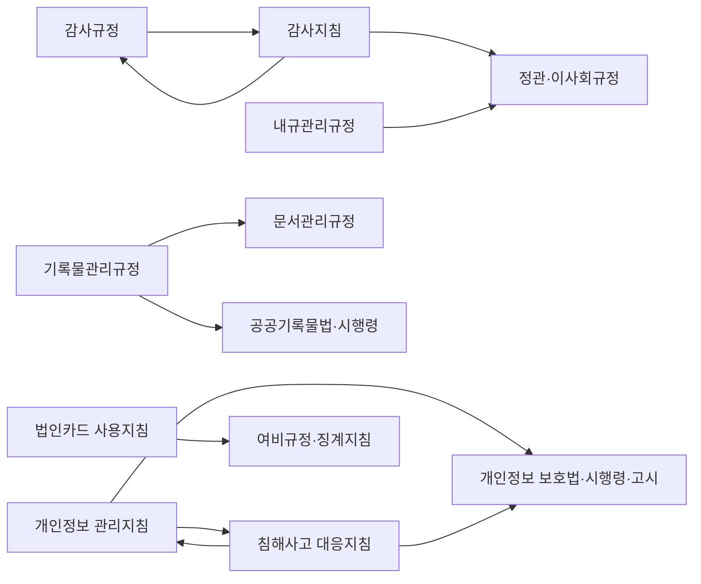

# 23개 내부규정 인용관계

기준: 작업 폴더의 저장본. 감사규정부터 벤처투자회사 등에 관한 행정자료 보관·관리 지침까지 23개 문서. 원문은 수정하지 않았다.

명시된 문서명과 약칭, 본문·부칙·별표·서식의 조문 인용을 찾아 연결했다. **조번호 존재는 내용의 적합성이나 현행 법적 효력 확인을 뜻하지 않는다.** 기존 문제점 보고서의 검토 ID(R번호)를 연결했으며, 새 인용관계 ID는 C번호다. 추출문 기준의 목록이므로 한글 화면의 자동번호·숨김 편집요소·문장 줄바꿈은 원본 대조가 필요하다. 원문에 없는 단순 업무상 연관은 인용으로 추가하지 않았다. 조문번호 없는 포괄 준용도 별도로 표시했다. 자기 문서의 “제1항”, “전항”, “본조” 등 상대적 인용만 있는 문장은 별도 목록에 포함하지 않았다. 외부 법령은 기존 문제점 보고서에서 확인한 쟁점 외에는 현행 조문을 추가 전수 검증하지 않았다.

개인정보 보호 및 관리지침은 본문이 반복 추출되어 동일 문구·위치·대상 인용을 묶고 근거행을 모두 남겼다. 부칙과 서식은 같은 제1조 등이 반복되므로 근거행의 앞뒤를 함께 확인한다. 타 문서의 머리말 잔존도 원문 언급으로 잡힐 수 있으므로 말미 항목은 공표본에서 확인한다.

## 인용망을 읽는 방법

- **문서별 요약:** 어떤 내부 규정과 외부 근거를 참조하는지, 그 문서를 다른 대상 문서가 어디에서 참조하는지 함께 표시한다.
- **상세 목록:** 인용 출발 위치 → 인용 대상 → 대상 조문·서식 → 확인상태 → 기존 문제점 보고서 항목으로 연결한다. CSV에는 인용 원문과 정비·확인 방법도 포함한다.
- **개정 영향:** 대상 조문을 고칠 때 아래 역방향 인용 목록에서 인용하는 문서도 함께 수정한다. 역방향은 이번 23개 문서가 인용한 관계만 집계하며 폴더 전체의 모든 역참조를 검색한 결과는 아니다.

## 핵심 연결 관계

화살표는 원문의 참조·위임·준용 방향이다. 기록물관리규정 부칙의 문서관리규정 참조는 **기록물관리규정 우선 적용**을 정하는 관계다. 개인정보 관리지침은 보고서에서 쓰는 짧은 표시이며 원문 제명은 개인정보 보호 및 관리지침이다.

## 문서별 인용 요약

|번호|문서|다른 내규|외부 근거|자기 문서 인용 행 수|
|---|---|---|---|---:|
|1|감사규정|감사지침 · 한국벤처투자 정관|특정 문서 인용 없음|5|
|2|감사지침|감사규정 · 감사기준시행세칙 · 복무규정 · 이사회규정 · 인사규정 · 직제규정 · 한국벤처투자 정관 · 회계규정|부패방지 및 국민권익위원회의 설치와 운영에 관한 법률|14|
|3|개인정보 보호 및 관리지침|영상정보처리기기 관리 및 운영지침|개인정보 보호법 · 개인정보 보호법 시행령 · 개인정보 보호지침 · 개인정보 안전성 확보조치 기준 고시 · 개인정보의 안전성 확보조치 기준 · 개인정보파일 관리업무 지침서 · 국가정보보안기본지침 · 표준 개인정보 보호지침|19|
|4|개인정보 침해사고 대응 및 복구지침|개인정보 보호 및 관리지침 · 개인정보처리 내부지침|개인정보 보호법률|6|
|5|경영공시 관리지침|직제규정|공공기관 통합공시 매뉴얼 · 공공기관의 운영에 관한 법률 · 공공기관의 통합공시에 관한 기준 · 공공기관의 혁신에 관한 지침 · 전자문서 작성지침|10|
|6|계약사무처리지침|특정 문서 인용 없음|국가를 당사자로 하는 계약에 관한 법률 · 국가를 당사자로 하는 계약에 관한 법률 시행령|0|
|7|고객헌장 운영지침|한국벤처투자 정관|특정 문서 인용 없음|2|
|8|공무직관리지침|공무직 관리규정 · 인사규정 · 직원채용지침 · 직제규정 · 취업규칙|근로기준법|9|
|9|공익신고 처리 및 신고자 보호 등에 관한 운영지침|취업규칙|개인정보 보호법 시행령 · 공익신고자 보호법 · 공익신고자 보호법 시행령 · 특정범죄신고자 등 보호법|27|
|10|근무평정시행지침|공무직관리지침 · 근무평정시행세칙 · 기록물관리규정 · 인사규정 · 임금피크제 운영지침 · 임직원교육훈련지침 · 조직성과평가지침 · 직제규정 · 직제지침 · 징계지침|특정 문서 인용 없음|49|
|11|글로벌 자금세탁행위 방지를 위한 업무규정|자금세탁행위 방지를 위한 업무규정 · 자금세탁행위 방지를 위한 업무지침|특정 문서 인용 없음|0|
|12|급여규정|공무직관리지침 · 복무규정 · 성과급지급지침 · 연봉제운영지침 · 인사규정 · 한국벤처투자 정관 · 해외근무직원 보수·복지규정|고등교육법 · 공공기관의 운영에 관한 법률 · 국가재정법 · 근로기준법 · 별정우체국법 · 사립학교법 · 지방공기업법 · 지방자치단체 기금관리기본법 · 지방재정법|16|
|13|기록물관리규정|문서관리규정 · 보안업무지침|공공기관의 정보공개에 관한 법률 · 공공기록물 관리에 관한 법률 · 공공기록물 관리에 관한 법률 시행령 · 행정 효율과 협업 촉진에 관한 규정|17|
|14|내규관리규정|이사회규정 · 임직원행동강령 · 제규정관리규정 · 직제규정 · 취업규칙 · 한국벤처투자 정관|특정 문서 인용 없음|11|
|15|내부통제운영지침|리스크관리규정 · 상벌규정 · 임직원행동강령 · 한국벤처투자 정관|변호사법|13|
|16|노사협의회규정|특정 문서 인용 없음|근로자참여 및 협력증진에 관한 법률 · 근로자참여 및 협력증진에 관한 법률 시행규칙 · 근로자참여 및 협력증진에 관한 법률 시행령 · 남녀고용평등과 일ㆍ가정 양립 지원에 관한 법률|8|
|17|도서관리지침|특정 문서 인용 없음|특정 문서 인용 없음|8|
|18|문서관리규정|민원사무 처리요령 · 민원사무처리규정 · 수수료 및 수당지급규정 · 직무전결규정 · 직제규정 · 한국벤처투자 정관|공공기관의 정보공개에 관한 법률 · 공공기록물 관리에 관한 법률 시행령 · 행정업무의 효율적 운영에 관한 규정|48|
|19|물품관리규정|특정 문서 인용 없음|물품관리법|0|
|20|민원 처리지침|내부통제운영지침 · 임직원행동강령|민원 처리에 관한 법률 · 민원 처리에 관한 법률 시행령 · 부패방지 및 국민권익위원회의 설치와 운영에 관한 법률|5|
|21|방첩업무 시행지침|특정 문서 인용 없음|국가정보원 방첩업무규정 · 중소벤처기업부 방첩업무규정 시행지침|5|
|22|법인카드 사용지침|여비규정 · 징계지침|특정 문서 인용 없음|9|
|23|벤처투자회사 등에 관한 행정자료 보관·관리 지침|특정 문서 인용 없음|공공기록물 관리에 관한 법률 · 벤처투자 촉진에 관한 법률 시행령 · 벤처투자 촉진에 관한 법률〔약칭 미정의〕|3|

## 1. 감사규정

**이 문서를 인용하는 대상 문서:** 감사지침(제15조(불이행시의 조치)) · 감사지침(제17조(정의 및 범위)) · 감사지침(제1조(목적)) · 감사지침(제20조(감사인의 성실의무)) · 감사지침(제22조(감사결과 보고)) · 감사지침(제23조(감사결과에 대한 조치 및 사후관리)) · 감사지침(제33조(감사지원 인력에 대한 대우)) · 감사지침(제34조(적극업무면책의 요건 및 운영절차 등)) · 감사지침(제3조(감사준거)) · 감사지침(제4조(대상 및 범위)) · 감사지침(제6조(대상 및 소집권자)) · 감사지침(제9조(정의))

|ID|출발 위치·근거|구분|인용 대상|대상 조문·서식|확인상태·검토 연결|
|---|---|---|---|---|---|
|C0001|제2조(정의) · [근거 16행](C:/Users/Admin/Downloads/한국벤처투자_내부규정_최신개정본/검토자료/감사규정.txt:16)|다른 내규|한국벤처투자 정관|제23조제1항|검토 필요 — 기존 검토 연계 / R001|
|C0002|제2조(정의) · [근거 17행](C:/Users/Admin/Downloads/한국벤처투자_내부규정_최신개정본/검토자료/감사규정.txt:17)|자기 문서|감사규정|제5조|조번호 존재·항호/내용 확인 필요|
|C0003|제3조(다른 규정 등과의 관계) · [근거 18행](C:/Users/Admin/Downloads/한국벤처투자_내부규정_최신개정본/검토자료/감사규정.txt:18)|포괄 근거|특정하지 않은 관계 법령·내규|문서 전체/조문 특정 없음|적용 법령·내규의 구체적 대상 확인 필요|
|C0004|제4조(감사의 범위) · [근거 21행](C:/Users/Admin/Downloads/한국벤처투자_내부규정_최신개정본/검토자료/감사규정.txt:21)|다른 내규|한국벤처투자 정관|문서 전체/조문 특정 없음|대상 문서 있음·적용 내용 확인 필요|
|C0005|제9조(감사지원 부서 등) · [근거 43행](C:/Users/Admin/Downloads/한국벤처투자_내부규정_최신개정본/검토자료/감사규정.txt:43)|다른 내규|감사지침|문서 전체/조문 특정 없음|대상 문서 있음·적용 내용 확인 필요|
|C0006|제18조(적극업무에 대한 면책) · [근거 72행](C:/Users/Admin/Downloads/한국벤처투자_내부규정_최신개정본/검토자료/감사규정.txt:72)|다른 내규|감사지침|문서 전체/조문 특정 없음|대상 문서 있음·적용 내용 확인 필요|
|C0007|제19조(소명자료의 제출) · [근거 73행](C:/Users/Admin/Downloads/한국벤처투자_내부규정_최신개정본/검토자료/감사규정.txt:73)|자기 문서|감사규정|제18조제1항|조번호 존재·항호/내용 확인 필요|
|C0008|제21조(사고 보고) · [근거 78행](C:/Users/Admin/Downloads/한국벤처투자_내부규정_최신개정본/검토자료/감사규정.txt:78)|다른 내규|감사지침|문서 전체/조문 특정 없음|대상 문서 있음·적용 내용 확인 필요|
|C0009|제23조(이의 신청) · [근거 81행](C:/Users/Admin/Downloads/한국벤처투자_내부규정_최신개정본/검토자료/감사규정.txt:81)|자기 문서|감사규정|제22조제1항|조번호 존재·항호/내용 확인 필요|
|C0010|제24조(대외보고 사전검토) · [근거 84행](C:/Users/Admin/Downloads/한국벤처투자_내부규정_최신개정본/검토자료/감사규정.txt:84)|포괄 근거|특정하지 않은 관계 법령·내규|문서 전체/조문 특정 없음|적용 법령·내규의 구체적 대상 확인 필요|
|C0011|제26조(감사지원인력에 대한 대우) · [근거 88행](C:/Users/Admin/Downloads/한국벤처투자_내부규정_최신개정본/검토자료/감사규정.txt:88)|다른 내규|감사지침|문서 전체/조문 특정 없음|대상 문서 있음·적용 내용 확인 필요|
|C0012|제26조(감사지원인력에 대한 대우) · [근거 92행](C:/Users/Admin/Downloads/한국벤처투자_내부규정_최신개정본/검토자료/감사규정.txt:92)|자기 문서|감사규정|제25조|조번호 존재·항호/내용 확인 필요|
|C0013|제27조(감사지원인력에 대한 복무관리) · [근거 93행](C:/Users/Admin/Downloads/한국벤처투자_내부규정_최신개정본/검토자료/감사규정.txt:93)|자기 문서|감사규정|제8조|조번호 존재·항호/내용 확인 필요|
|C0014|제28조(회계감사의 기준) · [근거 95행](C:/Users/Admin/Downloads/한국벤처투자_내부규정_최신개정본/검토자료/감사규정.txt:95)|포괄 근거|특정하지 않은 관계 법령·내규|문서 전체/조문 특정 없음|적용 법령·내규의 구체적 대상 확인 필요|
|C0015|제29조(그 밖의 사항) · [근거 96행](C:/Users/Admin/Downloads/한국벤처투자_내부규정_최신개정본/검토자료/감사규정.txt:96)|다른 내규|감사지침|문서 전체/조문 특정 없음|대상 문서 있음·적용 내용 확인 필요|

## 2. 감사지침

**이 문서를 인용하는 대상 문서:** 감사규정(제18조(적극업무에 대한 면책)) · 감사규정(제21조(사고 보고)) · 감사규정(제26조(감사지원인력에 대한 대우)) · 감사규정(제29조(그 밖의 사항)) · 감사규정(제9조(감사지원 부서 등))

|ID|출발 위치·근거|구분|인용 대상|대상 조문·서식|확인상태·검토 연결|
|---|---|---|---|---|---|
|C0016|제1조(목적) · [근거 14,14행](C:/Users/Admin/Downloads/한국벤처투자_내부규정_최신개정본/검토자료/감사지침.txt:14)|다른 내규|감사규정|문서 전체/조문 특정 없음|대상 문서 있음·적용 내용 확인 필요|
|C0017|제3조(감사준거) · [근거 16행](C:/Users/Admin/Downloads/한국벤처투자_내부규정_최신개정본/검토자료/감사지침.txt:16)|다른 내규|감사규정|문서 전체/조문 특정 없음|대상 문서 있음·적용 내용 확인 필요|
|C0018|제4조(대상 및 범위) · [근거 19행](C:/Users/Admin/Downloads/한국벤처투자_내부규정_최신개정본/검토자료/감사지침.txt:19)|다른 내규|감사규정|제4조|확정 — 기존 검토 연계 / R006|
|C0019|제6조(대상 및 소집권자) · [근거 33행](C:/Users/Admin/Downloads/한국벤처투자_내부규정_최신개정본/검토자료/감사지침.txt:33)|다른 내규|감사규정|제4조|확정 — 기존 검토 연계 / R006|
|C0020|제7조(특별감사 업무의 운영) · [근거 36행](C:/Users/Admin/Downloads/한국벤처투자_내부규정_최신개정본/검토자료/감사지침.txt:36)|자기 문서|감사지침|제6조제1호|조번호 존재·항호/내용 확인 필요|
|C0021|제7조(특별감사 업무의 운영) · [근거 37행](C:/Users/Admin/Downloads/한국벤처투자_내부규정_최신개정본/검토자료/감사지침.txt:37)|자기 문서|감사지침|제6조제2호|조번호 존재·항호/내용 확인 필요|
|C0022|제9조(정의) · [근거 40행](C:/Users/Admin/Downloads/한국벤처투자_내부규정_최신개정본/검토자료/감사지침.txt:40)|다른 내규|감사규정|제4조|확정 — 기존 검토 연계 / R006|
|C0023|제10조(일상감사 범위) · [근거 41행](C:/Users/Admin/Downloads/한국벤처투자_내부규정_최신개정본/검토자료/감사지침.txt:41)|자기 문서|감사지침|별표2|대상 문서 있음·적용 내용 확인 필요|
|C0024|제11조(일상감사 의뢰) · [근거 44행](C:/Users/Admin/Downloads/한국벤처투자_내부규정_최신개정본/검토자료/감사지침.txt:44)|자기 문서|감사지침|별지 제1호 서식|대상 문서 있음·적용 내용 확인 필요|
|C0025|제15조(불이행시의 조치) · [근거 49행](C:/Users/Admin/Downloads/한국벤처투자_내부규정_최신개정본/검토자료/감사지침.txt:49)|자기 문서|감사지침|제14조|조번호 존재·항호/내용 확인 필요|
|C0026|제15조(불이행시의 조치) · [근거 49행](C:/Users/Admin/Downloads/한국벤처투자_내부규정_최신개정본/검토자료/감사지침.txt:49)|다른 내규|감사규정|문서 전체/조문 특정 없음|대상 문서 있음·적용 내용 확인 필요|
|C0027|제17조(정의 및 범위) · [근거 52행](C:/Users/Admin/Downloads/한국벤처투자_내부규정_최신개정본/검토자료/감사지침.txt:52)|다른 내규|감사규정|제4조|확정 — 기존 검토 연계 / R006|
|C0028|제20조(감사인의 성실의무) · [근거 59행](C:/Users/Admin/Downloads/한국벤처투자_내부규정_최신개정본/검토자료/감사지침.txt:59)|다른 내규|감사규정|제8조|확정 — 기존 검토 연계 / R007|
|C0029|제20조(감사인의 성실의무) · [근거 60행](C:/Users/Admin/Downloads/한국벤처투자_내부규정_최신개정본/검토자료/감사지침.txt:60)|다른 내규|감사규정|문서 전체/조문 특정 없음|대상 문서 있음·적용 내용 확인 필요|
|C0030|제21조(증빙서류 등) · [근거 63행](C:/Users/Admin/Downloads/한국벤처투자_내부규정_최신개정본/검토자료/감사지침.txt:63)|자기 문서|감사지침|별지 제2호 서식|대상 문서 있음·적용 내용 확인 필요|
|C0031|제21조(증빙서류 등) · [근거 64행](C:/Users/Admin/Downloads/한국벤처투자_내부규정_최신개정본/검토자료/감사지침.txt:64)|자기 문서|감사지침|별지 제3호 |대상 문서 있음·적용 내용 확인 필요|
|C0032|제21조(증빙서류 등) · [근거 65행](C:/Users/Admin/Downloads/한국벤처투자_내부규정_최신개정본/검토자료/감사지침.txt:65)|자기 문서|감사지침|별지 제5호 서식|대상 문서 있음·적용 내용 확인 필요|
|C0033|제22조(감사결과 보고) · [근거 69행](C:/Users/Admin/Downloads/한국벤처투자_내부규정_최신개정본/검토자료/감사지침.txt:69)|다른 내규|감사규정|문서 전체/조문 특정 없음|대상 문서 있음·적용 내용 확인 필요|
|C0034|제23조(감사결과에 대한 조치 및 사후관리) · [근거 79행](C:/Users/Admin/Downloads/한국벤처투자_내부규정_최신개정본/검토자료/감사지침.txt:79)|다른 내규|감사규정|제16조|확정 — 기존 검토 연계 / R008|
|C0035|제23조(감사결과에 대한 조치 및 사후관리) · [근거 79행](C:/Users/Admin/Downloads/한국벤처투자_내부규정_최신개정본/검토자료/감사지침.txt:79)|자기 문서|감사지침|별표1|확정 — 기존 검토 연계 / R008|
|C0036|제23조(감사결과에 대한 조치 및 사후관리) · [근거 82행](C:/Users/Admin/Downloads/한국벤처투자_내부규정_최신개정본/검토자료/감사지침.txt:82)|자기 문서|감사지침|별지 제6호서식|대상 문서 있음·적용 내용 확인 필요|
|C0037|제24조(조치결과 보고) · [근거 87행](C:/Users/Admin/Downloads/한국벤처투자_내부규정_최신개정본/검토자료/감사지침.txt:87)|자기 문서|감사지침|별지 제9호서식|대상 문서 있음·적용 내용 확인 필요|
|C0038|제24조(조치결과 보고) · [근거 89행](C:/Users/Admin/Downloads/한국벤처투자_내부규정_최신개정본/검토자료/감사지침.txt:89)|자기 문서|감사지침|별지 제10호 서식|대상 문서 있음·적용 내용 확인 필요|
|C0039|제25조(조치결과의 처리) · [근거 90행](C:/Users/Admin/Downloads/한국벤처투자_내부규정_최신개정본/검토자료/감사지침.txt:90)|자기 문서|감사지침|별지 제7호 |대상 문서 있음·적용 내용 확인 필요|
|C0040|제33조(감사지원 인력에 대한 대우) · [근거 109행](C:/Users/Admin/Downloads/한국벤처투자_내부규정_최신개정본/검토자료/감사지침.txt:109)|다른 내규|감사규정|제21조|확정 — 기존 검토 연계 / R009|
|C0041|제34조(적극업무면책의 요건 및 운영절차 등) · [근거 117행](C:/Users/Admin/Downloads/한국벤처투자_내부규정_최신개정본/검토자료/감사지침.txt:117)|외부 근거|부패방지 및 국민권익위원회의 설치와 운영에 관한 법률|제46조|외부 원문·적용 기준일 대조 필요|
|C0042|제34조(적극업무면책의 요건 및 운영절차 등) · [근거 117행](C:/Users/Admin/Downloads/한국벤처투자_내부규정_최신개정본/검토자료/감사지침.txt:117)|외부 근거|부패방지 및 국민권익위원회의 설치와 운영에 관한 법률|제47조|외부 원문·적용 기준일 대조 필요|
|C0043|제34조(적극업무면책의 요건 및 운영절차 등) · [근거 117행](C:/Users/Admin/Downloads/한국벤처투자_내부규정_최신개정본/검토자료/감사지침.txt:117)|외부 근거|부패방지 및 국민권익위원회의 설치와 운영에 관한 법률|제50조|외부 원문·적용 기준일 대조 필요|
|C0044|제34조(적극업무면책의 요건 및 운영절차 등) · [근거 118행](C:/Users/Admin/Downloads/한국벤처투자_내부규정_최신개정본/검토자료/감사지침.txt:118)|자기 문서|감사지침|별지 제11호 서식|대상 문서 있음·적용 내용 확인 필요|
|C0045|제34조(적극업무면책의 요건 및 운영절차 등) · [근거 120행](C:/Users/Admin/Downloads/한국벤처투자_내부규정_최신개정본/검토자료/감사지침.txt:120)|다른 내규|감사규정|문서 전체/조문 특정 없음|대상 문서 있음·적용 내용 확인 필요|
|C0046|[별표 1] · [근거 149행](C:/Users/Admin/Downloads/한국벤처투자_내부규정_최신개정본/검토자료/감사지침.txt:149)|다른 내규|인사규정|문서 전체/조문 특정 없음|대상 문서 있음·적용 내용 확인 필요|
|C0047|[별표 2] [개정 2015.08.18., 2017.07.03., 2020.02.17., 2021.03.18., 2021.06.14.] · [근거 168행](C:/Users/Admin/Downloads/한국벤처투자_내부규정_최신개정본/검토자료/감사지침.txt:168)|다른 내규|한국벤처투자 정관|제36조|대조 완료 — 기존 검토 연계 / R014|
|C0048|[별표 2] [개정 2015.08.18., 2017.07.03., 2020.02.17., 2021.03.18., 2021.06.14.] · [근거 168행](C:/Users/Admin/Downloads/한국벤처투자_내부규정_최신개정본/검토자료/감사지침.txt:168)|다른 내규|이사회규정|제3조제2항|대조 완료 — 기존 검토 연계 / R014|
|C0049|[별지 제7호 서식][개정 2020.12.30.] · [근거 289행](C:/Users/Admin/Downloads/한국벤처투자_내부규정_최신개정본/검토자료/감사지침.txt:289)|다른 내규|감사기준시행세칙|제31조 제1항|확인 필요 — 기존 검토 연계 / R010|
|C0050|[별지 제7호 서식][개정 2020.12.30.] · [근거 291행](C:/Users/Admin/Downloads/한국벤처투자_내부규정_최신개정본/검토자료/감사지침.txt:291)|다른 내규|직제규정|문서 전체/조문 특정 없음|대상 문서 있음·적용 내용 확인 필요|
|C0051|[별지 제8호 서식][개정 2020.12.30.] · [근거 307행](C:/Users/Admin/Downloads/한국벤처투자_내부규정_최신개정본/검토자료/감사지침.txt:307)|다른 내규|직제규정|문서 전체/조문 특정 없음|대상 문서 있음·적용 내용 확인 필요|
|C0052|[별지 제8호 서식][개정 2020.12.30.] · [근거 309행](C:/Users/Admin/Downloads/한국벤처투자_내부규정_최신개정본/검토자료/감사지침.txt:309)|다른 내규|감사기준시행세칙|제31조 제1항|확인 필요 — 기존 검토 연계 / R010|
|C0053|[별지 제8호 서식][개정 2020.12.30.] · [근거 309행](C:/Users/Admin/Downloads/한국벤처투자_내부규정_최신개정본/검토자료/감사지침.txt:309)|다른 내규|복무규정|문서 전체/조문 특정 없음|확인 필요 — 기존 검토 연계 / R010|
|C0054|[별지 제8호 서식][개정 2020.12.30.] · [근거 309행](C:/Users/Admin/Downloads/한국벤처투자_내부규정_최신개정본/검토자료/감사지침.txt:309)|다른 내규|회계규정|문서 전체/조문 특정 없음|확인 필요 — 기존 검토 연계 / R010|

## 3. 개인정보 보호 및 관리지침

**이 문서를 인용하는 대상 문서:** 개인정보 침해사고 대응 및 복구지침(제3조(정의))

|ID|출발 위치·근거|구분|인용 대상|대상 조문·서식|확인상태·검토 연결|
|---|---|---|---|---|---|
|C0055|제1조(목적) · [근거 12,384행](C:/Users/Admin/Downloads/한국벤처투자_내부규정_최신개정본/검토자료/개인정보 보호 및 관리지침.txt:12)|외부 근거|개인정보 보호법|문서 전체/조문 특정 없음|외부 원문·적용 기준일 대조 필요|
|C0056|제4조(개인정보 보호원칙) · [근거 42,414행](C:/Users/Admin/Downloads/한국벤처투자_내부규정_최신개정본/검토자료/개인정보 보호 및 관리지침.txt:42)|외부 근거|개인정보 보호법|문서 전체/조문 특정 없음|외부 원문·적용 기준일 대조 필요|
|C0057|제5조(개인정보보호책임자) · [근거 48,420행](C:/Users/Admin/Downloads/한국벤처투자_내부규정_최신개정본/검토자료/개인정보 보호 및 관리지침.txt:48)|외부 근거|개인정보 보호법|제31조제1항|외부 원문·적용 기준일 대조 필요|
|C0058|제6조(개인정보처리책임자) · [근거 64,436행](C:/Users/Admin/Downloads/한국벤처투자_내부규정_최신개정본/검토자료/개인정보 보호 및 관리지침.txt:64)|외부 근거|개인정보 보호법|문서 전체/조문 특정 없음|외부 원문·적용 기준일 대조 필요|
|C0059|제8조(개인정보취급자) · [근거 79,451행](C:/Users/Admin/Downloads/한국벤처투자_내부규정_최신개정본/검토자료/개인정보 보호 및 관리지침.txt:79)|외부 근거|개인정보 보호법|제59조|외부 원문·적용 기준일 대조 필요|
|C0060|제8조(개인정보취급자) · [근거 80,452행](C:/Users/Admin/Downloads/한국벤처투자_내부규정_최신개정본/검토자료/개인정보 보호 및 관리지침.txt:80)|외부 근거|개인정보 보호법|제71조|외부 원문·적용 기준일 대조 필요|
|C0061|제12조(개인정보파일 신규 보유 및 변경) · [근거 92,464행](C:/Users/Admin/Downloads/한국벤처투자_내부규정_최신개정본/검토자료/개인정보 보호 및 관리지침.txt:92)|외부 근거|개인정보 보호법|제32조|외부 원문·적용 기준일 대조 필요|
|C0062|제12조(개인정보파일 신규 보유 및 변경) · [근거 93,465행](C:/Users/Admin/Downloads/한국벤처투자_내부규정_최신개정본/검토자료/개인정보 보호 및 관리지침.txt:93)|외부 근거|개인정보 보호법|제32조제2항제4호|외부 원문·적용 기준일 대조 필요|
|C0063|제12조(개인정보파일 신규 보유 및 변경) · [근거 93,465행](C:/Users/Admin/Downloads/한국벤처투자_내부규정_최신개정본/검토자료/개인정보 보호 및 관리지침.txt:93)|외부 근거|개인정보 보호법|제32조제2항|외부 원문·적용 기준일 대조 필요|
|C0064|제13조(개인정보파일의 파기) · [근거 95,467행](C:/Users/Admin/Downloads/한국벤처투자_내부규정_최신개정본/검토자료/개인정보 보호 및 관리지침.txt:95)|외부 근거|개인정보 보호법|제21조제1항|외부 원문·적용 기준일 대조 필요|
|C0065|제13조(개인정보파일의 파기) · [근거 96,468행](C:/Users/Admin/Downloads/한국벤처투자_내부규정_최신개정본/검토자료/개인정보 보호 및 관리지침.txt:96)|자기 문서|개인정보 보호 및 관리지침|제36조|조번호 존재·항호/내용 확인 필요|
|C0066|제14조(개인정보파일의 관리) · [근거 97,469행](C:/Users/Admin/Downloads/한국벤처투자_내부규정_최신개정본/검토자료/개인정보 보호 및 관리지침.txt:97)|외부 근거|개인정보 보호법|제31조제2항제6호|외부 원문·적용 기준일 대조 필요|
|C0067|제14조(개인정보파일의 관리) · [근거 97,469행](C:/Users/Admin/Downloads/한국벤처투자_내부규정_최신개정본/검토자료/개인정보 보호 및 관리지침.txt:97)|외부 근거|개인정보파일 관리업무 지침서|문서 전체/조문 특정 없음|외부 원문·적용 기준일 대조 필요|
|C0068|제14조(개인정보파일의 관리) · [근거 109,481행](C:/Users/Admin/Downloads/한국벤처투자_내부규정_최신개정본/검토자료/개인정보 보호 및 관리지침.txt:109)|외부 근거|개인정보 보호법|제35조제4항|외부 원문·적용 기준일 대조 필요|
|C0069|제14조(개인정보파일의 관리) · [근거 111,483행](C:/Users/Admin/Downloads/한국벤처투자_내부규정_최신개정본/검토자료/개인정보 보호 및 관리지침.txt:111)|외부 근거|개인정보 보호법|제32조제4항|외부 원문·적용 기준일 대조 필요|
|C0070|제15조(개인정보처리방침의 수립) · [근거 113행](C:/Users/Admin/Downloads/한국벤처투자_내부규정_최신개정본/검토자료/개인정보 보호 및 관리지침.txt:113)|외부 근거|개인정보 보호법|제30조제1항|외부 원문·적용 기준일 대조 필요|
|C0071|제16조(개인정보처리방침의 개정) · [근거 140,508행](C:/Users/Admin/Downloads/한국벤처투자_내부규정_최신개정본/검토자료/개인정보 보호 및 관리지침.txt:140)|외부 근거|개인정보 보호법|문서 전체/조문 특정 없음|검토 필요 — 기존 검토 연계 / R025|
|C0072|제20조(개인정보처리 교육) · [근거 161,529행](C:/Users/Admin/Downloads/한국벤처투자_내부규정_최신개정본/검토자료/개인정보 보호 및 관리지침.txt:161)|포괄 근거|특정하지 않은 관계 법령·내규|문서 전체/조문 특정 없음|적용 법령·내규의 구체적 대상 확인 필요|
|C0073|제21조(개인정보취급자 및 단말기 관리) · [근거 170,538행](C:/Users/Admin/Downloads/한국벤처투자_내부규정_최신개정본/검토자료/개인정보 보호 및 관리지침.txt:170)|자기 문서|개인정보 보호 및 관리지침|별지 제2호 서식|대상 문서 있음·적용 내용 확인 필요|
|C0074|제22조(개인정보시스템 접근권한 관리) · [근거 174,542행](C:/Users/Admin/Downloads/한국벤처투자_내부규정_최신개정본/검토자료/개인정보 보호 및 관리지침.txt:174)|자기 문서|개인정보 보호 및 관리지침|별지 제3호 서식|대상 문서 있음·적용 내용 확인 필요|
|C0075|제23조(개인정보시스템 로그 기록 관리) · [근거 177,545행](C:/Users/Admin/Downloads/한국벤처투자_내부규정_최신개정본/검토자료/개인정보 보호 및 관리지침.txt:177)|자기 문서|개인정보 보호 및 관리지침|별지 제4호 서식|대상 문서 있음·적용 내용 확인 필요|
|C0076|제24조(개인정보 보조기억매체 관리) · [근거 181,549행](C:/Users/Admin/Downloads/한국벤처투자_내부규정_최신개정본/검토자료/개인정보 보호 및 관리지침.txt:181)|자기 문서|개인정보 보호 및 관리지침|제36조|조번호 존재·항호/내용 확인 필요|
|C0077|제25조(불법 소프트웨어 예방 및 치료) · [근거 184,552행](C:/Users/Admin/Downloads/한국벤처투자_내부규정_최신개정본/검토자료/개인정보 보호 및 관리지침.txt:184)|외부 근거|국가정보보안기본지침|제43조|외부 원문·적용 기준일 대조 필요|
|C0078|제26조(개인정보 제공 및 관리) · [근거 192,560행](C:/Users/Admin/Downloads/한국벤처투자_내부규정_최신개정본/검토자료/개인정보 보호 및 관리지침.txt:192)|자기 문서|개인정보 보호 및 관리지침|제30조|조번호 존재·항호/내용 확인 필요|
|C0079|제28조(개인정보의 수집 원칙) · [근거 200,568행](C:/Users/Admin/Downloads/한국벤처투자_내부규정_최신개정본/검토자료/개인정보 보호 및 관리지침.txt:200)|자기 문서|개인정보 보호 및 관리지침|제5장|대상 문서 있음·적용 내용 확인 필요|
|C0080|제28조(개인정보의 수집 원칙) · [근거 201행](C:/Users/Admin/Downloads/한국벤처투자_내부규정_최신개정본/검토자료/개인정보 보호 및 관리지침.txt:201)|자기 문서|개인정보 보호 및 관리지침|제16조|조번호 존재·항호/내용 확인 필요|
|C0081|제30조(개인정보 저장 및 전송) · [근거 203,571행](C:/Users/Admin/Downloads/한국벤처투자_내부규정_최신개정본/검토자료/개인정보 보호 및 관리지침.txt:203)|자기 문서|개인정보 보호 및 관리지침|별표 1|대상 문서 있음·적용 내용 확인 필요|
|C0082|제31조(개인정보의 이용 및 제공의 제한) · [근거 207,575행](C:/Users/Admin/Downloads/한국벤처투자_내부규정_최신개정본/검토자료/개인정보 보호 및 관리지침.txt:207)|외부 근거|개인정보 보호법|문서 전체/조문 특정 없음|외부 원문·적용 기준일 대조 필요|
|C0083|제32조(개인정보의 이용 및 제공 시 승인 및 보안조치) · [근거 222,590행](C:/Users/Admin/Downloads/한국벤처투자_내부규정_최신개정본/검토자료/개인정보 보호 및 관리지침.txt:222)|자기 문서|개인정보 보호 및 관리지침|별지 제5호 서식|대상 문서 있음·적용 내용 확인 필요|
|C0084|제32조(개인정보의 이용 및 제공 시 승인 및 보안조치) · [근거 228,596행](C:/Users/Admin/Downloads/한국벤처투자_내부규정_최신개정본/검토자료/개인정보 보호 및 관리지침.txt:228)|외부 근거|개인정보 보호법|제19조|검토 필요 — 기존 검토 연계 / R018|
|C0085|제34조(개인정보 처리 위탁) · [근거 235행](C:/Users/Admin/Downloads/한국벤처투자_내부규정_최신개정본/검토자료/개인정보 보호 및 관리지침.txt:235)|자기 문서|개인정보 보호 및 관리지침|별지 제8호 서식|대상 문서 있음·적용 내용 확인 필요|
|C0086|제35조(개인정보의 출력) · [근거 248,615행](C:/Users/Admin/Downloads/한국벤처투자_내부규정_최신개정본/검토자료/개인정보 보호 및 관리지침.txt:248)|자기 문서|개인정보 보호 및 관리지침|제36조|조번호 존재·항호/내용 확인 필요|
|C0087|제35조(개인정보의 출력) · [근거 249,616행](C:/Users/Admin/Downloads/한국벤처투자_내부규정_최신개정본/검토자료/개인정보 보호 및 관리지침.txt:249)|자기 문서|개인정보 보호 및 관리지침|별지 제6호 서식|대상 문서 있음·적용 내용 확인 필요|
|C0088|제37조(이용자 권리 보호) · [근거 262,629행](C:/Users/Admin/Downloads/한국벤처투자_내부규정_최신개정본/검토자료/개인정보 보호 및 관리지침.txt:262)|외부 근거|개인정보 보호법|문서 전체/조문 특정 없음|외부 원문·적용 기준일 대조 필요|
|C0089|제38조(개인정보 노출 방지) · [근거 275,642행](C:/Users/Admin/Downloads/한국벤처투자_내부규정_최신개정본/검토자료/개인정보 보호 및 관리지침.txt:275)|자기 문서|개인정보 보호 및 관리지침|제21조|조번호 존재·항호/내용 확인 필요|
|C0090|제38조(개인정보 노출 방지) · [근거 277,644행](C:/Users/Admin/Downloads/한국벤처투자_내부규정_최신개정본/검토자료/개인정보 보호 및 관리지침.txt:277)|자기 문서|개인정보 보호 및 관리지침|제36조|조번호 존재·항호/내용 확인 필요|
|C0091|제41조(개인정보 영향평가) · [근거 287,654행](C:/Users/Admin/Downloads/한국벤처투자_내부규정_최신개정본/검토자료/개인정보 보호 및 관리지침.txt:287)|외부 근거|개인정보 보호법|제23조|확정 — 기존 검토 연계 / R019|
|C0092|제43조(국제협력) · [근거 299,666행](C:/Users/Admin/Downloads/한국벤처투자_내부규정_최신개정본/검토자료/개인정보 보호 및 관리지침.txt:299)|자기 문서|개인정보 보호 및 관리지침|별지 제5호 서식|대상 문서 있음·적용 내용 확인 필요|
|C0093|제44조(영상정보처리기기) · [근거 300,667행](C:/Users/Admin/Downloads/한국벤처투자_내부규정_최신개정본/검토자료/개인정보 보호 및 관리지침.txt:300)|다른 내규|영상정보처리기기 관리 및 운영지침|문서 전체/조문 특정 없음|대상 문서 있음·적용 내용 확인 필요|
|C0094|제2조(경과조치) · [근거 308,675행](C:/Users/Admin/Downloads/한국벤처투자_내부규정_최신개정본/검토자료/개인정보 보호 및 관리지침.txt:308)|외부 근거|개인정보 보호지침|문서 전체/조문 특정 없음|외부 원문·적용 기준일 대조 필요|
|C0095|[별지 제1호 서식] [개정 2021.03.16.] · [근거 354,721행](C:/Users/Admin/Downloads/한국벤처투자_내부규정_최신개정본/검토자료/개인정보 보호 및 관리지침.txt:354)|외부 근거|개인정보 보호법|제32조제1항|외부 원문·적용 기준일 대조 필요|
|C0096|[별지 제1호 서식] [개정 2021.03.16.] · [근거 354,721행](C:/Users/Admin/Downloads/한국벤처투자_내부규정_최신개정본/검토자료/개인정보 보호 및 관리지침.txt:354)|외부 근거|개인정보 보호법 시행령|제34조제1항|외부 원문·적용 기준일 대조 필요|
|C0097|제15조(개인정보처리방침의 수립) · [근거 485행](C:/Users/Admin/Downloads/한국벤처투자_내부규정_최신개정본/검토자료/개인정보 보호 및 관리지침.txt:485)|외부 근거|개인정보 보호법|제30조제1항|외부 원문·적용 기준일 대조 필요|
|C0098|제28조(개인정보의 수집 원칙) · [근거 569행](C:/Users/Admin/Downloads/한국벤처투자_내부규정_최신개정본/검토자료/개인정보 보호 및 관리지침.txt:569)|자기 문서|개인정보 보호 및 관리지침|제16조|조번호 존재·항호/내용 확인 필요|
|C0099|제34조(개인정보 처리 위탁) · [근거 603행](C:/Users/Admin/Downloads/한국벤처투자_내부규정_최신개정본/검토자료/개인정보 보호 및 관리지침.txt:603)|자기 문서|개인정보 보호 및 관리지침|별지 제8호 서식|대상 문서 있음·적용 내용 확인 필요|
|C0100|[별지 제5호 서식] · [근거 826,999행](C:/Users/Admin/Downloads/한국벤처투자_내부규정_최신개정본/검토자료/개인정보 보호 및 관리지침.txt:826)|외부 근거|개인정보 보호법|제18조제5항|외부 원문·적용 기준일 대조 필요|
|C0101|제2조(용어의 정의) · [근거 919,1086행](C:/Users/Admin/Downloads/한국벤처투자_내부규정_최신개정본/검토자료/개인정보 보호 및 관리지침.txt:919)|외부 근거|개인정보 보호법|문서 전체/조문 특정 없음|확정 — 기존 검토 연계 / R028|
|C0102|제2조(용어의 정의) · [근거 919,1086행](C:/Users/Admin/Downloads/한국벤처투자_내부규정_최신개정본/검토자료/개인정보 보호 및 관리지침.txt:919)|외부 근거|개인정보 보호법 시행령|문서 전체/조문 특정 없음|확정 — 기존 검토 연계 / R028|
|C0103|제2조(용어의 정의) · [근거 919,1086행](C:/Users/Admin/Downloads/한국벤처투자_내부규정_최신개정본/검토자료/개인정보 보호 및 관리지침.txt:919)|외부 근거|개인정보의 안전성 확보조치 기준|문서 전체/조문 특정 없음|확정 — 기존 검토 연계 / R028|
|C0104|제2조(용어의 정의) · [근거 919,1086행](C:/Users/Admin/Downloads/한국벤처투자_내부규정_최신개정본/검토자료/개인정보 보호 및 관리지침.txt:919)|외부 근거|표준 개인정보 보호지침|문서 전체/조문 특정 없음|확정 — 기존 검토 연계 / R028|
|C0105|제6조(개인정보의 안전성 확보조치) · [근거 929,1096행](C:/Users/Admin/Downloads/한국벤처투자_내부규정_최신개정본/검토자료/개인정보 보호 및 관리지침.txt:929)|외부 근거|개인정보 보호법|제23조제2항|외부 원문·적용 기준일 대조 필요|
|C0106|제6조(개인정보의 안전성 확보조치) · [근거 929,1096행](C:/Users/Admin/Downloads/한국벤처투자_내부규정_최신개정본/검토자료/개인정보 보호 및 관리지침.txt:929)|외부 근거|개인정보 보호법|제24조제3항|외부 원문·적용 기준일 대조 필요|
|C0107|제6조(개인정보의 안전성 확보조치) · [근거 929,1096행](C:/Users/Admin/Downloads/한국벤처투자_내부규정_최신개정본/검토자료/개인정보 보호 및 관리지침.txt:929)|외부 근거|개인정보 보호법|제29조|외부 원문·적용 기준일 대조 필요|
|C0108|제6조(개인정보의 안전성 확보조치) · [근거 929,1096행](C:/Users/Admin/Downloads/한국벤처투자_내부규정_최신개정본/검토자료/개인정보 보호 및 관리지침.txt:929)|외부 근거|개인정보 보호법 시행령|제21조|외부 원문·적용 기준일 대조 필요|
|C0109|제6조(개인정보의 안전성 확보조치) · [근거 929,1096행](C:/Users/Admin/Downloads/한국벤처투자_내부규정_최신개정본/검토자료/개인정보 보호 및 관리지침.txt:929)|외부 근거|개인정보 보호법 시행령|제30조|외부 원문·적용 기준일 대조 필요|
|C0110|제6조(개인정보의 안전성 확보조치) · [근거 929,1096행](C:/Users/Admin/Downloads/한국벤처투자_내부규정_최신개정본/검토자료/개인정보 보호 및 관리지침.txt:929)|외부 근거|개인정보의 안전성 확보조치 기준|문서 전체/조문 특정 없음|외부 원문·적용 기준일 대조 필요|
|C0111|제7조(개인정보의 처리제한) · [근거 931,1098행](C:/Users/Admin/Downloads/한국벤처투자_내부규정_최신개정본/검토자료/개인정보 보호 및 관리지침.txt:931)|외부 근거|개인정보 보호법 시행령|제16조|외부 원문·적용 기준일 대조 필요|
|C0112|제7조(개인정보의 처리제한) · [근거 931,1098행](C:/Users/Admin/Downloads/한국벤처투자_내부규정_최신개정본/검토자료/개인정보 보호 및 관리지침.txt:931)|외부 근거|개인정보 보호법|문서 전체/조문 특정 없음|외부 원문·적용 기준일 대조 필요|
|C0113|제7조(개인정보의 처리제한) · [근거 931,1098행](C:/Users/Admin/Downloads/한국벤처투자_내부규정_최신개정본/검토자료/개인정보 보호 및 관리지침.txt:931)|외부 근거|개인정보의 안전성 확보조치 기준|문서 전체/조문 특정 없음|외부 원문·적용 기준일 대조 필요|
|C0114|제8조(수탁자에 대한 관리·감독 등) · [근거 940,1107행](C:/Users/Admin/Downloads/한국벤처투자_내부규정_최신개정본/검토자료/개인정보 보호 및 관리지침.txt:940)|외부 근거|개인정보 보호법|제26조|외부 원문·적용 기준일 대조 필요|
|C0115|제8조(수탁자에 대한 관리·감독 등) · [근거 940,1107행](C:/Users/Admin/Downloads/한국벤처투자_내부규정_최신개정본/검토자료/개인정보 보호 및 관리지침.txt:940)|외부 근거|개인정보 안전성 확보조치 기준 고시|문서 전체/조문 특정 없음|외부 원문·적용 기준일 대조 필요|
|C0116|제10조(개인정보의 파기) · [근거 943,1110행](C:/Users/Admin/Downloads/한국벤처투자_내부규정_최신개정본/검토자료/개인정보 보호 및 관리지침.txt:943)|자기 문서|개인정보 보호 및 관리지침|제4조|조번호 존재·항호/내용 확인 필요|

## 4. 개인정보 침해사고 대응 및 복구지침

**이 문서를 인용하는 대상 문서:** 이번 23개 문서에서 다른 문서의 명시적 인용이 발견되지 않음.

|ID|출발 위치·근거|구분|인용 대상|대상 조문·서식|확인상태·검토 연결|
|---|---|---|---|---|---|
|C0117|제2조(적용 범위) · [근거 7행](C:/Users/Admin/Downloads/한국벤처투자_내부규정_최신개정본/검토자료/개인정보 침해사고 대응 및 복구지침.txt:7)|다른 내규|개인정보처리 내부지침|문서 전체/조문 특정 없음|확인 필요 — 기존 검토 연계 / R032|
|C0118|제3조(정의) · [근거 9행](C:/Users/Admin/Downloads/한국벤처투자_내부규정_최신개정본/검토자료/개인정보 침해사고 대응 및 복구지침.txt:9)|다른 내규|개인정보 보호 및 관리지침|문서 전체/조문 특정 없음|대상 문서 있음·적용 내용 확인 필요|
|C0119|제3조(정의) · [근거 11행](C:/Users/Admin/Downloads/한국벤처투자_내부규정_최신개정본/검토자료/개인정보 침해사고 대응 및 복구지침.txt:11)|다른 내규|개인정보 보호 및 관리지침|문서 전체/조문 특정 없음|대상 문서 있음·적용 내용 확인 필요|
|C0120|제7조(개인정보처리담당자) · [근거 18행](C:/Users/Admin/Downloads/한국벤처투자_내부규정_최신개정본/검토자료/개인정보 침해사고 대응 및 복구지침.txt:18)|자기 문서|개인정보 침해사고 대응 및 복구지침|제10조|조번호 존재·항호/내용 확인 필요|
|C0121|제12조(개인정보침해의 신고) · [근거 34행](C:/Users/Admin/Downloads/한국벤처투자_내부규정_최신개정본/검토자료/개인정보 침해사고 대응 및 복구지침.txt:34)|자기 문서|개인정보 침해사고 대응 및 복구지침|제10조|조번호 존재·항호/내용 확인 필요|
|C0122|제13조(개인정보침해사고의 접수) · [근거 35행](C:/Users/Admin/Downloads/한국벤처투자_내부규정_최신개정본/검토자료/개인정보 침해사고 대응 및 복구지침.txt:35)|자기 문서|개인정보 침해사고 대응 및 복구지침|별지 제1호 서식|대상 문서 있음·적용 내용 확인 필요|
|C0123|제17조(침해사고의 종료) · [근거 49행](C:/Users/Admin/Downloads/한국벤처투자_내부규정_최신개정본/검토자료/개인정보 침해사고 대응 및 복구지침.txt:49)|자기 문서|개인정보 침해사고 대응 및 복구지침|별지 제2호 서식|대상 문서 있음·적용 내용 확인 필요|
|C0124|제1조(시행일) · [근거 72행](C:/Users/Admin/Downloads/한국벤처투자_내부규정_최신개정본/검토자료/개인정보 침해사고 대응 및 복구지침.txt:72)|자기 문서|개인정보 침해사고 대응 및 복구지침|별지 제1호 서식|대상 문서 있음·적용 내용 확인 필요|
|C0125|제1조(시행일) · [근거 93행](C:/Users/Admin/Downloads/한국벤처투자_내부규정_최신개정본/검토자료/개인정보 침해사고 대응 및 복구지침.txt:93)|자기 문서|개인정보 침해사고 대응 및 복구지침|별지 제2호 서식|대상 문서 있음·적용 내용 확인 필요|
|C0126|[별지 제3호 서식] 개인정보 침해사실 신고서 · [근거 139행](C:/Users/Admin/Downloads/한국벤처투자_내부규정_최신개정본/검토자료/개인정보 침해사고 대응 및 복구지침.txt:139)|외부 근거|개인정보 보호법률|제62조|확정 — 기존 검토 연계 / R039|

## 5. 경영공시 관리지침

**이 문서를 인용하는 대상 문서:** 이번 23개 문서에서 다른 문서의 명시적 인용이 발견되지 않음.

|ID|출발 위치·근거|구분|인용 대상|대상 조문·서식|확인상태·검토 연결|
|---|---|---|---|---|---|
|C0127|제2조(정의) · [근거 18행](C:/Users/Admin/Downloads/한국벤처투자_내부규정_최신개정본/검토자료/경영공시 관리지침.txt:18)|외부 근거|공공기관의 운영에 관한 법률|문서 전체/조문 특정 없음|외부 원문·적용 기준일 대조 필요|
|C0128|제2조(정의) · [근거 18행](C:/Users/Admin/Downloads/한국벤처투자_내부규정_최신개정본/검토자료/경영공시 관리지침.txt:18)|외부 근거|공공기관의 혁신에 관한 지침|문서 전체/조문 특정 없음|외부 원문·적용 기준일 대조 필요|
|C0129|제2조(정의) · [근거 18행](C:/Users/Admin/Downloads/한국벤처투자_내부규정_최신개정본/검토자료/경영공시 관리지침.txt:18)|외부 근거|공공기관의 통합공시에 관한 기준|문서 전체/조문 특정 없음|외부 원문·적용 기준일 대조 필요|
|C0130|제2조(정의) · [근거 18행](C:/Users/Admin/Downloads/한국벤처투자_내부규정_최신개정본/검토자료/경영공시 관리지침.txt:18)|외부 근거|공공기관 통합공시 매뉴얼|문서 전체/조문 특정 없음|외부 원문·적용 기준일 대조 필요|
|C0131|제2조(정의) · [근거 18행](C:/Users/Admin/Downloads/한국벤처투자_내부규정_최신개정본/검토자료/경영공시 관리지침.txt:18)|외부 근거|전자문서 작성지침|문서 전체/조문 특정 없음|외부 원문·적용 기준일 대조 필요|
|C0132|제2조(정의) · [근거 20행](C:/Users/Admin/Downloads/한국벤처투자_내부규정_최신개정본/검토자료/경영공시 관리지침.txt:20)|다른 내규|직제규정|문서 전체/조문 특정 없음|대상 문서 있음·적용 내용 확인 필요|
|C0133|제2조(정의) · [근거 24행](C:/Users/Admin/Downloads/한국벤처투자_내부규정_최신개정본/검토자료/경영공시 관리지침.txt:24)|외부 근거|공공기관의 통합공시에 관한 기준|문서 전체/조문 특정 없음|외부 원문·적용 기준일 대조 필요|
|C0134|제2조(정의) · [근거 26,26행](C:/Users/Admin/Downloads/한국벤처투자_내부규정_최신개정본/검토자료/경영공시 관리지침.txt:26)|자기 문서|경영공시 관리지침|제3조|조번호 존재·항호/내용 확인 필요|
|C0135|제2조(정의) · [근거 26행](C:/Users/Admin/Downloads/한국벤처투자_내부규정_최신개정본/검토자료/경영공시 관리지침.txt:26)|자기 문서|경영공시 관리지침|제2조|조번호 존재·항호/내용 확인 필요|
|C0136|제3조(다른 규정과의 관계) · [근거 27행](C:/Users/Admin/Downloads/한국벤처투자_내부규정_최신개정본/검토자료/경영공시 관리지침.txt:27)|포괄 근거|특정하지 않은 관계 법령·내규|문서 전체/조문 특정 없음|적용 법령·내규의 구체적 대상 확인 필요|
|C0137|제3조(다른 규정과의 관계) · [근거 29,29행](C:/Users/Admin/Downloads/한국벤처투자_내부규정_최신개정본/검토자료/경영공시 관리지침.txt:29)|자기 문서|경영공시 관리지침|제2조|조번호 존재·항호/내용 확인 필요|
|C0138|제3조(다른 규정과의 관계) · [근거 29행](C:/Users/Admin/Downloads/한국벤처투자_내부규정_최신개정본/검토자료/경영공시 관리지침.txt:29)|자기 문서|경영공시 관리지침|제3조|조번호 존재·항호/내용 확인 필요|
|C0139|제5조(공시담당부서) · [근거 38행](C:/Users/Admin/Downloads/한국벤처투자_내부규정_최신개정본/검토자료/경영공시 관리지침.txt:38)|외부 근거|공공기관의 혁신에 관한 지침|문서 전체/조문 특정 없음|외부 원문·적용 기준일 대조 필요|
|C0140|제5조(공시담당부서) · [근거 38행](C:/Users/Admin/Downloads/한국벤처투자_내부규정_최신개정본/검토자료/경영공시 관리지침.txt:38)|외부 근거|공공기관의 통합공시에 관한 기준|문서 전체/조문 특정 없음|외부 원문·적용 기준일 대조 필요|
|C0141|제5조(공시담당부서) · [근거 38행](C:/Users/Admin/Downloads/한국벤처투자_내부규정_최신개정본/검토자료/경영공시 관리지침.txt:38)|외부 근거|공공기관 통합공시 매뉴얼|문서 전체/조문 특정 없음|외부 원문·적용 기준일 대조 필요|
|C0142|제5조(공시담당부서) · [근거 38행](C:/Users/Admin/Downloads/한국벤처투자_내부규정_최신개정본/검토자료/경영공시 관리지침.txt:38)|외부 근거|전자문서 작성지침|문서 전체/조문 특정 없음|외부 원문·적용 기준일 대조 필요|
|C0143|제6조(공시확인부서) · [근거 46행](C:/Users/Admin/Downloads/한국벤처투자_내부규정_최신개정본/검토자료/경영공시 관리지침.txt:46)|포괄 근거|특정하지 않은 관계 법령·내규|문서 전체/조문 특정 없음|적용 법령·내규의 구체적 대상 확인 필요|
|C0144|제7조(공시의 종류) · [근거 50행](C:/Users/Admin/Downloads/한국벤처투자_내부규정_최신개정본/검토자료/경영공시 관리지침.txt:50)|외부 근거|공공기관의 통합공시에 관한 기준|문서 전체/조문 특정 없음|외부 원문·적용 기준일 대조 필요|
|C0145|제9조(경영공시 처리절차) · [근거 55행](C:/Users/Admin/Downloads/한국벤처투자_내부규정_최신개정본/검토자료/경영공시 관리지침.txt:55)|자기 문서|경영공시 관리지침|별표 1|대상 문서 있음·적용 내용 확인 필요|
|C0146|제12조(불성실공시에 따른 벌점 등) · [근거 68행](C:/Users/Admin/Downloads/한국벤처투자_내부규정_최신개정본/검토자료/경영공시 관리지침.txt:68)|자기 문서|경영공시 관리지침|별표 2|대상 문서 있음·적용 내용 확인 필요|
|C0147|제12조(불성실공시에 따른 벌점 등) · [근거 69행](C:/Users/Admin/Downloads/한국벤처투자_내부규정_최신개정본/검토자료/경영공시 관리지침.txt:69)|자기 문서|경영공시 관리지침|별표2|대상 문서 있음·적용 내용 확인 필요|
|C0148|제12조(그 밖의 사항) · [근거 75행](C:/Users/Admin/Downloads/한국벤처투자_내부규정_최신개정본/검토자료/경영공시 관리지침.txt:75)|외부 근거|공공기관 통합공시 매뉴얼|문서 전체/조문 특정 없음|외부 원문·적용 기준일 대조 필요|
|C0149|제12조(그 밖의 사항) · [근거 75행](C:/Users/Admin/Downloads/한국벤처투자_내부규정_최신개정본/검토자료/경영공시 관리지침.txt:75)|외부 근거|전자문서 작성지침|문서 전체/조문 특정 없음|외부 원문·적용 기준일 대조 필요|
|C0150|[별표 1]  [제9조에서 이동, 종전 별표1은 별표2로 이동 <2025.04.24.>] · [근거 103행](C:/Users/Admin/Downloads/한국벤처투자_내부규정_최신개정본/검토자료/경영공시 관리지침.txt:103)|자기 문서|경영공시 관리지침|제9조|조번호 존재·항호/내용 확인 필요|
|C0151|[별표2] <개정 2025.04.24.> · [근거 130행](C:/Users/Admin/Downloads/한국벤처투자_내부규정_최신개정본/검토자료/경영공시 관리지침.txt:130)|자기 문서|경영공시 관리지침|제12조|조번호 존재·항호/내용 확인 필요|
|C0152|[별표2] <개정 2025.04.24.> · [근거 140행](C:/Users/Admin/Downloads/한국벤처투자_내부규정_최신개정본/검토자료/경영공시 관리지침.txt:140)|자기 문서|경영공시 관리지침|별표2|대상 문서 있음·적용 내용 확인 필요|

## 6. 계약사무처리지침

**이 문서를 인용하는 대상 문서:** 이번 23개 문서에서 다른 문서의 명시적 인용이 발견되지 않음.

|ID|출발 위치·근거|구분|인용 대상|대상 조문·서식|확인상태·검토 연결|
|---|---|---|---|---|---|
|C0153|제2조(적용범위) · [근거 15행](C:/Users/Admin/Downloads/한국벤처투자_내부규정_최신개정본/검토자료/계약사무처리지침.txt:15)|외부 근거|국가를 당사자로 하는 계약에 관한 법률|문서 전체/조문 특정 없음|외부 원문·적용 기준일 대조 필요|
|C0154|제4조(수의계약의 범위) · [근거 21행](C:/Users/Admin/Downloads/한국벤처투자_내부규정_최신개정본/검토자료/계약사무처리지침.txt:21)|외부 근거|국가를 당사자로 하는 계약에 관한 법률|문서 전체/조문 특정 없음|외부 원문·적용 기준일 대조 필요|
|C0155|제4조(수의계약의 범위) · [근거 21행](C:/Users/Admin/Downloads/한국벤처투자_내부규정_최신개정본/검토자료/계약사무처리지침.txt:21)|외부 근거|국가를 당사자로 하는 계약에 관한 법률 시행령|문서 전체/조문 특정 없음|외부 원문·적용 기준일 대조 필요|
|C0156|제7조(입찰보증금) · [근거 34행](C:/Users/Admin/Downloads/한국벤처투자_내부규정_최신개정본/검토자료/계약사무처리지침.txt:34)|외부 근거|국가를 당사자로 하는 계약에 관한 법률|문서 전체/조문 특정 없음|외부 원문·적용 기준일 대조 필요|
|C0157|제7조(입찰보증금) · [근거 34행](C:/Users/Admin/Downloads/한국벤처투자_내부규정_최신개정본/검토자료/계약사무처리지침.txt:34)|외부 근거|국가를 당사자로 하는 계약에 관한 법률 시행령|문서 전체/조문 특정 없음|외부 원문·적용 기준일 대조 필요|

## 7. 고객헌장 운영지침

**이 문서를 인용하는 대상 문서:** 이번 23개 문서에서 다른 문서의 명시적 인용이 발견되지 않음.

|ID|출발 위치·근거|구분|인용 대상|대상 조문·서식|확인상태·검토 연결|
|---|---|---|---|---|---|
|C0158|제1조(목적) · [근거 6행](C:/Users/Admin/Downloads/한국벤처투자_내부규정_최신개정본/검토자료/고객헌장 운영지침.txt:6)|다른 내규|한국벤처투자 정관|제49조|대조 완료 — 기존 검토 연계 / R056|
|C0159|제2조(헌장의 제정 및 개정) · [근거 9행](C:/Users/Admin/Downloads/한국벤처투자_내부규정_최신개정본/검토자료/고객헌장 운영지침.txt:9)|자기 문서|고객헌장 운영지침|제3조|조번호 존재·항호/내용 확인 필요|
|C0160|제9조(포상) · [근거 44행](C:/Users/Admin/Downloads/한국벤처투자_내부규정_최신개정본/검토자료/고객헌장 운영지침.txt:44)|자기 문서|고객헌장 운영지침|제8조|조번호 존재·항호/내용 확인 필요|

## 8. 공무직관리지침

**이 문서를 인용하는 대상 문서:** 근무평정시행지침(제5조(평가대상자)) · 급여규정(제2조(적용범위))

|ID|출발 위치·근거|구분|인용 대상|대상 조문·서식|확인상태·검토 연결|
|---|---|---|---|---|---|
|C0161|제4조(근로계약) · [근거 24행](C:/Users/Admin/Downloads/한국벤처투자_내부규정_최신개정본/검토자료/공무직관리지침.txt:24)|자기 문서|공무직관리지침|별지 1호 서식|대상 문서 있음·적용 내용 확인 필요|
|C0162|제5조(정원) · [근거 25행](C:/Users/Admin/Downloads/한국벤처투자_내부규정_최신개정본/검토자료/공무직관리지침.txt:25)|다른 내규|직제규정|별표|대상 문서 있음·적용 내용 확인 필요|
|C0163|제9조(채용절차) · [근거 37행](C:/Users/Admin/Downloads/한국벤처투자_내부규정_최신개정본/검토자료/공무직관리지침.txt:37)|다른 내규|인사규정|문서 전체/조문 특정 없음|대상 문서 있음·적용 내용 확인 필요|
|C0164|제9조(채용절차) · [근거 37행](C:/Users/Admin/Downloads/한국벤처투자_내부규정_최신개정본/검토자료/공무직관리지침.txt:37)|다른 내규|직원채용지침|문서 전체/조문 특정 없음|대상 문서 있음·적용 내용 확인 필요|
|C0165|제11조(직무·직위) · [근거 44행](C:/Users/Admin/Downloads/한국벤처투자_내부규정_최신개정본/검토자료/공무직관리지침.txt:44)|자기 문서|공무직관리지침|별표1|대상 문서 있음·적용 내용 확인 필요|
|C0166|제12조(승급) · [근거 45행](C:/Users/Admin/Downloads/한국벤처투자_내부규정_최신개정본/검토자료/공무직관리지침.txt:45)|자기 문서|공무직관리지침|별표2|대상 문서 있음·적용 내용 확인 필요|
|C0167|제18조(직무급) · [근거 67행](C:/Users/Admin/Downloads/한국벤처투자_내부규정_최신개정본/검토자료/공무직관리지침.txt:67)|자기 문서|공무직관리지침|별표3|대상 문서 있음·적용 내용 확인 필요|
|C0168|제19조(직책수당) · [근거 69행](C:/Users/Admin/Downloads/한국벤처투자_내부규정_최신개정본/검토자료/공무직관리지침.txt:69)|자기 문서|공무직관리지침|제18조|조번호 존재·항호/내용 확인 필요|
|C0169|제19조(직책수당) · [근거 69행](C:/Users/Admin/Downloads/한국벤처투자_내부규정_최신개정본/검토자료/공무직관리지침.txt:69)|자기 문서|공무직관리지침|별표4|대상 문서 있음·적용 내용 확인 필요|
|C0170|제28조(평가지표) · [근거 102행](C:/Users/Admin/Downloads/한국벤처투자_내부규정_최신개정본/검토자료/공무직관리지침.txt:102)|자기 문서|공무직관리지침|별표5|대상 문서 있음·적용 내용 확인 필요|
|C0171|제31조(상벌) · [근거 140행](C:/Users/Admin/Downloads/한국벤처투자_내부규정_최신개정본/검토자료/공무직관리지침.txt:140)|다른 내규|인사규정|문서 전체/조문 특정 없음|대상 문서 있음·적용 내용 확인 필요|
|C0172|제34조(퇴직) · [근거 146행](C:/Users/Admin/Downloads/한국벤처투자_내부규정_최신개정본/검토자료/공무직관리지침.txt:146)|다른 내규|인사규정|문서 전체/조문 특정 없음|대상 문서 있음·적용 내용 확인 필요|
|C0173|제35조(인사위원회) · [근거 154행](C:/Users/Admin/Downloads/한국벤처투자_내부규정_최신개정본/검토자료/공무직관리지침.txt:154)|다른 내규|인사규정|문서 전체/조문 특정 없음|대상 문서 있음·적용 내용 확인 필요|
|C0174|제37조(연수) · [근거 156행](C:/Users/Admin/Downloads/한국벤처투자_내부규정_최신개정본/검토자료/공무직관리지침.txt:156)|다른 내규|인사규정|제10장|대상 문서 있음·적용 내용 확인 필요|
|C0175|제2조(공무직 전환) · [근거 162행](C:/Users/Admin/Downloads/한국벤처투자_내부규정_최신개정본/검토자료/공무직관리지침.txt:162)|자기 문서|공무직관리지침|제9조 1항|조번호 존재·항호/내용 확인 필요|
|C0176|제2조(공무직 전환) · [근거 164행](C:/Users/Admin/Downloads/한국벤처투자_내부규정_최신개정본/검토자료/공무직관리지침.txt:164)|자기 문서|공무직관리지침|별표6|대상 문서 있음·적용 내용 확인 필요|
|C0177|제4조(임금) · [근거 570행](C:/Users/Admin/Downloads/한국벤처투자_내부규정_최신개정본/검토자료/공무직관리지침.txt:570)|다른 내규|공무직 관리규정|문서 전체/조문 특정 없음|폴더 미수록·내규대장/승인본 확인 필요|
|C0178|제5조(휴일 및 휴가) · [근거 576행](C:/Users/Admin/Downloads/한국벤처투자_내부규정_최신개정본/검토자료/공무직관리지침.txt:576)|다른 내규|공무직 관리규정|문서 전체/조문 특정 없음|폴더 미수록·내규대장/승인본 확인 필요|
|C0179|제5조(휴일 및 휴가) · [근거 577행](C:/Users/Admin/Downloads/한국벤처투자_내부규정_최신개정본/검토자료/공무직관리지침.txt:577)|외부 근거|근로기준법|제60조|외부 원문·적용 기준일 대조 필요|
|C0180|제7조(근로계약의 해지) · [근거 583행](C:/Users/Admin/Downloads/한국벤처투자_내부규정_최신개정본/검토자료/공무직관리지침.txt:583)|다른 내규|취업규칙|문서 전체/조문 특정 없음|대상 문서 있음·적용 내용 확인 필요|
|C0181|제9조(기타) · [근거 588행](C:/Users/Admin/Downloads/한국벤처투자_내부규정_최신개정본/검토자료/공무직관리지침.txt:588)|외부 근거|근로기준법|문서 전체/조문 특정 없음|외부 원문·적용 기준일 대조 필요|
|C0182|제9조(기타) · [근거 588행](C:/Users/Admin/Downloads/한국벤처투자_내부규정_최신개정본/검토자료/공무직관리지침.txt:588)|다른 내규|공무직 관리규정|문서 전체/조문 특정 없음|폴더 미수록·내규대장/승인본 확인 필요|

## 9. 공익신고 처리 및 신고자 보호 등에 관한 운영지침

**이 문서를 인용하는 대상 문서:** 이번 23개 문서에서 다른 문서의 명시적 인용이 발견되지 않음.

|ID|출발 위치·근거|구분|인용 대상|대상 조문·서식|확인상태·검토 연결|
|---|---|---|---|---|---|
|C0183|제1조(목적) · [근거 5,5,5행](C:/Users/Admin/Downloads/한국벤처투자_내부규정_최신개정본/검토자료/공익신고 처리 및 신고자 보호 등에 관한 운영지침.txt:5)|외부 근거|공익신고자 보호법|문서 전체/조문 특정 없음|외부 원문·적용 기준일 대조 필요|
|C0184|제1조(목적) · [근거 5,5행](C:/Users/Admin/Downloads/한국벤처투자_내부규정_최신개정본/검토자료/공익신고 처리 및 신고자 보호 등에 관한 운영지침.txt:5)|외부 근거|공익신고자 보호법 시행령|문서 전체/조문 특정 없음|외부 원문·적용 기준일 대조 필요|
|C0185|제2조(정의) · [근거 7행](C:/Users/Admin/Downloads/한국벤처투자_내부규정_최신개정본/검토자료/공익신고 처리 및 신고자 보호 등에 관한 운영지침.txt:7)|외부 근거|공익신고자 보호법|제2조제1호|외부 원문·적용 기준일 대조 필요|
|C0186|제2조(정의) · [근거 8행](C:/Users/Admin/Downloads/한국벤처투자_내부규정_최신개정본/검토자료/공익신고 처리 및 신고자 보호 등에 관한 운영지침.txt:8)|외부 근거|공익신고자 보호법|제2조제2호|외부 원문·적용 기준일 대조 필요|
|C0187|제2조(정의) · [근거 9행](C:/Users/Admin/Downloads/한국벤처투자_내부규정_최신개정본/검토자료/공익신고 처리 및 신고자 보호 등에 관한 운영지침.txt:9)|외부 근거|공익신고자 보호법|제2조제3호|외부 원문·적용 기준일 대조 필요|
|C0188|제2조(정의) · [근거 10행](C:/Users/Admin/Downloads/한국벤처투자_내부규정_최신개정본/검토자료/공익신고 처리 및 신고자 보호 등에 관한 운영지침.txt:10)|외부 근거|공익신고자 보호법|제2조제4호|외부 원문·적용 기준일 대조 필요|
|C0189|제2조(정의) · [근거 11행](C:/Users/Admin/Downloads/한국벤처투자_내부규정_최신개정본/검토자료/공익신고 처리 및 신고자 보호 등에 관한 운영지침.txt:11)|외부 근거|공익신고자 보호법|제2조제5호|외부 원문·적용 기준일 대조 필요|
|C0190|제2조(정의) · [근거 12행](C:/Users/Admin/Downloads/한국벤처투자_내부규정_최신개정본/검토자료/공익신고 처리 및 신고자 보호 등에 관한 운영지침.txt:12)|외부 근거|공익신고자 보호법|제2조제6호|외부 원문·적용 기준일 대조 필요|
|C0191|제2조(정의) · [근거 13행](C:/Users/Admin/Downloads/한국벤처투자_내부규정_최신개정본/검토자료/공익신고 처리 및 신고자 보호 등에 관한 운영지침.txt:13)|외부 근거|공익신고자 보호법|제2조제7호|외부 원문·적용 기준일 대조 필요|
|C0192|제11조(공익신고의 접수) · [근거 40행](C:/Users/Admin/Downloads/한국벤처투자_내부규정_최신개정본/검토자료/공익신고 처리 및 신고자 보호 등에 관한 운영지침.txt:40)|외부 근거|공익신고자 보호법|제8조|외부 원문·적용 기준일 대조 필요|
|C0193|제12조(신고서식의 비치 등) · [근거 42행](C:/Users/Admin/Downloads/한국벤처투자_내부규정_최신개정본/검토자료/공익신고 처리 및 신고자 보호 등에 관한 운영지침.txt:42)|자기 문서|공익신고 처리 및 신고자 보호 등에 관한 운영지침|별지 제1호서식|대상 문서 있음·적용 내용 확인 필요|
|C0194|제13조(공익신고 접수절차) · [근거 44행](C:/Users/Admin/Downloads/한국벤처투자_내부규정_최신개정본/검토자료/공익신고 처리 및 신고자 보호 등에 관한 운영지침.txt:44)|자기 문서|공익신고 처리 및 신고자 보호 등에 관한 운영지침|별지 제2호서식|대상 문서 있음·적용 내용 확인 필요|
|C0195|제13조(공익신고 접수절차) · [근거 44행](C:/Users/Admin/Downloads/한국벤처투자_내부규정_최신개정본/검토자료/공익신고 처리 및 신고자 보호 등에 관한 운영지침.txt:44)|자기 문서|공익신고 처리 및 신고자 보호 등에 관한 운영지침|별지 제3호서식|대상 문서 있음·적용 내용 확인 필요|
|C0196|제13조(공익신고 접수절차) · [근거 44행](C:/Users/Admin/Downloads/한국벤처투자_내부규정_최신개정본/검토자료/공익신고 처리 및 신고자 보호 등에 관한 운영지침.txt:44)|자기 문서|공익신고 처리 및 신고자 보호 등에 관한 운영지침|별지 제7호서식|대상 문서 있음·적용 내용 확인 필요|
|C0197|제13조(공익신고 접수절차) · [근거 44행](C:/Users/Admin/Downloads/한국벤처투자_내부규정_최신개정본/검토자료/공익신고 처리 및 신고자 보호 등에 관한 운영지침.txt:44)|자기 문서|공익신고 처리 및 신고자 보호 등에 관한 운영지침|별지 제11호서식|대상 문서 있음·적용 내용 확인 필요|
|C0198|제13조(공익신고 접수절차) · [근거 45행](C:/Users/Admin/Downloads/한국벤처투자_내부규정_최신개정본/검토자료/공익신고 처리 및 신고자 보호 등에 관한 운영지침.txt:45)|자기 문서|공익신고 처리 및 신고자 보호 등에 관한 운영지침|별지 제4호서식|대상 문서 있음·적용 내용 확인 필요|
|C0199|제14조(대표자 선정 등) · [근거 46행](C:/Users/Admin/Downloads/한국벤처투자_내부규정_최신개정본/검토자료/공익신고 처리 및 신고자 보호 등에 관한 운영지침.txt:46)|자기 문서|공익신고 처리 및 신고자 보호 등에 관한 운영지침|별지 제5호서식|대상 문서 있음·적용 내용 확인 필요|
|C0200|제16조(보완의 요구) · [근거 52행](C:/Users/Admin/Downloads/한국벤처투자_내부규정_최신개정본/검토자료/공익신고 처리 및 신고자 보호 등에 관한 운영지침.txt:52)|외부 근거|공익신고자 보호법|제8조제1항|외부 원문·적용 기준일 대조 필요|
|C0201|제16조(보완의 요구) · [근거 58행](C:/Users/Admin/Downloads/한국벤처투자_내부규정_최신개정본/검토자료/공익신고 처리 및 신고자 보호 등에 관한 운영지침.txt:58)|자기 문서|공익신고 처리 및 신고자 보호 등에 관한 운영지침|제21조제1항|조번호 존재·항호/내용 확인 필요|
|C0202|제16조(보완의 요구) · [근거 59행](C:/Users/Admin/Downloads/한국벤처투자_내부규정_최신개정본/검토자료/공익신고 처리 및 신고자 보호 등에 관한 운영지침.txt:59)|자기 문서|공익신고 처리 및 신고자 보호 등에 관한 운영지침|제21조제1항|조번호 존재·항호/내용 확인 필요|
|C0203|제18조(공익신고기록) · [근거 62행](C:/Users/Admin/Downloads/한국벤처투자_내부규정_최신개정본/검토자료/공익신고 처리 및 신고자 보호 등에 관한 운영지침.txt:62)|자기 문서|공익신고 처리 및 신고자 보호 등에 관한 운영지침|별지 제6호서식|대상 문서 있음·적용 내용 확인 필요|
|C0204|제19조(공익신고의 조사 등) · [근거 70행](C:/Users/Admin/Downloads/한국벤처투자_내부규정_최신개정본/검토자료/공익신고 처리 및 신고자 보호 등에 관한 운영지침.txt:70)|자기 문서|공익신고 처리 및 신고자 보호 등에 관한 운영지침|별지 제7호서식|대상 문서 있음·적용 내용 확인 필요|
|C0205|제19조(공익신고의 조사 등) · [근거 70행](C:/Users/Admin/Downloads/한국벤처투자_내부규정_최신개정본/검토자료/공익신고 처리 및 신고자 보호 등에 관한 운영지침.txt:70)|자기 문서|공익신고 처리 및 신고자 보호 등에 관한 운영지침|별지 제11호서식|대상 문서 있음·적용 내용 확인 필요|
|C0206|제19조(공익신고의 조사 등) · [근거 78행](C:/Users/Admin/Downloads/한국벤처투자_내부규정_최신개정본/검토자료/공익신고 처리 및 신고자 보호 등에 관한 운영지침.txt:78)|외부 근거|공익신고자 보호법|제9조제6항|외부 원문·적용 기준일 대조 필요|
|C0207|제19조(공익신고의 조사 등) · [근거 78행](C:/Users/Admin/Downloads/한국벤처투자_내부규정_최신개정본/검토자료/공익신고 처리 및 신고자 보호 등에 관한 운영지침.txt:78)|외부 근거|공익신고자 보호법|제9조제8항|외부 원문·적용 기준일 대조 필요|
|C0208|제19조(공익신고의 조사 등) · [근거 79행](C:/Users/Admin/Downloads/한국벤처투자_내부규정_최신개정본/검토자료/공익신고 처리 및 신고자 보호 등에 관한 운영지침.txt:79)|외부 근거|특정범죄신고자 등 보호법|제7조|외부 원문·적용 기준일 대조 필요|
|C0209|제19조(공익신고의 조사 등) · [근거 79행](C:/Users/Admin/Downloads/한국벤처투자_내부규정_최신개정본/검토자료/공익신고 처리 및 신고자 보호 등에 관한 운영지침.txt:79)|외부 근거|특정범죄신고자 등 보호법|제9조|외부 원문·적용 기준일 대조 필요|
|C0210|제19조(공익신고의 조사 등) · [근거 79행](C:/Users/Admin/Downloads/한국벤처투자_내부규정_최신개정본/검토자료/공익신고 처리 및 신고자 보호 등에 관한 운영지침.txt:79)|외부 근거|특정범죄신고자 등 보호법|제12조|외부 원문·적용 기준일 대조 필요|
|C0211|제20조(공익신고의 이송 등) · [근거 81행](C:/Users/Admin/Downloads/한국벤처투자_내부규정_최신개정본/검토자료/공익신고 처리 및 신고자 보호 등에 관한 운영지침.txt:81)|자기 문서|공익신고 처리 및 신고자 보호 등에 관한 운영지침|별지 제8호서식|대상 문서 있음·적용 내용 확인 필요|
|C0212|제20조(공익신고의 이송 등) · [근거 81행](C:/Users/Admin/Downloads/한국벤처투자_내부규정_최신개정본/검토자료/공익신고 처리 및 신고자 보호 등에 관한 운영지침.txt:81)|자기 문서|공익신고 처리 및 신고자 보호 등에 관한 운영지침|별지 제7호서식|대상 문서 있음·적용 내용 확인 필요|
|C0213|제20조(공익신고의 이송 등) · [근거 81행](C:/Users/Admin/Downloads/한국벤처투자_내부규정_최신개정본/검토자료/공익신고 처리 및 신고자 보호 등에 관한 운영지침.txt:81)|자기 문서|공익신고 처리 및 신고자 보호 등에 관한 운영지침|별지 제11호서식|대상 문서 있음·적용 내용 확인 필요|
|C0214|제21조(공익신고의 종결) · [근거 83행](C:/Users/Admin/Downloads/한국벤처투자_내부규정_최신개정본/검토자료/공익신고 처리 및 신고자 보호 등에 관한 운영지침.txt:83)|자기 문서|공익신고 처리 및 신고자 보호 등에 관한 운영지침|제19조제1항|조번호 존재·항호/내용 확인 필요|
|C0215|제21조(공익신고의 종결) · [근거 83행](C:/Users/Admin/Downloads/한국벤처투자_내부규정_최신개정본/검토자료/공익신고 처리 및 신고자 보호 등에 관한 운영지침.txt:83)|자기 문서|공익신고 처리 및 신고자 보호 등에 관한 운영지침|제20조제1항|조번호 존재·항호/내용 확인 필요|
|C0216|제22조(공익신고 처리결과에 대한 이의신청) · [근거 93행](C:/Users/Admin/Downloads/한국벤처투자_내부규정_최신개정본/검토자료/공익신고 처리 및 신고자 보호 등에 관한 운영지침.txt:93)|자기 문서|공익신고 처리 및 신고자 보호 등에 관한 운영지침|별지 제9호서식|대상 문서 있음·적용 내용 확인 필요|
|C0217|제22조(공익신고 처리결과에 대한 이의신청) · [근거 94행](C:/Users/Admin/Downloads/한국벤처투자_내부규정_최신개정본/검토자료/공익신고 처리 및 신고자 보호 등에 관한 운영지침.txt:94)|자기 문서|공익신고 처리 및 신고자 보호 등에 관한 운영지침|제11조|조번호 존재·항호/내용 확인 필요|
|C0218|제22조(공익신고 처리결과에 대한 이의신청) · [근거 94행](C:/Users/Admin/Downloads/한국벤처투자_내부규정_최신개정본/검토자료/공익신고 처리 및 신고자 보호 등에 관한 운영지침.txt:94)|자기 문서|공익신고 처리 및 신고자 보호 등에 관한 운영지침|제19조|조번호 존재·항호/내용 확인 필요|
|C0219|제24조(불이익조치 등의 금지) · [근거 104행](C:/Users/Admin/Downloads/한국벤처투자_내부규정_최신개정본/검토자료/공익신고 처리 및 신고자 보호 등에 관한 운영지침.txt:104)|외부 근거|공익신고자 보호법|제15조|외부 원문·적용 기준일 대조 필요|
|C0220|제27조(징계의 감면) · [근거 110행](C:/Users/Admin/Downloads/한국벤처투자_내부규정_최신개정본/검토자료/공익신고 처리 및 신고자 보호 등에 관한 운영지침.txt:110)|다른 내규|취업규칙|문서 전체/조문 특정 없음|대상 문서 있음·적용 내용 확인 필요|
|C0221|제29조(공익신고자 보호) · [근거 114행](C:/Users/Admin/Downloads/한국벤처투자_내부규정_최신개정본/검토자료/공익신고 처리 및 신고자 보호 등에 관한 운영지침.txt:114)|외부 근거|공익신고자 보호법|제11조|외부 원문·적용 기준일 대조 필요|
|C0222|제29조(공익신고자 보호) · [근거 114행](C:/Users/Admin/Downloads/한국벤처투자_내부규정_최신개정본/검토자료/공익신고 처리 및 신고자 보호 등에 관한 운영지침.txt:114)|외부 근거|특정범죄신고자 등 보호법|문서 전체/조문 특정 없음|외부 원문·적용 기준일 대조 필요|
|C0223|제29조(공익신고자 보호) · [근거 115행](C:/Users/Admin/Downloads/한국벤처투자_내부규정_최신개정본/검토자료/공익신고 처리 및 신고자 보호 등에 관한 운영지침.txt:115)|외부 근거|공익신고자 보호법|제12조|외부 원문·적용 기준일 대조 필요|
|C0224|제29조(공익신고자 보호) · [근거 116행](C:/Users/Admin/Downloads/한국벤처투자_내부규정_최신개정본/검토자료/공익신고 처리 및 신고자 보호 등에 관한 운영지침.txt:116)|외부 근거|공익신고자 보호법|제13조|외부 원문·적용 기준일 대조 필요|
|C0225|제29조(공익신고자 보호) · [근거 117행](C:/Users/Admin/Downloads/한국벤처투자_내부규정_최신개정본/검토자료/공익신고 처리 및 신고자 보호 등에 관한 운영지침.txt:117)|외부 근거|공익신고자 보호법|제14조|외부 원문·적용 기준일 대조 필요|
|C0226|제29조(공익신고자 보호) · [근거 118행](C:/Users/Admin/Downloads/한국벤처투자_내부규정_최신개정본/검토자료/공익신고 처리 및 신고자 보호 등에 관한 운영지침.txt:118)|외부 근거|공익신고자 보호법|제15조|외부 원문·적용 기준일 대조 필요|
|C0227|제29조(공익신고자 보호) · [근거 119행](C:/Users/Admin/Downloads/한국벤처투자_내부규정_최신개정본/검토자료/공익신고 처리 및 신고자 보호 등에 관한 운영지침.txt:119)|외부 근거|공익신고자 보호법|제16조|외부 원문·적용 기준일 대조 필요|
|C0228|제29조(공익신고자 보호) · [근거 120행](C:/Users/Admin/Downloads/한국벤처투자_내부규정_최신개정본/검토자료/공익신고 처리 및 신고자 보호 등에 관한 운영지침.txt:120)|외부 근거|공익신고자 보호법|제17조|외부 원문·적용 기준일 대조 필요|
|C0229|제29조(공익신고자 보호) · [근거 121행](C:/Users/Admin/Downloads/한국벤처투자_내부규정_최신개정본/검토자료/공익신고 처리 및 신고자 보호 등에 관한 운영지침.txt:121)|외부 근거|공익신고자 보호법|제22조|외부 원문·적용 기준일 대조 필요|
|C0230|제30조(보상금 지급신청 안내) · [근거 122행](C:/Users/Admin/Downloads/한국벤처투자_내부규정_최신개정본/검토자료/공익신고 처리 및 신고자 보호 등에 관한 운영지침.txt:122)|외부 근거|공익신고자 보호법|제2조제7호|외부 원문·적용 기준일 대조 필요|
|C0231|제31조(포상금 지급대상자 추천) · [근거 134행](C:/Users/Admin/Downloads/한국벤처투자_내부규정_최신개정본/검토자료/공익신고 처리 및 신고자 보호 등에 관한 운영지침.txt:134)|자기 문서|공익신고 처리 및 신고자 보호 등에 관한 운영지침|별지 제10호서식|대상 문서 있음·적용 내용 확인 필요|
|C0232|제35조(고유식별정보의 처리) · [근거 151행](C:/Users/Admin/Downloads/한국벤처투자_내부규정_최신개정본/검토자료/공익신고 처리 및 신고자 보호 등에 관한 운영지침.txt:151)|외부 근거|공익신고자 보호법 시행령|제29조|외부 원문·적용 기준일 대조 필요|
|C0233|제35조(고유식별정보의 처리) · [근거 151행](C:/Users/Admin/Downloads/한국벤처투자_내부규정_최신개정본/검토자료/공익신고 처리 및 신고자 보호 등에 관한 운영지침.txt:151)|외부 근거|개인정보 보호법 시행령|제19조제1호|외부 원문·적용 기준일 대조 필요|
|C0234|[별지 제7호서식] 공익신고자 보호･보상제도 운영 안내문 · [근거 308행](C:/Users/Admin/Downloads/한국벤처투자_내부규정_최신개정본/검토자료/공익신고 처리 및 신고자 보호 등에 관한 운영지침.txt:308)|외부 근거|공익신고자 보호법|문서 전체/조문 특정 없음|외부 원문·적용 기준일 대조 필요|
|C0235|[별지 제7호서식] 공익신고자 보호･보상제도 운영 안내문 · [근거 336행](C:/Users/Admin/Downloads/한국벤처투자_내부규정_최신개정본/검토자료/공익신고 처리 및 신고자 보호 등에 관한 운영지침.txt:336)|외부 근거|공익신고자 보호법|문서 전체/조문 특정 없음|외부 원문·적용 기준일 대조 필요|
|C0236|[별지 제8호서식] 공익신고 사항 처리철자 유의사항 · [근거 341행](C:/Users/Admin/Downloads/한국벤처투자_내부규정_최신개정본/검토자료/공익신고 처리 및 신고자 보호 등에 관한 운영지침.txt:341)|외부 근거|공익신고자 보호법|문서 전체/조문 특정 없음|외부 원문·적용 기준일 대조 필요|
|C0237|[별지 제8호서식] 공익신고 사항 처리철자 유의사항 · [근거 343행](C:/Users/Admin/Downloads/한국벤처투자_내부규정_최신개정본/검토자료/공익신고 처리 및 신고자 보호 등에 관한 운영지침.txt:343)|외부 근거|공익신고자 보호법|제12조 제1항|외부 원문·적용 기준일 대조 필요|
|C0238|[별지 제8호서식] 공익신고 사항 처리철자 유의사항 · [근거 345행](C:/Users/Admin/Downloads/한국벤처투자_내부규정_최신개정본/검토자료/공익신고 처리 및 신고자 보호 등에 관한 운영지침.txt:345)|외부 근거|특정범죄신고자 등 보호법|제7조|외부 원문·적용 기준일 대조 필요|
|C0239|[별지 제8호서식] 공익신고 사항 처리철자 유의사항 · [근거 345행](C:/Users/Admin/Downloads/한국벤처투자_내부규정_최신개정본/검토자료/공익신고 처리 및 신고자 보호 등에 관한 운영지침.txt:345)|외부 근거|특정범죄신고자 등 보호법|제9조|외부 원문·적용 기준일 대조 필요|
|C0240|[별지 제8호서식] 공익신고 사항 처리철자 유의사항 · [근거 345행](C:/Users/Admin/Downloads/한국벤처투자_내부규정_최신개정본/검토자료/공익신고 처리 및 신고자 보호 등에 관한 운영지침.txt:345)|외부 근거|특정범죄신고자 등 보호법|제12조|외부 원문·적용 기준일 대조 필요|
|C0241|[별지 제8호서식] 공익신고 사항 처리철자 유의사항 · [근거 345행](C:/Users/Admin/Downloads/한국벤처투자_내부규정_최신개정본/검토자료/공익신고 처리 및 신고자 보호 등에 관한 운영지침.txt:345)|외부 근거|공익신고자 보호법|제11조 제1항|외부 원문·적용 기준일 대조 필요|
|C0242|[별지 제8호서식] 공익신고 사항 처리철자 유의사항 · [근거 346행](C:/Users/Admin/Downloads/한국벤처투자_내부규정_최신개정본/검토자료/공익신고 처리 및 신고자 보호 등에 관한 운영지침.txt:346)|자기 문서|공익신고 처리 및 신고자 보호 등에 관한 운영지침|제7조|조번호 존재·항호/내용 확인 필요|
|C0243|[별지 제8호서식] 공익신고 사항 처리철자 유의사항 · [근거 346행](C:/Users/Admin/Downloads/한국벤처투자_내부규정_최신개정본/검토자료/공익신고 처리 및 신고자 보호 등에 관한 운영지침.txt:346)|자기 문서|공익신고 처리 및 신고자 보호 등에 관한 운영지침|제9조|조번호 존재·항호/내용 확인 필요|
|C0244|[별지 제8호서식] 공익신고 사항 처리철자 유의사항 · [근거 346행](C:/Users/Admin/Downloads/한국벤처투자_내부규정_최신개정본/검토자료/공익신고 처리 및 신고자 보호 등에 관한 운영지침.txt:346)|자기 문서|공익신고 처리 및 신고자 보호 등에 관한 운영지침|제10조|조번호 존재·항호/내용 확인 필요|
|C0245|[별지 제8호서식] 공익신고 사항 처리철자 유의사항 · [근거 346행](C:/Users/Admin/Downloads/한국벤처투자_내부규정_최신개정본/검토자료/공익신고 처리 및 신고자 보호 등에 관한 운영지침.txt:346)|자기 문서|공익신고 처리 및 신고자 보호 등에 관한 운영지침|제11조|조번호 존재·항호/내용 확인 필요|
|C0246|[별지 제8호서식] 공익신고 사항 처리철자 유의사항 · [근거 346행](C:/Users/Admin/Downloads/한국벤처투자_내부규정_최신개정본/검토자료/공익신고 처리 및 신고자 보호 등에 관한 운영지침.txt:346)|자기 문서|공익신고 처리 및 신고자 보호 등에 관한 운영지침|제12조|조번호 존재·항호/내용 확인 필요|
|C0247|[별지 제8호서식] 공익신고 사항 처리철자 유의사항 · [근거 348행](C:/Users/Admin/Downloads/한국벤처투자_내부규정_최신개정본/검토자료/공익신고 처리 및 신고자 보호 등에 관한 운영지침.txt:348)|외부 근거|공익신고자 보호법|제10조 제5항|외부 원문·적용 기준일 대조 필요|
|C0248|[별지 제10호서식] 포상금 지급대상자 추천서 · [근거 410행](C:/Users/Admin/Downloads/한국벤처투자_내부규정_최신개정본/검토자료/공익신고 처리 및 신고자 보호 등에 관한 운영지침.txt:410)|외부 근거|공익신고자 보호법|제26조의2제1항|외부 원문·적용 기준일 대조 필요|
|C0249|[별지 제10호서식] 포상금 지급대상자 추천서 · [근거 423행](C:/Users/Admin/Downloads/한국벤처투자_내부규정_최신개정본/검토자료/공익신고 처리 및 신고자 보호 등에 관한 운영지침.txt:423)|자기 문서|공익신고 처리 및 신고자 보호 등에 관한 운영지침|제31조제2항|조번호 존재·항호/내용 확인 필요|

## 10. 근무평정시행지침

**이 문서를 인용하는 대상 문서:** 이번 23개 문서에서 다른 문서의 명시적 인용이 발견되지 않음.

|ID|출발 위치·근거|구분|인용 대상|대상 조문·서식|확인상태·검토 연결|
|---|---|---|---|---|---|
|C0250|제1조(목적) · [근거 31행](C:/Users/Admin/Downloads/한국벤처투자_내부규정_최신개정본/검토자료/근무평정시행지침.txt:31)|다른 내규|인사규정|제45조|조번호 존재·항호/내용 확인 필요|
|C0251|제3조(평가의 종류) · [근거 38행](C:/Users/Admin/Downloads/한국벤처투자_내부규정_최신개정본/검토자료/근무평정시행지침.txt:38)|다른 내규|조직성과평가지침|문서 전체/조문 특정 없음|대상 문서 있음·적용 내용 확인 필요|
|C0252|제5조(평가대상자) · [근거 96행](C:/Users/Admin/Downloads/한국벤처투자_내부규정_최신개정본/검토자료/근무평정시행지침.txt:96)|다른 내규|직제규정|문서 전체/조문 특정 없음|대상 문서 있음·적용 내용 확인 필요|
|C0253|제5조(평가대상자) · [근거 105행](C:/Users/Admin/Downloads/한국벤처투자_내부규정_최신개정본/검토자료/근무평정시행지침.txt:105)|자기 문서|근무평정시행지침|별표 1|대상 문서 있음·적용 내용 확인 필요|
|C0254|제5조(평가대상자) · [근거 106행](C:/Users/Admin/Downloads/한국벤처투자_내부규정_최신개정본/검토자료/근무평정시행지침.txt:106)|다른 내규|공무직관리지침|문서 전체/조문 특정 없음|대상 문서 있음·적용 내용 확인 필요|
|C0255|제5조(평가대상자) · [근거 107행](C:/Users/Admin/Downloads/한국벤처투자_내부규정_최신개정본/검토자료/근무평정시행지침.txt:107)|다른 내규|임금피크제 운영지침|문서 전체/조문 특정 없음|대상 문서 있음·적용 내용 확인 필요|
|C0256|제7조(개인 업적 목표수립) · [근거 110행](C:/Users/Admin/Downloads/한국벤처투자_내부규정_최신개정본/검토자료/근무평정시행지침.txt:110)|자기 문서|근무평정시행지침|별지 제1|대상 문서 있음·적용 내용 확인 필요|
|C0257|제8조(성과평가 중간점검 등) · [근거 121행](C:/Users/Admin/Downloads/한국벤처투자_내부규정_최신개정본/검토자료/근무평정시행지침.txt:121)|자기 문서|근무평정시행지침|별지 제1|대상 문서 있음·적용 내용 확인 필요|
|C0258|제8조의3(평가) · [근거 142행](C:/Users/Admin/Downloads/한국벤처투자_내부규정_최신개정본/검토자료/근무평정시행지침.txt:142)|자기 문서|근무평정시행지침|제5조제3항|조번호 존재·항호/내용 확인 필요|
|C0259|제8조의3(평가) · [근거 142행](C:/Users/Admin/Downloads/한국벤처투자_내부규정_최신개정본/검토자료/근무평정시행지침.txt:142)|자기 문서|근무평정시행지침|제8조의2제2항제1호|조번호 존재·항호/내용 확인 필요|
|C0260|제8조의3(평가) · [근거 143행](C:/Users/Admin/Downloads/한국벤처투자_내부규정_최신개정본/검토자료/근무평정시행지침.txt:143)|자기 문서|근무평정시행지침|별지 제7호 서식|대상 문서 있음·적용 내용 확인 필요|
|C0261|제8조의3(평가) · [근거 145행](C:/Users/Admin/Downloads/한국벤처투자_내부규정_최신개정본/검토자료/근무평정시행지침.txt:145)|자기 문서|근무평정시행지침|제5조제3항제2호|조번호 존재·항호/내용 확인 필요|
|C0262|제8조의3(평가) · [근거 145행](C:/Users/Admin/Downloads/한국벤처투자_내부규정_최신개정본/검토자료/근무평정시행지침.txt:145)|자기 문서|근무평정시행지침|별지 제8호 서식|대상 문서 있음·적용 내용 확인 필요|
|C0263|제9조(평가점수 산정) · [근거 172행](C:/Users/Admin/Downloads/한국벤처투자_내부규정_최신개정본/검토자료/근무평정시행지침.txt:172)|자기 문서|근무평정시행지침|제4조|조번호 존재·항호/내용 확인 필요|
|C0264|제9조(평가점수 산정) · [근거 173행](C:/Users/Admin/Downloads/한국벤처투자_내부규정_최신개정본/검토자료/근무평정시행지침.txt:173)|자기 문서|근무평정시행지침|제8조의2제2항제1호|조번호 존재·항호/내용 확인 필요|
|C0265|제9조(평가점수 산정) · [근거 175행](C:/Users/Admin/Downloads/한국벤처투자_내부규정_최신개정본/검토자료/근무평정시행지침.txt:175)|자기 문서|근무평정시행지침|제5장|대상 문서 있음·적용 내용 확인 필요|
|C0266|제9조(평가점수 산정) · [근거 176,176행](C:/Users/Admin/Downloads/한국벤처투자_내부규정_최신개정본/검토자료/근무평정시행지침.txt:176)|자기 문서|근무평정시행지침|제9조|조번호 존재·항호/내용 확인 필요|
|C0267|제9조(평가점수 산정) · [근거 194행](C:/Users/Admin/Downloads/한국벤처투자_내부규정_최신개정본/검토자료/근무평정시행지침.txt:194)|자기 문서|근무평정시행지침|제10조|조번호 검색 미발견·원문 확인 필요|
|C0268|제11조(평가등급 결정) · [근거 195행](C:/Users/Admin/Downloads/한국벤처투자_내부규정_최신개정본/검토자료/근무평정시행지침.txt:195)|자기 문서|근무평정시행지침|제9조|확정 — 기존 검토 연계 / R070|
|C0269|제11조(평가등급 결정) · [근거 195행](C:/Users/Admin/Downloads/한국벤처투자_내부규정_최신개정본/검토자료/근무평정시행지침.txt:195)|자기 문서|근무평정시행지침|제9조의2|확정 — 기존 검토 연계 / R070|
|C0270|제11조(평가등급 결정) · [근거 195행](C:/Users/Admin/Downloads/한국벤처투자_내부규정_최신개정본/검토자료/근무평정시행지침.txt:195)|자기 문서|근무평정시행지침|별지 제5호 서식|확정 — 기존 검토 연계 / R070|
|C0271|제12조(평가결과의 환류) · [근거 244행](C:/Users/Admin/Downloads/한국벤처투자_내부규정_최신개정본/검토자료/근무평정시행지침.txt:244)|자기 문서|근무평정시행지침|제11조|조번호 존재·항호/내용 확인 필요|
|C0272|제13조(평가소원제) · [근거 248행](C:/Users/Admin/Downloads/한국벤처투자_내부규정_최신개정본/검토자료/근무평정시행지침.txt:248)|자기 문서|근무평정시행지침|별지 6호|대상 문서 있음·적용 내용 확인 필요|
|C0273|제15조(평가결과 및 평가표관리) · [근거 257행](C:/Users/Admin/Downloads/한국벤처투자_내부규정_최신개정본/검토자료/근무평정시행지침.txt:257)|다른 내규|기록물관리규정|문서 전체/조문 특정 없음|대상 문서 있음·적용 내용 확인 필요|
|C0274|제16조(평가자 교육) · [근거 258행](C:/Users/Admin/Downloads/한국벤처투자_내부규정_최신개정본/검토자료/근무평정시행지침.txt:258)|자기 문서|근무평정시행지침|제2조|조번호 존재·항호/내용 확인 필요|
|C0275|제17조(기본원칙) · [근거 262행](C:/Users/Admin/Downloads/한국벤처투자_내부규정_최신개정본/검토자료/근무평정시행지침.txt:262)|다른 내규|조직성과평가지침|문서 전체/조문 특정 없음|대상 문서 있음·적용 내용 확인 필요|
|C0276|제17조(기본원칙) · [근거 291행](C:/Users/Admin/Downloads/한국벤처투자_내부규정_최신개정본/검토자료/근무평정시행지침.txt:291)|자기 문서|근무평정시행지침|제18조|조번호 검색 미발견·원문 확인 필요|
|C0277|제19조(평가방법) · [근거 292행](C:/Users/Admin/Downloads/한국벤처투자_내부규정_최신개정본/검토자료/근무평정시행지침.txt:292)|자기 문서|근무평정시행지침|별지 제1|대상 문서 있음·적용 내용 확인 필요|
|C0278|제19조(평가방법) · [근거 295행](C:/Users/Admin/Downloads/한국벤처투자_내부규정_최신개정본/검토자료/근무평정시행지침.txt:295)|자기 문서|근무평정시행지침|별지 제1|대상 문서 있음·적용 내용 확인 필요|
|C0279|제19조(평가방법) · [근거 296행](C:/Users/Admin/Downloads/한국벤처투자_내부규정_최신개정본/검토자료/근무평정시행지침.txt:296)|자기 문서|근무평정시행지침|별지 제1|대상 문서 있음·적용 내용 확인 필요|
|C0280|제19조(평가방법) · [근거 297행](C:/Users/Admin/Downloads/한국벤처투자_내부규정_최신개정본/검토자료/근무평정시행지침.txt:297)|자기 문서|근무평정시행지침|별표2|대상 문서 있음·적용 내용 확인 필요|
|C0281|제19조(평가방법) · [근거 299행](C:/Users/Admin/Downloads/한국벤처투자_내부규정_최신개정본/검토자료/근무평정시행지침.txt:299)|자기 문서|근무평정시행지침|제19조의2|조번호 검색 미발견·원문 확인 필요|
|C0282|제20조(기본원칙) · [근거 319행](C:/Users/Admin/Downloads/한국벤처투자_내부규정_최신개정본/검토자료/근무평정시행지침.txt:319)|자기 문서|근무평정시행지침|별지 제1|대상 문서 있음·적용 내용 확인 필요|
|C0283|제20조의2(평가방법) · [근거 325,325행](C:/Users/Admin/Downloads/한국벤처투자_내부규정_최신개정본/검토자료/근무평정시행지침.txt:325)|자기 문서|근무평정시행지침|별지 제1|대상 문서 있음·적용 내용 확인 필요|
|C0284|제20조의2(평가방법) · [근거 326,326행](C:/Users/Admin/Downloads/한국벤처투자_내부규정_최신개정본/검토자료/근무평정시행지침.txt:326)|자기 문서|근무평정시행지침|별지 제1|대상 문서 있음·적용 내용 확인 필요|
|C0285|제20조의2(평가방법) · [근거 327행](C:/Users/Admin/Downloads/한국벤처투자_내부규정_최신개정본/검토자료/근무평정시행지침.txt:327)|자기 문서|근무평정시행지침|별표2|대상 문서 있음·적용 내용 확인 필요|
|C0286|제20조의2(평가방법) · [근거 330행](C:/Users/Admin/Downloads/한국벤처투자_내부규정_최신개정본/검토자료/근무평정시행지침.txt:330)|자기 문서|근무평정시행지침|제21조|조번호 검색 미발견·원문 확인 필요|
|C0287|제26조(TF 구성원에 대한 평가) · [근거 355행](C:/Users/Admin/Downloads/한국벤처투자_내부규정_최신개정본/검토자료/근무평정시행지침.txt:355)|자기 문서|근무평정시행지침|별지 1호 서식|대상 문서 있음·적용 내용 확인 필요|
|C0288|제26조(TF 구성원에 대한 평가) · [근거 356행](C:/Users/Admin/Downloads/한국벤처투자_내부규정_최신개정본/검토자료/근무평정시행지침.txt:356)|다른 내규|직제지침|제8조|조번호 존재·항호/내용 확인 필요|
|C0289|제28조(중소벤처기업부 민간전문가 파견) · [근거 387행](C:/Users/Admin/Downloads/한국벤처투자_내부규정_최신개정본/검토자료/근무평정시행지침.txt:387)|자기 문서|근무평정시행지침|제28조|조번호 존재·항호/내용 확인 필요|
|C0290|제28조(중소벤처기업부 민간전문가 파견) · [근거 387행](C:/Users/Admin/Downloads/한국벤처투자_내부규정_최신개정본/검토자료/근무평정시행지침.txt:387)|자기 문서|근무평정시행지침|제29조|조번호 존재·항호/내용 확인 필요|
|C0291|제29조(정보보안 전담인력) · [근거 397행](C:/Users/Admin/Downloads/한국벤처투자_내부규정_최신개정본/검토자료/근무평정시행지침.txt:397)|자기 문서|근무평정시행지침|제29조|조번호 존재·항호/내용 확인 필요|
|C0292|제29조(정보보안 전담인력) · [근거 397행](C:/Users/Admin/Downloads/한국벤처투자_내부규정_최신개정본/검토자료/근무평정시행지침.txt:397)|자기 문서|근무평정시행지침|제30조|조번호 존재·항호/내용 확인 필요|
|C0293|제30조(징계 처분) · [근거 398행](C:/Users/Admin/Downloads/한국벤처투자_내부규정_최신개정본/검토자료/근무평정시행지침.txt:398)|다른 내규|징계지침|제4조|조번호 존재·항호/내용 확인 필요|
|C0294|제30조(징계 처분) · [근거 401행](C:/Users/Admin/Downloads/한국벤처투자_내부규정_최신개정본/검토자료/근무평정시행지침.txt:401)|자기 문서|근무평정시행지침|제29조|조번호 존재·항호/내용 확인 필요|
|C0295|제30조(징계 처분) · [근거 401행](C:/Users/Admin/Downloads/한국벤처투자_내부규정_최신개정본/검토자료/근무평정시행지침.txt:401)|자기 문서|근무평정시행지침|제30조|조번호 존재·항호/내용 확인 필요|
|C0296|제30조(징계 처분) · [근거 401행](C:/Users/Admin/Downloads/한국벤처투자_내부규정_최신개정본/검토자료/근무평정시행지침.txt:401)|자기 문서|근무평정시행지침|제31조|조번호 존재·항호/내용 확인 필요|
|C0297|제31조(경위서 징구) · [근거 402행](C:/Users/Admin/Downloads/한국벤처투자_내부규정_최신개정본/검토자료/근무평정시행지침.txt:402)|다른 내규|징계지침|제8조|조번호 존재·항호/내용 확인 필요|
|C0298|제31조(경위서 징구) · [근거 405행](C:/Users/Admin/Downloads/한국벤처투자_내부규정_최신개정본/검토자료/근무평정시행지침.txt:405)|자기 문서|근무평정시행지침|제30조|조번호 존재·항호/내용 확인 필요|
|C0299|제31조(경위서 징구) · [근거 405행](C:/Users/Admin/Downloads/한국벤처투자_내부규정_최신개정본/검토자료/근무평정시행지침.txt:405)|자기 문서|근무평정시행지침|제31조|조번호 존재·항호/내용 확인 필요|
|C0300|제31조(경위서 징구) · [근거 405행](C:/Users/Admin/Downloads/한국벤처투자_내부규정_최신개정본/검토자료/근무평정시행지침.txt:405)|자기 문서|근무평정시행지침|제32조|조번호 존재·항호/내용 확인 필요|
|C0301|제32조(교육 미이수) · [근거 406행](C:/Users/Admin/Downloads/한국벤처투자_내부규정_최신개정본/검토자료/근무평정시행지침.txt:406)|다른 내규|임직원교육훈련지침|별표2|대상 문서 있음·적용 내용 확인 필요|
|C0302|제32조(교육 미이수) · [근거 410행](C:/Users/Admin/Downloads/한국벤처투자_내부규정_최신개정본/검토자료/근무평정시행지침.txt:410)|자기 문서|근무평정시행지침|제31조|조번호 존재·항호/내용 확인 필요|
|C0303|제2조(경과조치) · [근거 414행](C:/Users/Admin/Downloads/한국벤처투자_내부규정_최신개정본/검토자료/근무평정시행지침.txt:414)|다른 내규|근무평정시행세칙|문서 전체/조문 특정 없음|폴더 미수록·내규대장/승인본 확인 필요|
|C0304|제2조(경과조치) · [근거 434,434행](C:/Users/Admin/Downloads/한국벤처투자_내부규정_최신개정본/검토자료/근무평정시행지침.txt:434)|다른 내규|직제규정|문서 전체/조문 특정 없음|대상 문서 있음·적용 내용 확인 필요|
|C0305|부      칙 <2016.2.26.> · [근거 438행](C:/Users/Admin/Downloads/한국벤처투자_내부규정_최신개정본/검토자료/근무평정시행지침.txt:438)|자기 문서|근무평정시행지침|제19조의2|부칙의 과거 개정 지시·당시 시행본으로 확인|
|C0306|부      칙 <2016.2.26.> · [근거 438행](C:/Users/Admin/Downloads/한국벤처투자_내부규정_최신개정본/검토자료/근무평정시행지침.txt:438)|자기 문서|근무평정시행지침|제19조의3|부칙의 과거 개정 지시·당시 시행본으로 확인|
|C0307|부      칙 <2017.3.31.> · [근거 440행](C:/Users/Admin/Downloads/한국벤처투자_내부규정_최신개정본/검토자료/근무평정시행지침.txt:440)|자기 문서|근무평정시행지침|제19조의3|부칙의 과거 개정 지시·당시 시행본으로 확인|
|C0308|부      칙 <2022.06.13.> · [근거 457행](C:/Users/Admin/Downloads/한국벤처투자_내부규정_최신개정본/검토자료/근무평정시행지침.txt:457)|자기 문서|근무평정시행지침|제25조|조번호 존재·항호/내용 확인 필요|
|C0309|부      칙 <2022.08.09.> · [근거 459행](C:/Users/Admin/Downloads/한국벤처투자_내부규정_최신개정본/검토자료/근무평정시행지침.txt:459)|자기 문서|근무평정시행지침|제25조|조번호 존재·항호/내용 확인 필요|
|C0310|부      칙 <2022.12.07.> · [근거 461행](C:/Users/Admin/Downloads/한국벤처투자_내부규정_최신개정본/검토자료/근무평정시행지침.txt:461)|자기 문서|근무평정시행지침|제25조|조번호 존재·항호/내용 확인 필요|
|C0311|부      칙 <2025.05.30.> · [근거 469행](C:/Users/Admin/Downloads/한국벤처투자_내부규정_최신개정본/검토자료/근무평정시행지침.txt:469)|자기 문서|근무평정시행지침|제28조|조번호 존재·항호/내용 확인 필요|

## 11. 글로벌 자금세탁행위 방지를 위한 업무규정

**이 문서를 인용하는 대상 문서:** 이번 23개 문서에서 다른 문서의 명시적 인용이 발견되지 않음.

|ID|출발 위치·근거|구분|인용 대상|대상 조문·서식|확인상태·검토 연결|
|---|---|---|---|---|---|
|C0312|제2조(용어의 정의) · [근거 9행](C:/Users/Admin/Downloads/한국벤처투자_내부규정_최신개정본/검토자료/글로벌 자금세탁행위 방지를 위한 업무규정.txt:9)|다른 내규|자금세탁행위 방지를 위한 업무규정|문서 전체/조문 특정 없음|개선 권고 — 기존 검토 연계 / R074|
|C0313|제3조(적용범위) · [근거 11행](C:/Users/Admin/Downloads/한국벤처투자_내부규정_최신개정본/검토자료/글로벌 자금세탁행위 방지를 위한 업무규정.txt:11)|포괄 근거|특정하지 않은 관계 법령·내규|문서 전체/조문 특정 없음|적용 법령·내규의 구체적 대상 확인 필요|
|C0314|제7조(관련 규정 및 지침) · [근거 19행](C:/Users/Admin/Downloads/한국벤처투자_내부규정_최신개정본/검토자료/글로벌 자금세탁행위 방지를 위한 업무규정.txt:19)|포괄 근거|특정하지 않은 관계 법령·내규|문서 전체/조문 특정 없음|적용 법령·내규의 구체적 대상 확인 필요|
|C0315|제8조(이사회 및 대표이사의 역할 및 책임) · [근거 23행](C:/Users/Admin/Downloads/한국벤처투자_내부규정_최신개정본/검토자료/글로벌 자금세탁행위 방지를 위한 업무규정.txt:23)|포괄 근거|특정하지 않은 관계 법령·내규|문서 전체/조문 특정 없음|적용 법령·내규의 구체적 대상 확인 필요|
|C0316|제8조(이사회 및 대표이사의 역할 및 책임) · [근거 24행](C:/Users/Admin/Downloads/한국벤처투자_내부규정_최신개정본/검토자료/글로벌 자금세탁행위 방지를 위한 업무규정.txt:24)|포괄 근거|특정하지 않은 관계 법령·내규|문서 전체/조문 특정 없음|적용 법령·내규의 구체적 대상 확인 필요|
|C0317|제9조(보고책임자의 역할 및 책임) · [근거 25행](C:/Users/Admin/Downloads/한국벤처투자_내부규정_최신개정본/검토자료/글로벌 자금세탁행위 방지를 위한 업무규정.txt:25)|포괄 근거|특정하지 않은 관계 법령·내규|문서 전체/조문 특정 없음|적용 법령·내규의 구체적 대상 확인 필요|
|C0318|제10조(리스크관리전담부서의 역할 및 책임) · [근거 31행](C:/Users/Admin/Downloads/한국벤처투자_내부규정_최신개정본/검토자료/글로벌 자금세탁행위 방지를 위한 업무규정.txt:31)|포괄 근거|특정하지 않은 관계 법령·내규|문서 전체/조문 특정 없음|적용 법령·내규의 구체적 대상 확인 필요|
|C0319|제10조(리스크관리전담부서의 역할 및 책임) · [근거 32행](C:/Users/Admin/Downloads/한국벤처투자_내부규정_최신개정본/검토자료/글로벌 자금세탁행위 방지를 위한 업무규정.txt:32)|포괄 근거|특정하지 않은 관계 법령·내규|문서 전체/조문 특정 없음|적용 법령·내규의 구체적 대상 확인 필요|
|C0320|제11조(임직원의 역할 및 책임) · [근거 33행](C:/Users/Admin/Downloads/한국벤처투자_내부규정_최신개정본/검토자료/글로벌 자금세탁행위 방지를 위한 업무규정.txt:33)|포괄 근거|특정하지 않은 관계 법령·내규|문서 전체/조문 특정 없음|적용 법령·내규의 구체적 대상 확인 필요|
|C0321|제12조(자금세탁방지ㆍ테러자금조달방지 및 제재 위험평가) · [근거 37행](C:/Users/Admin/Downloads/한국벤처투자_내부규정_최신개정본/검토자료/글로벌 자금세탁행위 방지를 위한 업무규정.txt:37)|포괄 근거|특정하지 않은 관계 법령·내규|문서 전체/조문 특정 없음|적용 법령·내규의 구체적 대상 확인 필요|
|C0322|제14조(의심되는거래 모니터링 및 보고) · [근거 45행](C:/Users/Admin/Downloads/한국벤처투자_내부규정_최신개정본/검토자료/글로벌 자금세탁행위 방지를 위한 업무규정.txt:45)|포괄 근거|특정하지 않은 관계 법령·내규|문서 전체/조문 특정 없음|적용 법령·내규의 구체적 대상 확인 필요|
|C0323|제14조(의심되는거래 모니터링 및 보고) · [근거 46행](C:/Users/Admin/Downloads/한국벤처투자_내부규정_최신개정본/검토자료/글로벌 자금세탁행위 방지를 위한 업무규정.txt:46)|포괄 근거|특정하지 않은 관계 법령·내규|문서 전체/조문 특정 없음|적용 법령·내규의 구체적 대상 확인 필요|
|C0324|제16조(정보 공유 및 협조) · [근거 53행](C:/Users/Admin/Downloads/한국벤처투자_내부규정_최신개정본/검토자료/글로벌 자금세탁행위 방지를 위한 업무규정.txt:53)|포괄 근거|특정하지 않은 관계 법령·내규|문서 전체/조문 특정 없음|적용 법령·내규의 구체적 대상 확인 필요|
|C0325|제18조(자료 관리 및 보존) · [근거 57행](C:/Users/Admin/Downloads/한국벤처투자_내부규정_최신개정본/검토자료/글로벌 자금세탁행위 방지를 위한 업무규정.txt:57)|포괄 근거|특정하지 않은 관계 법령·내규|문서 전체/조문 특정 없음|적용 법령·내규의 구체적 대상 확인 필요|
|C0326|제18조(자료 관리 및 보존) · [근거 58행](C:/Users/Admin/Downloads/한국벤처투자_내부규정_최신개정본/검토자료/글로벌 자금세탁행위 방지를 위한 업무규정.txt:58)|포괄 근거|특정하지 않은 관계 법령·내규|문서 전체/조문 특정 없음|적용 법령·내규의 구체적 대상 확인 필요|
|C0327|제2조제2항 · [근거 9행](C:/Users/Admin/Downloads/한국벤처투자_내부규정_최신개정본/검토자료/글로벌 자금세탁행위 방지를 위한 업무규정.txt:9)|다른 내규|자금세탁행위 방지를 위한 업무지침|문서 전체/조문 특정 없음|개선 권고 — 기존 검토 연계 / R074|

## 12. 급여규정

**이 문서를 인용하는 대상 문서:** 이번 23개 문서에서 다른 문서의 명시적 인용이 발견되지 않음.

|ID|출발 위치·근거|구분|인용 대상|대상 조문·서식|확인상태·검토 연결|
|---|---|---|---|---|---|
|C0328|제2조(적용범위) · [근거 23행](C:/Users/Admin/Downloads/한국벤처투자_내부규정_최신개정본/검토자료/급여규정.txt:23)|다른 내규|공무직관리지침|문서 전체/조문 특정 없음|대상 문서 있음·적용 내용 확인 필요|
|C0329|제4조(연봉제) · [근거 34행](C:/Users/Admin/Downloads/한국벤처투자_내부규정_최신개정본/검토자료/급여규정.txt:34)|다른 내규|연봉제운영지침|문서 전체/조문 특정 없음|대상 문서 있음·적용 내용 확인 필요|
|C0330|제6조(연봉구성) · [근거 36행](C:/Users/Admin/Downloads/한국벤처투자_내부규정_최신개정본/검토자료/급여규정.txt:36)|다른 내규|연봉제운영지침|문서 전체/조문 특정 없음|대상 문서 있음·적용 내용 확인 필요|
|C0331|제7조(연봉책정) · [근거 38행](C:/Users/Admin/Downloads/한국벤처투자_내부규정_최신개정본/검토자료/급여규정.txt:38)|다른 내규|연봉제운영지침|문서 전체/조문 특정 없음|대상 문서 있음·적용 내용 확인 필요|
|C0332|제10조(보수지급) · [근거 51행](C:/Users/Admin/Downloads/한국벤처투자_내부규정_최신개정본/검토자료/급여규정.txt:51)|외부 근거|근로기준법|문서 전체/조문 특정 없음|외부 원문·적용 기준일 대조 필요|
|C0333|제14조(겸직자의 보수) · [근거 58행](C:/Users/Admin/Downloads/한국벤처투자_내부규정_최신개정본/검토자료/급여규정.txt:58)|다른 내규|인사규정|제25조|조번호 존재·항호/내용 확인 필요|
|C0334|제15조(파견자의 보수) · [근거 60행](C:/Users/Admin/Downloads/한국벤처투자_내부규정_최신개정본/검토자료/급여규정.txt:60)|다른 내규|인사규정|제24조|조번호 존재·항호/내용 확인 필요|
|C0335|제15조(파견자의 보수) · [근거 61행](C:/Users/Admin/Downloads/한국벤처투자_내부규정_최신개정본/검토자료/급여규정.txt:61)|다른 내규|한국벤처투자 정관|문서 전체/조문 특정 없음|대상 문서 있음·적용 내용 확인 필요|
|C0336|제16조(휴직자의 보수) · [근거 64행](C:/Users/Admin/Downloads/한국벤처투자_내부규정_최신개정본/검토자료/급여규정.txt:64)|다른 내규|인사규정|제6장|대상 문서 있음·적용 내용 확인 필요|
|C0337|제16조(휴직자의 보수) · [근거 66행](C:/Users/Admin/Downloads/한국벤처투자_내부규정_최신개정본/검토자료/급여규정.txt:66)|다른 내규|인사규정|제28조|조번호 존재·항호/내용 확인 필요|
|C0338|제16조(휴직자의 보수) · [근거 67행](C:/Users/Admin/Downloads/한국벤처투자_내부규정_최신개정본/검토자료/급여규정.txt:67)|다른 내규|인사규정|제28조|조번호 존재·항호/내용 확인 필요|
|C0339|제16조(휴직자의 보수) · [근거 68행](C:/Users/Admin/Downloads/한국벤처투자_내부규정_최신개정본/검토자료/급여규정.txt:68)|다른 내규|인사규정|제29조 제1항 제2호|조번호 존재·항호/내용 확인 필요|
|C0340|제17조(직위해제자의 보수) · [근거 72행](C:/Users/Admin/Downloads/한국벤처투자_내부규정_최신개정본/검토자료/급여규정.txt:72)|다른 내규|인사규정|제34조 제4항|조번호 존재·항호/내용 확인 필요|
|C0341|제18조(휴가자의 보수) · [근거 73행](C:/Users/Admin/Downloads/한국벤처투자_내부규정_최신개정본/검토자료/급여규정.txt:73)|다른 내규|복무규정|제4장|대상 문서 있음·적용 내용 확인 필요|
|C0342|제19조(시간외 근로수당 등) · [근거 77행](C:/Users/Admin/Downloads/한국벤처투자_내부규정_최신개정본/검토자료/급여규정.txt:77)|외부 근거|근로기준법|제63조|외부 원문·적용 기준일 대조 필요|
|C0343|제21조(자녀수당) · [근거 85행](C:/Users/Admin/Downloads/한국벤처투자_내부규정_최신개정본/검토자료/급여규정.txt:85)|자기 문서|급여규정|별표|대상 문서 있음·적용 내용 확인 필요|
|C0344|제21조(자녀수당) · [근거 85행](C:/Users/Admin/Downloads/한국벤처투자_내부규정_최신개정본/검토자료/급여규정.txt:85)|다른 내규|해외근무직원 보수·복지규정|문서 전체/조문 특정 없음|대상 문서 있음·적용 내용 확인 필요|
|C0345|제21조(자녀수당) · [근거 93행](C:/Users/Admin/Downloads/한국벤처투자_내부규정_최신개정본/검토자료/급여규정.txt:93)|외부 근거|국가재정법|문서 전체/조문 특정 없음|외부 원문·적용 기준일 대조 필요|
|C0346|제21조(자녀수당) · [근거 93행](C:/Users/Admin/Downloads/한국벤처투자_내부규정_최신개정본/검토자료/급여규정.txt:93)|외부 근거|지방재정법|문서 전체/조문 특정 없음|외부 원문·적용 기준일 대조 필요|
|C0347|제21조(자녀수당) · [근거 93행](C:/Users/Admin/Downloads/한국벤처투자_내부규정_최신개정본/검토자료/급여규정.txt:93)|외부 근거|지방자치단체 기금관리기본법|문서 전체/조문 특정 없음|외부 원문·적용 기준일 대조 필요|
|C0348|제21조(자녀수당) · [근거 95행](C:/Users/Admin/Downloads/한국벤처투자_내부규정_최신개정본/검토자료/급여규정.txt:95)|외부 근거|사립학교법|제2조|외부 원문·적용 기준일 대조 필요|
|C0349|제21조(자녀수당) · [근거 96행](C:/Users/Admin/Downloads/한국벤처투자_내부규정_최신개정본/검토자료/급여규정.txt:96)|외부 근거|별정우체국법|제2조|외부 원문·적용 기준일 대조 필요|
|C0350|제21조(자녀수당) · [근거 97행](C:/Users/Admin/Downloads/한국벤처투자_내부규정_최신개정본/검토자료/급여규정.txt:97)|외부 근거|공공기관의 운영에 관한 법률|제4조|외부 원문·적용 기준일 대조 필요|
|C0351|제21조(자녀수당) · [근거 98행](C:/Users/Admin/Downloads/한국벤처투자_내부규정_최신개정본/검토자료/급여규정.txt:98)|외부 근거|지방공기업법|제49조|외부 원문·적용 기준일 대조 필요|
|C0352|제21조(자녀수당) · [근거 98행](C:/Users/Admin/Downloads/한국벤처투자_내부규정_최신개정본/검토자료/급여규정.txt:98)|외부 근거|지방공기업법|제76조|외부 원문·적용 기준일 대조 필요|
|C0353|제21조(자녀수당) · [근거 99행](C:/Users/Admin/Downloads/한국벤처투자_내부규정_최신개정본/검토자료/급여규정.txt:99)|외부 근거|고등교육법|제2조|외부 원문·적용 기준일 대조 필요|
|C0354|제21조(자녀수당) · [근거 100행](C:/Users/Admin/Downloads/한국벤처투자_내부규정_최신개정본/검토자료/급여규정.txt:100)|자기 문서|급여규정|별지 제1호 서식|대상 문서 있음·적용 내용 확인 필요|
|C0355|제21조(자녀수당) · [근거 101행](C:/Users/Admin/Downloads/한국벤처투자_내부규정_최신개정본/검토자료/급여규정.txt:101)|자기 문서|급여규정|별표 |대상 문서 있음·적용 내용 확인 필요|
|C0356|제21조(자녀수당) · [근거 103행](C:/Users/Admin/Downloads/한국벤처투자_내부규정_최신개정본/검토자료/급여규정.txt:103)|자기 문서|급여규정|제21조|조번호 존재·항호/내용 확인 필요|
|C0357|제21조(자녀수당) · [근거 103행](C:/Users/Admin/Downloads/한국벤처투자_내부규정_최신개정본/검토자료/급여규정.txt:103)|자기 문서|급여규정|제22조|조번호 존재·항호/내용 확인 필요|
|C0358|제22조(성과급) · [근거 106행](C:/Users/Admin/Downloads/한국벤처투자_내부규정_최신개정본/검토자료/급여규정.txt:106)|다른 내규|성과급지급지침|문서 전체/조문 특정 없음|대상 문서 있음·적용 내용 확인 필요|
|C0359|제22조(성과급) · [근거 108행](C:/Users/Admin/Downloads/한국벤처투자_내부규정_최신개정본/검토자료/급여규정.txt:108)|자기 문서|급여규정|제21조|조번호 존재·항호/내용 확인 필요|
|C0360|제22조(성과급) · [근거 108행](C:/Users/Admin/Downloads/한국벤처투자_내부규정_최신개정본/검토자료/급여규정.txt:108)|자기 문서|급여규정|제22조|조번호 존재·항호/내용 확인 필요|
|C0361|제22조(성과급) · [근거 108행](C:/Users/Admin/Downloads/한국벤처투자_내부규정_최신개정본/검토자료/급여규정.txt:108)|자기 문서|급여규정|제23조|조번호 존재·항호/내용 확인 필요|
|C0362|제23조(위원회 위원 수당등) · [근거 112행](C:/Users/Admin/Downloads/한국벤처투자_내부규정_최신개정본/검토자료/급여규정.txt:112)|자기 문서|급여규정|제22조|조번호 존재·항호/내용 확인 필요|
|C0363|제2조(경과조치) · [근거 128행](C:/Users/Admin/Downloads/한국벤처투자_내부규정_최신개정본/검토자료/급여규정.txt:128)|다른 내규|한국벤처투자 정관|제39조의2|조번호 검색 미발견·원문 확인 필요|
|C0364|제2조(경과조치) · [근거 136행](C:/Users/Admin/Downloads/한국벤처투자_내부규정_최신개정본/검토자료/급여규정.txt:136)|자기 문서|급여규정|제 2조|조번호 존재·항호/내용 확인 필요|
|C0365|제2조(경과조치) · [근거 136행](C:/Users/Admin/Downloads/한국벤처투자_내부규정_최신개정본/검토자료/급여규정.txt:136)|자기 문서|급여규정|제 4조|조번호 존재·항호/내용 확인 필요|
|C0366|제2조(경과조치) · [근거 136행](C:/Users/Admin/Downloads/한국벤처투자_내부규정_최신개정본/검토자료/급여규정.txt:136)|자기 문서|급여규정|제 14조|조번호 존재·항호/내용 확인 필요|
|C0367|[별지 제1호 서식]  <신설 2025.03.28.> · [근거 166행](C:/Users/Admin/Downloads/한국벤처투자_내부규정_최신개정본/검토자료/급여규정.txt:166)|자기 문서|급여규정|제21조제4항|조번호 존재·항호/내용 확인 필요|
|C0368|[별지 제1호 서식]  <신설 2025.03.28.> · [근거 191행](C:/Users/Admin/Downloads/한국벤처투자_내부규정_최신개정본/검토자료/급여규정.txt:191)|자기 문서|급여규정|제21조제4항|확정 — 기존 검토 연계 / R081|
|C0369|[별지 제1호 서식]  <신설 2025.03.28.> · [근거 194행](C:/Users/Admin/Downloads/한국벤처투자_내부규정_최신개정본/검토자료/급여규정.txt:194)|자기 문서|급여규정|제21조제2항제3호|조번호 존재·항호/내용 확인 필요|
|C0370|[별지 제1호 서식]  <신설 2025.03.28.> · [근거 195행](C:/Users/Admin/Downloads/한국벤처투자_내부규정_최신개정본/검토자료/급여규정.txt:195)|자기 문서|급여규정|제21조제4항|조번호 존재·항호/내용 확인 필요|

## 13. 기록물관리규정

**이 문서를 인용하는 대상 문서:** 근무평정시행지침(제15조(평가결과 및 평가표관리))

|ID|출발 위치·근거|구분|인용 대상|대상 조문·서식|확인상태·검토 연결|
|---|---|---|---|---|---|
|C0371|제1조(목적) · [근거 7,7행](C:/Users/Admin/Downloads/한국벤처투자_내부규정_최신개정본/검토자료/기록물관리규정.txt:7)|외부 근거|공공기록물 관리에 관한 법률|문서 전체/조문 특정 없음|외부 원문·적용 기준일 대조 필요|
|C0372|제2조(정의) · [근거 20행](C:/Users/Admin/Downloads/한국벤처투자_내부규정_최신개정본/검토자료/기록물관리규정.txt:20)|외부 근거|행정 효율과 협업 촉진에 관한 규정|제3조제10호|확정 — 기존 검토 연계 / R084|
|C0373|제6조(기록물관리 전문요원의 자격) · [근거 35행](C:/Users/Admin/Downloads/한국벤처투자_내부규정_최신개정본/검토자료/기록물관리규정.txt:35)|자기 문서|기록물관리규정|제5조제3항|조번호 존재·항호/내용 확인 필요|
|C0374|제6조(기록물관리 전문요원의 자격) · [근거 35행](C:/Users/Admin/Downloads/한국벤처투자_내부규정_최신개정본/검토자료/기록물관리규정.txt:35)|외부 근거|공공기록물 관리에 관한 법률 시행령|제78조제1항|외부 원문·적용 기준일 대조 필요|
|C0375|제8조(기록물의 생산) · [근거 60행](C:/Users/Admin/Downloads/한국벤처투자_내부규정_최신개정본/검토자료/기록물관리규정.txt:60)|외부 근거|공공기록물 관리에 관한 법률 시행령|제17조|외부 원문·적용 기준일 대조 필요|
|C0376|제8조(기록물의 생산) · [근거 60행](C:/Users/Admin/Downloads/한국벤처투자_내부규정_최신개정본/검토자료/기록물관리규정.txt:60)|외부 근거|공공기록물 관리에 관한 법률 시행령|제19조|외부 원문·적용 기준일 대조 필요|
|C0377|제11조(보존기간) · [근거 76,76행](C:/Users/Admin/Downloads/한국벤처투자_내부규정_최신개정본/검토자료/기록물관리규정.txt:76)|자기 문서|기록물관리규정|별표1|대상 문서 있음·적용 내용 확인 필요|
|C0378|제11조(보존기간) · [근거 76행](C:/Users/Admin/Downloads/한국벤처투자_내부규정_최신개정본/검토자료/기록물관리규정.txt:76)|외부 근거|공공기록물 관리에 관한 법률 시행령|별표1|외부 원문·적용 기준일 대조 필요|
|C0379|제11조(보존기간) · [근거 79행](C:/Users/Admin/Downloads/한국벤처투자_내부규정_최신개정본/검토자료/기록물관리규정.txt:79)|자기 문서|기록물관리규정|별표1|대상 문서 있음·적용 내용 확인 필요|
|C0380|제12조(공개여부의 구분관리) · [근거 81행](C:/Users/Admin/Downloads/한국벤처투자_내부규정_최신개정본/검토자료/기록물관리규정.txt:81)|외부 근거|공공기관의 정보공개에 관한 법률|제9조제1항|외부 원문·적용 기준일 대조 필요|
|C0381|제15조(기록물의 이관) · [근거 90행](C:/Users/Admin/Downloads/한국벤처투자_내부규정_최신개정본/검토자료/기록물관리규정.txt:90)|자기 문서|기록물관리규정|별지 제1호서식|대상 문서 있음·적용 내용 확인 필요|
|C0382|제15조(기록물의 이관) · [근거 92행](C:/Users/Admin/Downloads/한국벤처투자_내부규정_최신개정본/검토자료/기록물관리규정.txt:92)|자기 문서|기록물관리규정|별지 제2호서식|대상 문서 있음·적용 내용 확인 필요|
|C0383|제16조(기록물의 보존관리) · [근거 95행](C:/Users/Admin/Downloads/한국벤처투자_내부규정_최신개정본/검토자료/기록물관리규정.txt:95)|자기 문서|기록물관리규정|제15조|조번호 존재·항호/내용 확인 필요|
|C0384|제17조(기록물의 평가 및 폐기) · [근거 99행](C:/Users/Admin/Downloads/한국벤처투자_내부규정_최신개정본/검토자료/기록물관리규정.txt:99)|외부 근거|공공기록물 관리에 관한 법률 시행령|제43조|외부 원문·적용 기준일 대조 필요|
|C0385|제18조(생산부서 의견조회) · [근거 102행](C:/Users/Admin/Downloads/한국벤처투자_내부규정_최신개정본/검토자료/기록물관리규정.txt:102)|자기 문서|기록물관리규정|제17조제2항|조번호 존재·항호/내용 확인 필요|
|C0386|제18조(생산부서 의견조회) · [근거 102행](C:/Users/Admin/Downloads/한국벤처투자_내부규정_최신개정본/검토자료/기록물관리규정.txt:102)|자기 문서|기록물관리규정|별지 제3호서식|대상 문서 있음·적용 내용 확인 필요|
|C0387|제19조(전문요원의 평가심사) · [근거 103행](C:/Users/Admin/Downloads/한국벤처투자_내부규정_최신개정본/검토자료/기록물관리규정.txt:103)|자기 문서|기록물관리규정|제18조|조번호 존재·항호/내용 확인 필요|
|C0388|제19조(전문요원의 평가심사) · [근거 103행](C:/Users/Admin/Downloads/한국벤처투자_내부규정_최신개정본/검토자료/기록물관리규정.txt:103)|자기 문서|기록물관리규정|별지 제3호서식|대상 문서 있음·적용 내용 확인 필요|
|C0389|제20조(기록물평가심의회의 설치) · [근거 105행](C:/Users/Admin/Downloads/한국벤처투자_내부규정_최신개정본/검토자료/기록물관리규정.txt:105)|자기 문서|기록물관리규정|제17조제2항|조번호 존재·항호/내용 확인 필요|
|C0390|제23조(기록물평가심의회 위원의 의무) · [근거 125행](C:/Users/Admin/Downloads/한국벤처투자_내부규정_최신개정본/검토자료/기록물관리규정.txt:125)|자기 문서|기록물관리규정|별지 제4호서식|대상 문서 있음·적용 내용 확인 필요|
|C0391|제24조(기록물평가심의회의 심의) · [근거 127행](C:/Users/Admin/Downloads/한국벤처투자_내부규정_최신개정본/검토자료/기록물관리규정.txt:127)|자기 문서|기록물관리규정|별지 제3호서식|대상 문서 있음·적용 내용 확인 필요|
|C0392|제24조(기록물평가심의회의 심의) · [근거 127행](C:/Users/Admin/Downloads/한국벤처투자_내부규정_최신개정본/검토자료/기록물관리규정.txt:127)|자기 문서|기록물관리규정|별지 제5호서식|대상 문서 있음·적용 내용 확인 필요|
|C0393|제24조(기록물평가심의회의 심의) · [근거 130행](C:/Users/Admin/Downloads/한국벤처투자_내부규정_최신개정본/검토자료/기록물관리규정.txt:130)|자기 문서|기록물관리규정|별지 제6호서식|대상 문서 있음·적용 내용 확인 필요|
|C0394|제26조(보존시설 및 장비의 확보) · [근거 133행](C:/Users/Admin/Downloads/한국벤처투자_내부규정_최신개정본/검토자료/기록물관리규정.txt:133)|자기 문서|기록물관리규정|별표2|대상 문서 있음·적용 내용 확인 필요|
|C0395|제28조(보안관리) · [근거 138행](C:/Users/Admin/Downloads/한국벤처투자_내부규정_최신개정본/검토자료/기록물관리규정.txt:138)|다른 내규|보안업무지침|문서 전체/조문 특정 없음|대상 문서 있음·적용 내용 확인 필요|
|C0396|제33조(열람 준수사항) · [근거 152행](C:/Users/Admin/Downloads/한국벤처투자_내부규정_최신개정본/검토자료/기록물관리규정.txt:152)|다른 내규|보안업무지침|별지 제5호서식|대상 문서 있음·적용 내용 확인 필요|
|C0397|제34조(대출의 한도 및 기간) · [근거 163행](C:/Users/Admin/Downloads/한국벤처투자_내부규정_최신개정본/검토자료/기록물관리규정.txt:163)|자기 문서|기록물관리규정|별지 제7호서식|대상 문서 있음·적용 내용 확인 필요|
|C0398|제2조(다른 내규와의 관계) · [근거 186행](C:/Users/Admin/Downloads/한국벤처투자_내부규정_최신개정본/검토자료/기록물관리규정.txt:186)|다른 내규|문서관리규정|문서 전체/조문 특정 없음|대상 문서 있음·적용 내용 확인 필요|
|C0399|[별표1] 기록물 보존기간별 분류기준 · [근거 212행](C:/Users/Admin/Downloads/한국벤처투자_내부규정_최신개정본/검토자료/기록물관리규정.txt:212)|포괄 근거|특정하지 않은 관계 법령·내규|문서 전체/조문 특정 없음|적용 법령·내규의 구체적 대상 확인 필요|
|C0400|[별표1] 기록물 보존기간별 분류기준 · [근거 216행](C:/Users/Admin/Downloads/한국벤처투자_내부규정_최신개정본/검토자료/기록물관리규정.txt:216)|포괄 근거|특정하지 않은 관계 법령·내규|문서 전체/조문 특정 없음|적용 법령·내규의 구체적 대상 확인 필요|
|C0401|[별표1] 기록물 보존기간별 분류기준 · [근거 221행](C:/Users/Admin/Downloads/한국벤처투자_내부규정_최신개정본/검토자료/기록물관리규정.txt:221)|포괄 근거|특정하지 않은 관계 법령·내규|문서 전체/조문 특정 없음|적용 법령·내규의 구체적 대상 확인 필요|
|C0402|[별표1] 기록물 보존기간별 분류기준 · [근거 227행](C:/Users/Admin/Downloads/한국벤처투자_내부규정_최신개정본/검토자료/기록물관리규정.txt:227)|포괄 근거|특정하지 않은 관계 법령·내규|문서 전체/조문 특정 없음|적용 법령·내규의 구체적 대상 확인 필요|
|C0403|[별표1] 기록물 보존기간별 분류기준 · [근거 233행](C:/Users/Admin/Downloads/한국벤처투자_내부규정_최신개정본/검토자료/기록물관리규정.txt:233)|포괄 근거|특정하지 않은 관계 법령·내규|문서 전체/조문 특정 없음|적용 법령·내규의 구체적 대상 확인 필요|

## 14. 내규관리규정

**이 문서를 인용하는 대상 문서:** 이번 23개 문서에서 다른 문서의 명시적 인용이 발견되지 않음.

|ID|출발 위치·근거|구분|인용 대상|대상 조문·서식|확인상태·검토 연결|
|---|---|---|---|---|---|
|C0404|제2조(정의) · [근거 10행](C:/Users/Admin/Downloads/한국벤처투자_내부규정_최신개정본/검토자료/내규관리규정.txt:10)|다른 내규|취업규칙|문서 전체/조문 특정 없음|대상 문서 있음·적용 내용 확인 필요|
|C0405|제2조(정의) · [근거 11행](C:/Users/Admin/Downloads/한국벤처투자_내부규정_최신개정본/검토자료/내규관리규정.txt:11)|다른 내규|임직원행동강령|문서 전체/조문 특정 없음|대상 문서 있음·적용 내용 확인 필요|
|C0406|제2조(정의) · [근거 13행](C:/Users/Admin/Downloads/한국벤처투자_내부규정_최신개정본/검토자료/내규관리규정.txt:13)|다른 내규|직제규정|문서 전체/조문 특정 없음|대상 문서 있음·적용 내용 확인 필요|
|C0407|제2조(정의) · [근거 14행](C:/Users/Admin/Downloads/한국벤처투자_내부규정_최신개정본/검토자료/내규관리규정.txt:14)|다른 내규|직제규정|문서 전체/조문 특정 없음|대상 문서 있음·적용 내용 확인 필요|
|C0408|제3조(다른 법령 등과의 관계) · [근거 15,15행](C:/Users/Admin/Downloads/한국벤처투자_내부규정_최신개정본/검토자료/내규관리규정.txt:15)|다른 내규|한국벤처투자 정관|문서 전체/조문 특정 없음|대상 문서 있음·적용 내용 확인 필요|
|C0409|제7조(내규 상호간의 효력) · [근거 25행](C:/Users/Admin/Downloads/한국벤처투자_내부규정_최신개정본/검토자료/내규관리규정.txt:25)|다른 내규|한국벤처투자 정관|문서 전체/조문 특정 없음|대상 문서 있음·적용 내용 확인 필요|
|C0410|제8조(내규의 해석) · [근거 34행](C:/Users/Admin/Downloads/한국벤처투자_내부규정_최신개정본/검토자료/내규관리규정.txt:34)|다른 내규|직제규정|문서 전체/조문 특정 없음|대상 문서 있음·적용 내용 확인 필요|
|C0411|제10조(내규의 편성) · [근거 44행](C:/Users/Admin/Downloads/한국벤처투자_내부규정_최신개정본/검토자료/내규관리규정.txt:44)|자기 문서|내규관리규정|별표|대상 문서 있음·적용 내용 확인 필요|
|C0412|제11조(제명의 결정) · [근거 45행](C:/Users/Admin/Downloads/한국벤처투자_내부규정_최신개정본/검토자료/내규관리규정.txt:45)|자기 문서|내규관리규정|제2조제2호|확정 — 기존 검토 연계 / R091|
|C0413|제16조(내규개정 시 표시) · [근거 74행](C:/Users/Admin/Downloads/한국벤처투자_내부규정_최신개정본/검토자료/내규관리규정.txt:74)|자기 문서|내규관리규정|제1조의2|작성 예시·실제 적용 조문 인용 아님|
|C0414|제18조(별표ㆍ서식 등) · [근거 78,78행](C:/Users/Admin/Downloads/한국벤처투자_내부규정_최신개정본/검토자료/내규관리규정.txt:78)|자기 문서|내규관리규정|별표 |대상 문서 있음·적용 내용 확인 필요|
|C0415|제18조(별표ㆍ서식 등) · [근거 78,78행](C:/Users/Admin/Downloads/한국벤처투자_내부규정_최신개정본/검토자료/내규관리규정.txt:78)|자기 문서|내규관리규정|별표|대상 문서 있음·적용 내용 확인 필요|
|C0416|제18조(별표ㆍ서식 등) · [근거 78행](C:/Users/Admin/Downloads/한국벤처투자_내부규정_최신개정본/검토자료/내규관리규정.txt:78)|자기 문서|내규관리규정|별표 1|대상 문서 있음·적용 내용 확인 필요|
|C0417|제18조(별표ㆍ서식 등) · [근거 78행](C:/Users/Admin/Downloads/한국벤처투자_내부규정_최신개정본/검토자료/내규관리규정.txt:78)|자기 문서|내규관리규정|별지 제1호서식|대상 문서 있음·적용 내용 확인 필요|
|C0418|제21조(내규안의 조정) · [근거 93행](C:/Users/Admin/Downloads/한국벤처투자_내부규정_최신개정본/검토자료/내규관리규정.txt:93)|다른 내규|한국벤처투자 정관|문서 전체/조문 특정 없음|대상 문서 있음·적용 내용 확인 필요|
|C0419|제22조(내규안의 확정) · [근거 96행](C:/Users/Admin/Downloads/한국벤처투자_내부규정_최신개정본/검토자료/내규관리규정.txt:96)|다른 내규|이사회규정|제3조제10호|확정 — 기존 검토 연계 / R092|
|C0420|제23조(등록 및 공지) · [근거 98행](C:/Users/Admin/Downloads/한국벤처투자_내부규정_최신개정본/검토자료/내규관리규정.txt:98)|자기 문서|내규관리규정|제22조|조번호 존재·항호/내용 확인 필요|
|C0421|제25조(내규의 관리) · [근거 104행](C:/Users/Admin/Downloads/한국벤처투자_내부규정_최신개정본/검토자료/내규관리규정.txt:104)|자기 문서|내규관리규정|제23조|조번호 존재·항호/내용 확인 필요|
|C0422|제25조(내규의 관리) · [근거 105행](C:/Users/Admin/Downloads/한국벤처투자_내부규정_최신개정본/검토자료/내규관리규정.txt:105)|자기 문서|내규관리규정|제20조|조번호 존재·항호/내용 확인 필요|
|C0423|제26조(내규집의 발간 및 관리) · [근거 106행](C:/Users/Admin/Downloads/한국벤처투자_내부규정_최신개정본/검토자료/내규관리규정.txt:106)|자기 문서|내규관리규정|제6조|조번호 존재·항호/내용 확인 필요|
|C0424|제26조(내규집의 발간 및 관리) · [근거 108행](C:/Users/Admin/Downloads/한국벤처투자_내부규정_최신개정본/검토자료/내규관리규정.txt:108)|다른 내규|한국벤처투자 정관|문서 전체/조문 특정 없음|대상 문서 있음·적용 내용 확인 필요|
|C0425|제2조(다른 내규와의 관계) · [근거 112,112행](C:/Users/Admin/Downloads/한국벤처투자_내부규정_최신개정본/검토자료/내규관리규정.txt:112)|다른 내규|제규정관리규정|문서 전체/조문 특정 없음|폴더 미수록·내규대장/승인본 확인 필요|

## 15. 내부통제운영지침

**이 문서를 인용하는 대상 문서:** 민원 처리지침(제5조(민원조정회의))

|ID|출발 위치·근거|구분|인용 대상|대상 조문·서식|확인상태·검토 연결|
|---|---|---|---|---|---|
|C0426|제1조(목적) · [근거 25행](C:/Users/Admin/Downloads/한국벤처투자_내부규정_최신개정본/검토자료/내부통제운영지침.txt:25)|다른 내규|리스크관리규정|제11조|확인 필요 — 기존 검토 연계 / R097|
|C0427|제2조(적용범위) · [근거 26행](C:/Users/Admin/Downloads/한국벤처투자_내부규정_최신개정본/검토자료/내부통제운영지침.txt:26)|포괄 근거|특정하지 않은 관계 법령·내규|문서 전체/조문 특정 없음|적용 법령·내규의 구체적 대상 확인 필요|
|C0428|제3조(용어의 정의) · [근거 30행](C:/Users/Admin/Downloads/한국벤처투자_내부규정_최신개정본/검토자료/내부통제운영지침.txt:30)|포괄 근거|특정하지 않은 관계 법령·내규|문서 전체/조문 특정 없음|적용 법령·내규의 구체적 대상 확인 필요|
|C0429|제3조(용어의 정의) · [근거 35행](C:/Users/Admin/Downloads/한국벤처투자_내부규정_최신개정본/검토자료/내부통제운영지침.txt:35)|외부 근거|변호사법|문서 전체/조문 특정 없음|외부 원문·적용 기준일 대조 필요|
|C0430|제3조(용어의 정의) · [근거 42행](C:/Users/Admin/Downloads/한국벤처투자_내부규정_최신개정본/검토자료/내부통제운영지침.txt:42)|자기 문서|내부통제운영지침|제20조|조번호 존재·항호/내용 확인 필요|
|C0431|제5조(내부통제체제 구축) · [근거 49행](C:/Users/Admin/Downloads/한국벤처투자_내부규정_최신개정본/검토자료/내부통제운영지침.txt:49)|포괄 근거|특정하지 않은 관계 법령·내규|문서 전체/조문 특정 없음|적용 법령·내규의 구체적 대상 확인 필요|
|C0432|제13조(준법감시인의 직무) · [근거 88행](C:/Users/Admin/Downloads/한국벤처투자_내부규정_최신개정본/검토자료/내부통제운영지침.txt:88)|다른 내규|한국벤처투자 정관|문서 전체/조문 특정 없음|대상 문서 있음·적용 내용 확인 필요|
|C0433|제13조(준법감시인의 직무) · [근거 102행](C:/Users/Admin/Downloads/한국벤처투자_내부규정_최신개정본/검토자료/내부통제운영지침.txt:102)|다른 내규|임직원행동강령|문서 전체/조문 특정 없음|대상 문서 있음·적용 내용 확인 필요|
|C0434|제15조(법규준수의무) · [근거 109행](C:/Users/Admin/Downloads/한국벤처투자_내부규정_최신개정본/검토자료/내부통제운영지침.txt:109)|포괄 근거|특정하지 않은 관계 법령·내규|문서 전체/조문 특정 없음|적용 법령·내규의 구체적 대상 확인 필요|
|C0435|제19조(준법 리스크 식별 및 평가) · [근거 118행](C:/Users/Admin/Downloads/한국벤처투자_내부규정_최신개정본/검토자료/내부통제운영지침.txt:118)|자기 문서|내부통제운영지침|별표2|대상 문서 있음·적용 내용 확인 필요|
|C0436|제22조(상시점검) · [근거 128행](C:/Users/Admin/Downloads/한국벤처투자_내부규정_최신개정본/검토자료/내부통제운영지침.txt:128)|자기 문서|내부통제운영지침|제23조|조번호 존재·항호/내용 확인 필요|
|C0437|제26조(조치) · [근거 146행](C:/Users/Admin/Downloads/한국벤처투자_내부규정_최신개정본/검토자료/내부통제운영지침.txt:146)|자기 문서|내부통제운영지침|제4장|대상 문서 있음·적용 내용 확인 필요|
|C0438|제26조(조치) · [근거 146행](C:/Users/Admin/Downloads/한국벤처투자_내부규정_최신개정본/검토자료/내부통제운영지침.txt:146)|자기 문서|내부통제운영지침|제5장|대상 문서 있음·적용 내용 확인 필요|
|C0439|제29조(선정심의회의 운영) · [근거 153행](C:/Users/Admin/Downloads/한국벤처투자_내부규정_최신개정본/검토자료/내부통제운영지침.txt:153)|자기 문서|내부통제운영지침|제30조|조번호 존재·항호/내용 확인 필요|
|C0440|제29조(선정심의회의 운영) · [근거 153행](C:/Users/Admin/Downloads/한국벤처투자_내부규정_최신개정본/검토자료/내부통제운영지침.txt:153)|자기 문서|내부통제운영지침|제31조|조번호 존재·항호/내용 확인 필요|
|C0441|제31조(소송 대리인의 선정) · [근거 169행](C:/Users/Admin/Downloads/한국벤처투자_내부규정_최신개정본/검토자료/내부통제운영지침.txt:169)|자기 문서|내부통제운영지침|별표1|대상 문서 있음·적용 내용 확인 필요|
|C0442|제31조의3(소송비용 심의회) · [근거 184행](C:/Users/Admin/Downloads/한국벤처투자_내부규정_최신개정본/검토자료/내부통제운영지침.txt:184)|자기 문서|내부통제운영지침|제31조의2제3항제4호|조번호 존재·항호/내용 확인 필요|
|C0443|제33조(선임의 제한) · [근거 201행](C:/Users/Admin/Downloads/한국벤처투자_내부규정_최신개정본/검토자료/내부통제운영지침.txt:201)|자기 문서|내부통제운영지침|제25조 제1항|확정 — 기존 검토 연계 / R096|
|C0444|제36조(소송운용현황 공개) · [근거 215행](C:/Users/Admin/Downloads/한국벤처투자_내부규정_최신개정본/검토자료/내부통제운영지침.txt:215)|자기 문서|내부통제운영지침|제5장|대상 문서 있음·적용 내용 확인 필요|
|C0445|제36조(소송운용현황 공개) · [근거 215행](C:/Users/Admin/Downloads/한국벤처투자_내부규정_최신개정본/검토자료/내부통제운영지침.txt:215)|자기 문서|내부통제운영지침|제6장|대상 문서 있음·적용 내용 확인 필요|
|C0446|제39조(위반사항 보고 및 처리) · [근거 222행](C:/Users/Admin/Downloads/한국벤처투자_내부규정_최신개정본/검토자료/내부통제운영지침.txt:222)|다른 내규|상벌규정|문서 전체/조문 특정 없음|폴더 미수록·내규대장/승인본 확인 필요|
|C0447|제40조(비밀유지 등 의무) · [근거 223행](C:/Users/Admin/Downloads/한국벤처투자_내부규정_최신개정본/검토자료/내부통제운영지침.txt:223)|포괄 근거|특정하지 않은 관계 법령·내규|문서 전체/조문 특정 없음|적용 법령·내규의 구체적 대상 확인 필요|
|C0448|제41조(금융거래 비밀보장 등) · [근거 225행](C:/Users/Admin/Downloads/한국벤처투자_내부규정_최신개정본/검토자료/내부통제운영지침.txt:225)|포괄 근거|특정하지 않은 관계 법령·내규|문서 전체/조문 특정 없음|적용 법령·내규의 구체적 대상 확인 필요|
|C0449|제41조(금융거래 비밀보장 등) · [근거 226행](C:/Users/Admin/Downloads/한국벤처투자_내부규정_최신개정본/검토자료/내부통제운영지침.txt:226)|포괄 근거|특정하지 않은 관계 법령·내규|문서 전체/조문 특정 없음|적용 법령·내규의 구체적 대상 확인 필요|
|C0450|제43조(기록) · [근거 229행](C:/Users/Admin/Downloads/한국벤처투자_내부규정_최신개정본/검토자료/내부통제운영지침.txt:229)|자기 문서|내부통제운영지침|제39조|조번호 존재·항호/내용 확인 필요|

## 16. 노사협의회규정

**이 문서를 인용하는 대상 문서:** 이번 23개 문서에서 다른 문서의 명시적 인용이 발견되지 않음.

|ID|출발 위치·근거|구분|인용 대상|대상 조문·서식|확인상태·검토 연결|
|---|---|---|---|---|---|
|C0451|제10조(선거관리 업무) · [근거 39행](C:/Users/Admin/Downloads/한국벤처투자_내부규정_최신개정본/검토자료/노사협의회규정.txt:39)|자기 문서|노사협의회규정|제10조 2항|조번호 존재·항호/내용 확인 필요|
|C0452|제11조(선거관리위원회의 임무) · [근거 42행](C:/Users/Admin/Downloads/한국벤처투자_내부규정_최신개정본/검토자료/노사협의회규정.txt:42)|자기 문서|노사협의회규정|제10조 1항|조번호 존재·항호/내용 확인 필요|
|C0453|제12조(선거관리위원 선출) · [근거 47행](C:/Users/Admin/Downloads/한국벤처투자_내부규정_최신개정본/검토자료/노사협의회규정.txt:47)|자기 문서|노사협의회규정|제10조 1항|조번호 존재·항호/내용 확인 필요|
|C0454|제14조(후보 등록) · [근거 50,50행](C:/Users/Admin/Downloads/한국벤처투자_내부규정_최신개정본/검토자료/노사협의회규정.txt:50)|자기 문서|노사협의회규정|제10조 1항|검토 필요 — 기존 검토 연계 / R105|
|C0455|제22조(협의사항) · [근거 90행](C:/Users/Admin/Downloads/한국벤처투자_내부규정_최신개정본/검토자료/노사협의회규정.txt:90)|외부 근거|남녀고용평등과 일ㆍ가정 양립 지원에 관한 법률|제2조제2호|외부 원문·적용 기준일 대조 필요|
|C0456|제22조(협의사항) · [근거 92행](C:/Users/Admin/Downloads/한국벤처투자_내부규정_최신개정본/검토자료/노사협의회규정.txt:92)|자기 문서|노사협의회규정|제18조|조번호 존재·항호/내용 확인 필요|
|C0457|제27조(임의중재) · [근거 111행](C:/Users/Admin/Downloads/한국벤처투자_내부규정_최신개정본/검토자료/노사협의회규정.txt:111)|자기 문서|노사협의회규정|제23조|조번호 존재·항호/내용 확인 필요|
|C0458|제31조(고충처리위원의 임기 및 결격사유) · [근거 121행](C:/Users/Admin/Downloads/한국벤처투자_내부규정_최신개정본/검토자료/노사협의회규정.txt:121)|자기 문서|노사협의회규정|제6조|조번호 존재·항호/내용 확인 필요|
|C0459|제31조(고충처리위원의 임기 및 결격사유) · [근거 121행](C:/Users/Admin/Downloads/한국벤처투자_내부규정_최신개정본/검토자료/노사협의회규정.txt:121)|자기 문서|노사협의회규정|제8조|조번호 존재·항호/내용 확인 필요|
|C0460|제2조(준용규정) · [근거 129행](C:/Users/Admin/Downloads/한국벤처투자_내부규정_최신개정본/검토자료/노사협의회규정.txt:129)|외부 근거|근로자참여 및 협력증진에 관한 법률|문서 전체/조문 특정 없음|외부 원문·적용 기준일 대조 필요|
|C0461|제2조(준용규정) · [근거 129행](C:/Users/Admin/Downloads/한국벤처투자_내부규정_최신개정본/검토자료/노사협의회규정.txt:129)|외부 근거|근로자참여 및 협력증진에 관한 법률 시행령|문서 전체/조문 특정 없음|외부 원문·적용 기준일 대조 필요|
|C0462|제2조(준용규정) · [근거 129행](C:/Users/Admin/Downloads/한국벤처투자_내부규정_최신개정본/검토자료/노사협의회규정.txt:129)|외부 근거|근로자참여 및 협력증진에 관한 법률 시행규칙|문서 전체/조문 특정 없음|외부 원문·적용 기준일 대조 필요|

## 17. 도서관리지침

**이 문서를 인용하는 대상 문서:** 이번 23개 문서에서 다른 문서의 명시적 인용이 발견되지 않음.

|ID|출발 위치·근거|구분|인용 대상|대상 조문·서식|확인상태·검토 연결|
|---|---|---|---|---|---|
|C0463|제5조(구입 신청) · [근거 15행](C:/Users/Admin/Downloads/한국벤처투자_내부규정_최신개정본/검토자료/도서관리지침.txt:15)|자기 문서|도서관리지침|별지 제1호서식|대상 문서 있음·적용 내용 확인 필요|
|C0464|제7조(열람 및 대출) · [근거 21행](C:/Users/Admin/Downloads/한국벤처투자_내부규정_최신개정본/검토자료/도서관리지침.txt:21)|자기 문서|도서관리지침|별지 제3호서식|대상 문서 있음·적용 내용 확인 필요|
|C0465|제7조(열람 및 대출) · [근거 25행](C:/Users/Admin/Downloads/한국벤처투자_내부규정_최신개정본/검토자료/도서관리지침.txt:25)|자기 문서|도서관리지침|별지 제4호서식|확정 — 기존 검토 연계 / R109|
|C0466|제8조(반납) · [근거 27행](C:/Users/Admin/Downloads/한국벤처투자_내부규정_최신개정본/검토자료/도서관리지침.txt:27)|자기 문서|도서관리지침|별지 제3호서식|대상 문서 있음·적용 내용 확인 필요|
|C0467|제9조(관리 및 변상) · [근거 33행](C:/Users/Admin/Downloads/한국벤처투자_내부규정_최신개정본/검토자료/도서관리지침.txt:33)|자기 문서|도서관리지침|별지 제3호서식|대상 문서 있음·적용 내용 확인 필요|
|C0468|제11조(점검) · [근거 42행](C:/Users/Admin/Downloads/한국벤처투자_내부규정_최신개정본/검토자료/도서관리지침.txt:42)|자기 문서|도서관리지침|제10조제2항|조번호 존재·항호/내용 확인 필요|
|C0469|제1조(시행일) · [근거 45행](C:/Users/Admin/Downloads/한국벤처투자_내부규정_최신개정본/검토자료/도서관리지침.txt:45)|자기 문서|도서관리지침|제8조|조번호 존재·항호/내용 확인 필요|
|C0470|제1조(시행일) · [근거 45행](C:/Users/Admin/Downloads/한국벤처투자_내부규정_최신개정본/검토자료/도서관리지침.txt:45)|자기 문서|도서관리지침|제13조|조번호 검색 미발견·원문 확인 필요|

## 18. 문서관리규정

**이 문서를 인용하는 대상 문서:** 기록물관리규정(제2조(다른 내규와의 관계))

|ID|출발 위치·근거|구분|인용 대상|대상 조문·서식|확인상태·검토 연결|
|---|---|---|---|---|---|
|C0471|제2조(적용범위) · [근거 21행](C:/Users/Admin/Downloads/한국벤처투자_내부규정_최신개정본/검토자료/문서관리규정.txt:21)|외부 근거|행정업무의 효율적 운영에 관한 규정|문서 전체/조문 특정 없음|확정 — 기존 검토 연계 / R119|
|C0472|제3조(정의) · [근거 36행](C:/Users/Admin/Downloads/한국벤처투자_내부규정_최신개정본/검토자료/문서관리규정.txt:36)|다른 내규|직무전결규정|문서 전체/조문 특정 없음|대상 문서 있음·적용 내용 확인 필요|
|C0473|제5조(문서의 종류) · [근거 50행](C:/Users/Admin/Downloads/한국벤처투자_내부규정_최신개정본/검토자료/문서관리규정.txt:50)|다른 내규|한국벤처투자 정관|문서 전체/조문 특정 없음|대상 문서 있음·적용 내용 확인 필요|
|C0474|제6조(문서의 성립 및 효력발생) · [근거 58행](C:/Users/Admin/Downloads/한국벤처투자_내부규정_최신개정본/검토자료/문서관리규정.txt:58)|다른 내규|민원사무 처리요령|문서 전체/조문 특정 없음|폴더 미수록·내규대장/승인본 확인 필요|
|C0475|제8조(보존기간) · [근거 62행](C:/Users/Admin/Downloads/한국벤처투자_내부규정_최신개정본/검토자료/문서관리규정.txt:62)|외부 근거|공공기록물 관리에 관한 법률 시행령|별표 1|외부 원문·적용 기준일 대조 필요|
|C0476|제10조(문서의 평가 및 폐기) · [근거 71행](C:/Users/Admin/Downloads/한국벤처투자_내부규정_최신개정본/검토자료/문서관리규정.txt:71)|자기 문서|문서관리규정|제4장|검토 필요 / 확정 — 기존 검토 연계 / R113,R126|
|C0477|제14조(문서의 간인) · [근거 98행](C:/Users/Admin/Downloads/한국벤처투자_내부규정_최신개정본/검토자료/문서관리규정.txt:98)|자기 문서|문서관리규정|제11조|확인 필요 — 기존 검토 연계 / R116|
|C0478|제16조(문서에 대한 표시) · [근거 105행](C:/Users/Admin/Downloads/한국벤처투자_내부규정_최신개정본/검토자료/문서관리규정.txt:105)|자기 문서|문서관리규정|제16조|확정 — 기존 검토 연계 / R115|
|C0479|제22조(문서의 기안) · [근거 135행](C:/Users/Admin/Downloads/한국벤처투자_내부규정_최신개정본/검토자료/문서관리규정.txt:135)|자기 문서|문서관리규정|별지 제1호 서식|대상 문서 있음·적용 내용 확인 필요|
|C0480|제22조(문서의 기안) · [근거 135행](C:/Users/Admin/Downloads/한국벤처투자_내부규정_최신개정본/검토자료/문서관리규정.txt:135)|자기 문서|문서관리규정|별지 제2호 서식|대상 문서 있음·적용 내용 확인 필요|
|C0481|제22조(문서의 기안) · [근거 135행](C:/Users/Admin/Downloads/한국벤처투자_내부규정_최신개정본/검토자료/문서관리규정.txt:135)|자기 문서|문서관리규정|별지 제3호 서식|대상 문서 있음·적용 내용 확인 필요|
|C0482|제22조(문서의 기안) · [근거 136행](C:/Users/Admin/Downloads/한국벤처투자_내부규정_최신개정본/검토자료/문서관리규정.txt:136)|자기 문서|문서관리규정|별지 제3호 서식|대상 문서 있음·적용 내용 확인 필요|
|C0483|제24조(서식 및 장부 등에 의한 처리) · [근거 140행](C:/Users/Admin/Downloads/한국벤처투자_내부규정_최신개정본/검토자료/문서관리규정.txt:140)|자기 문서|문서관리규정|별지 제4호 서식|대상 문서 있음·적용 내용 확인 필요|
|C0484|제26조(결재) · [근거 146행](C:/Users/Admin/Downloads/한국벤처투자_내부규정_최신개정본/검토자료/문서관리규정.txt:146)|다른 내규|직무전결규정|문서 전체/조문 특정 없음|대상 문서 있음·적용 내용 확인 필요|
|C0485|제26조(결재) · [근거 147행](C:/Users/Admin/Downloads/한국벤처투자_내부규정_최신개정본/검토자료/문서관리규정.txt:147)|다른 내규|직무전결규정|문서 전체/조문 특정 없음|대상 문서 있음·적용 내용 확인 필요|
|C0486|제27조(문서의 등록) · [근거 151행](C:/Users/Admin/Downloads/한국벤처투자_내부규정_최신개정본/검토자료/문서관리규정.txt:151)|자기 문서|문서관리규정|별지 제5호 서식|대상 문서 있음·적용 내용 확인 필요|
|C0487|제28조(시행문의 작성) · [근거 153행](C:/Users/Admin/Downloads/한국벤처투자_내부규정_최신개정본/검토자료/문서관리규정.txt:153)|자기 문서|문서관리규정|별지 제1호 서식|대상 문서 있음·적용 내용 확인 필요|
|C0488|제28조(시행문의 작성) · [근거 153행](C:/Users/Admin/Downloads/한국벤처투자_내부규정_최신개정본/검토자료/문서관리규정.txt:153)|자기 문서|문서관리규정|별지 제2호 서식|대상 문서 있음·적용 내용 확인 필요|
|C0489|제29조(직인날인 및 서명) · [근거 158행](C:/Users/Admin/Downloads/한국벤처투자_내부규정_최신개정본/검토자료/문서관리규정.txt:158)|자기 문서|문서관리규정|별지 제6호 서식|대상 문서 있음·적용 내용 확인 필요|
|C0490|제30조(문서의 발송) · [근거 167행](C:/Users/Admin/Downloads/한국벤처투자_내부규정_최신개정본/검토자료/문서관리규정.txt:167)|자기 문서|문서관리규정|별지 제18호 서식|대상 문서 있음·적용 내용 확인 필요|
|C0491|제30조(문서의 발송) · [근거 168행](C:/Users/Admin/Downloads/한국벤처투자_내부규정_최신개정본/검토자료/문서관리규정.txt:168)|자기 문서|문서관리규정|별지 제19호 서식|확정 — 기존 검토 연계 / R121|
|C0492|제31조(송수신사항의 기재) · [근거 169행](C:/Users/Admin/Downloads/한국벤처투자_내부규정_최신개정본/검토자료/문서관리규정.txt:169)|자기 문서|문서관리규정|별지 제8호 서식|대상 문서 있음·적용 내용 확인 필요|
|C0493|제33조(문서의 접수․처리) · [근거 172행](C:/Users/Admin/Downloads/한국벤처투자_내부규정_최신개정본/검토자료/문서관리규정.txt:172)|자기 문서|문서관리규정|별지 제9호 서식|대상 문서 있음·적용 내용 확인 필요|
|C0494|제33조(문서의 접수․처리) · [근거 173행](C:/Users/Admin/Downloads/한국벤처투자_내부규정_최신개정본/검토자료/문서관리규정.txt:173)|자기 문서|문서관리규정|별지 제5호 서식|대상 문서 있음·적용 내용 확인 필요|
|C0495|제33조(문서의 접수․처리) · [근거 173행](C:/Users/Admin/Downloads/한국벤처투자_내부규정_최신개정본/검토자료/문서관리규정.txt:173)|자기 문서|문서관리규정|별지 제1호 서식|대상 문서 있음·적용 내용 확인 필요|
|C0496|제33조(문서의 접수․처리) · [근거 173행](C:/Users/Admin/Downloads/한국벤처투자_내부규정_최신개정본/검토자료/문서관리규정.txt:173)|자기 문서|문서관리규정|별지 제10호 서식|대상 문서 있음·적용 내용 확인 필요|
|C0497|제33조(문서의 접수․처리) · [근거 178행](C:/Users/Admin/Downloads/한국벤처투자_내부규정_최신개정본/검토자료/문서관리규정.txt:178)|다른 내규|민원사무처리규정|문서 전체/조문 특정 없음|확인 필요 — 기존 검토 연계 / R120|
|C0498|제37조(심의회 구성) · [근거 194행](C:/Users/Admin/Downloads/한국벤처투자_내부규정_최신개정본/검토자료/문서관리규정.txt:194)|자기 문서|문서관리규정|제16조|검토 필요 / 확정 — 기존 검토 연계 / R114,R126|
|C0499|제37조(심의회 구성) · [근거 205행](C:/Users/Admin/Downloads/한국벤처투자_내부규정_최신개정본/검토자료/문서관리규정.txt:205)|다른 내규|수수료 및 수당지급규정|문서 전체/조문 특정 없음|폴더 미수록·내규대장/승인본 확인 필요|
|C0500|제39조(의장의 직무 및 의원의 의무) · [근거 209행](C:/Users/Admin/Downloads/한국벤처투자_내부규정_최신개정본/검토자료/문서관리규정.txt:209)|다른 내규|직제규정|문서 전체/조문 특정 없음|대상 문서 있음·적용 내용 확인 필요|
|C0501|제39조(의장의 직무 및 의원의 의무) · [근거 210행](C:/Users/Admin/Downloads/한국벤처투자_내부규정_최신개정본/검토자료/문서관리규정.txt:210)|자기 문서|문서관리규정|별지 제20호 서식|대상 문서 있음·적용 내용 확인 필요|
|C0502|제41조(심의회 기록의 관리) · [근거 217행](C:/Users/Admin/Downloads/한국벤처투자_내부규정_최신개정본/검토자료/문서관리규정.txt:217)|자기 문서|문서관리규정|별지 제21호 서식|검토 필요 — 기존 검토 연계 / R126|
|C0503|제41조(심의회 기록의 관리) · [근거 217행](C:/Users/Admin/Downloads/한국벤처투자_내부규정_최신개정본/검토자료/문서관리규정.txt:217)|자기 문서|문서관리규정|별지 제22호 서식|검토 필요 — 기존 검토 연계 / R126|
|C0504|제41조(심의회 기록의 관리) · [근거 217행](C:/Users/Admin/Downloads/한국벤처투자_내부규정_최신개정본/검토자료/문서관리규정.txt:217)|자기 문서|문서관리규정|별지 제23호 서식|검토 필요 — 기존 검토 연계 / R126|
|C0505|제42조(자료제출 등) · [근거 218행](C:/Users/Admin/Downloads/한국벤처투자_내부규정_최신개정본/검토자료/문서관리규정.txt:218)|자기 문서|문서관리규정|제40조|조번호 존재·항호/내용 확인 필요|
|C0506|제46조(인장의 교부 및 등록) · [근거 228행](C:/Users/Admin/Downloads/한국벤처투자_내부규정_최신개정본/검토자료/문서관리규정.txt:228)|자기 문서|문서관리규정|별지 제11호 서식|대상 문서 있음·적용 내용 확인 필요|
|C0507|제47조(인장의 재등록 및 폐기) · [근거 229행](C:/Users/Admin/Downloads/한국벤처투자_내부규정_최신개정본/검토자료/문서관리규정.txt:229)|자기 문서|문서관리규정|별지 제11호 서식|대상 문서 있음·적용 내용 확인 필요|
|C0508|제48조(전자인장의 등록 및 관리) · [근거 230행](C:/Users/Admin/Downloads/한국벤처투자_내부규정_최신개정본/검토자료/문서관리규정.txt:230)|자기 문서|문서관리규정|별지 제12호 서식|대상 문서 있음·적용 내용 확인 필요|
|C0509|제49조(인장의 사용 및 기록) · [근거 234행](C:/Users/Admin/Downloads/한국벤처투자_내부규정_최신개정본/검토자료/문서관리규정.txt:234)|자기 문서|문서관리규정|별지 제13호 서식|대상 문서 있음·적용 내용 확인 필요|
|C0510|제49조(인장의 사용 및 기록) · [근거 235행](C:/Users/Admin/Downloads/한국벤처투자_내부규정_최신개정본/검토자료/문서관리규정.txt:235)|자기 문서|문서관리규정|별지 제14호 서식|대상 문서 있음·적용 내용 확인 필요|
|C0511|제49조(인장의 사용 및 기록) · [근거 236행](C:/Users/Admin/Downloads/한국벤처투자_내부규정_최신개정본/검토자료/문서관리규정.txt:236)|자기 문서|문서관리규정|별지 제15호 서식|대상 문서 있음·적용 내용 확인 필요|
|C0512|제49조(인장의 사용 및 기록) · [근거 236행](C:/Users/Admin/Downloads/한국벤처투자_내부규정_최신개정본/검토자료/문서관리규정.txt:236)|자기 문서|문서관리규정|별지 제16호 서식|대상 문서 있음·적용 내용 확인 필요|
|C0513|[별지 제1호 서식] [개정 2015.06.25.] · [근거 289행](C:/Users/Admin/Downloads/한국벤처투자_내부규정_최신개정본/검토자료/문서관리규정.txt:289)|자기 문서|문서관리규정|별표 3|확정 — 기존 검토 연계 / R117|
|C0514|[별지 제1호 서식] [개정 2015.06.25.] · [근거 289,289행](C:/Users/Admin/Downloads/한국벤처투자_내부규정_최신개정본/검토자료/문서관리규정.txt:289)|다른 내규|직무전결규정|문서 전체/조문 특정 없음|확정 — 기존 검토 연계 / R117|
|C0515|[별지 제1호 서식] [개정 2015.06.25.] · [근거 304행](C:/Users/Admin/Downloads/한국벤처투자_내부규정_최신개정본/검토자료/문서관리규정.txt:304)|자기 문서|문서관리규정|별표 3|확정 — 기존 검토 연계 / R117|
|C0516|[별지 제1호 서식] [개정 2015.06.25.] · [근거 310행](C:/Users/Admin/Downloads/한국벤처투자_내부규정_최신개정본/검토자료/문서관리규정.txt:310)|다른 내규|직무전결규정|문서 전체/조문 특정 없음|대상 문서 있음·적용 내용 확인 필요|
|C0517|[별지 제1호 서식] [개정 2015.06.25.] · [근거 311행](C:/Users/Admin/Downloads/한국벤처투자_내부규정_최신개정본/검토자료/문서관리규정.txt:311)|다른 내규|직무전결규정|문서 전체/조문 특정 없음|대상 문서 있음·적용 내용 확인 필요|
|C0518|[별지 제3호 서식] [개정 2015.06.25.] · [근거 349행](C:/Users/Admin/Downloads/한국벤처투자_내부규정_최신개정본/검토자료/문서관리규정.txt:349)|다른 내규|직무전결규정|문서 전체/조문 특정 없음|대상 문서 있음·적용 내용 확인 필요|
|C0519|[별지 제3호 서식] [개정 2015.06.25.] · [근거 350행](C:/Users/Admin/Downloads/한국벤처투자_내부규정_최신개정본/검토자료/문서관리규정.txt:350)|다른 내규|직무전결규정|문서 전체/조문 특정 없음|대상 문서 있음·적용 내용 확인 필요|
|C0520|[별표 1] · [근거 1016행](C:/Users/Admin/Downloads/한국벤처투자_내부규정_최신개정본/검토자료/문서관리규정.txt:1016)|외부 근거|공공기관의 정보공개에 관한 법률|제7조제1항제1호|확정 — 기존 검토 연계 / R118|
|C0521|[별표 1] · [근거 1016행](C:/Users/Admin/Downloads/한국벤처투자_내부규정_최신개정본/검토자료/문서관리규정.txt:1016)|자기 문서|문서관리규정|제7조제1항제2호|확정 — 기존 검토 연계 / R118|
|C0522|[별표 1] · [근거 1016행](C:/Users/Admin/Downloads/한국벤처투자_내부규정_최신개정본/검토자료/문서관리규정.txt:1016)|자기 문서|문서관리규정|제7조제1항제3호|확정 — 기존 검토 연계 / R118|
|C0523|[별표 1] · [근거 1016행](C:/Users/Admin/Downloads/한국벤처투자_내부규정_최신개정본/검토자료/문서관리규정.txt:1016)|자기 문서|문서관리규정|제7조제1항제4호|확정 — 기존 검토 연계 / R118|
|C0524|[별표 1] · [근거 1016행](C:/Users/Admin/Downloads/한국벤처투자_내부규정_최신개정본/검토자료/문서관리규정.txt:1016)|자기 문서|문서관리규정|제7조제1항제5호|확정 — 기존 검토 연계 / R118|
|C0525|[별표 1] · [근거 1016행](C:/Users/Admin/Downloads/한국벤처투자_내부규정_최신개정본/검토자료/문서관리규정.txt:1016)|자기 문서|문서관리규정|제7조제1항제6호|확정 — 기존 검토 연계 / R118|
|C0526|[별표 1] · [근거 1016행](C:/Users/Admin/Downloads/한국벤처투자_내부규정_최신개정본/검토자료/문서관리규정.txt:1016)|자기 문서|문서관리규정|제7조제1항제7호|확정 — 기존 검토 연계 / R118|
|C0527|[별표 1] · [근거 1016행](C:/Users/Admin/Downloads/한국벤처투자_내부규정_최신개정본/검토자료/문서관리규정.txt:1016)|자기 문서|문서관리규정|제7조제1항제8호|확정 — 기존 검토 연계 / R118|
|C0528|[별표 1] · [근거 1022행](C:/Users/Admin/Downloads/한국벤처투자_내부규정_최신개정본/검토자료/문서관리규정.txt:1022)|외부 근거|공공기관의 정보공개에 관한 법률|제7조제1항제1호|확정 — 기존 검토 연계 / R118|
|C0529|[별표 1] · [근거 1025행](C:/Users/Admin/Downloads/한국벤처투자_내부규정_최신개정본/검토자료/문서관리규정.txt:1025)|자기 문서|문서관리규정|제7조제1항제2호|조번호 존재·항호/내용 확인 필요|
|C0530|[별표 1] · [근거 1029행](C:/Users/Admin/Downloads/한국벤처투자_내부규정_최신개정본/검토자료/문서관리규정.txt:1029)|자기 문서|문서관리규정|제7조제1항제3호|조번호 존재·항호/내용 확인 필요|
|C0531|[별표 1] · [근거 1032행](C:/Users/Admin/Downloads/한국벤처투자_내부규정_최신개정본/검토자료/문서관리규정.txt:1032)|자기 문서|문서관리규정|제7조제1항제4호|조번호 존재·항호/내용 확인 필요|
|C0532|[별표 1] · [근거 1035행](C:/Users/Admin/Downloads/한국벤처투자_내부규정_최신개정본/검토자료/문서관리규정.txt:1035)|자기 문서|문서관리규정|제7조제1항제5호|조번호 존재·항호/내용 확인 필요|
|C0533|[별표 1] · [근거 1038행](C:/Users/Admin/Downloads/한국벤처투자_내부규정_최신개정본/검토자료/문서관리규정.txt:1038)|자기 문서|문서관리규정|제7조제1항제6호|조번호 존재·항호/내용 확인 필요|
|C0534|[별표 1] · [근거 1041행](C:/Users/Admin/Downloads/한국벤처투자_내부규정_최신개정본/검토자료/문서관리규정.txt:1041)|자기 문서|문서관리규정|제7조제1항제7호|조번호 존재·항호/내용 확인 필요|
|C0535|[별표 1] · [근거 1044행](C:/Users/Admin/Downloads/한국벤처투자_내부규정_최신개정본/검토자료/문서관리규정.txt:1044)|자기 문서|문서관리규정|제7조제1항제8호|조번호 존재·항호/내용 확인 필요|

## 19. 물품관리규정

**이 문서를 인용하는 대상 문서:** 이번 23개 문서에서 다른 문서의 명시적 인용이 발견되지 않음.

|ID|출발 위치·근거|구분|인용 대상|대상 조문·서식|확인상태·검토 연결|
|---|---|---|---|---|---|
|C0536|제7조(다른 법령 등과의 관계) · [근거 21행](C:/Users/Admin/Downloads/한국벤처투자_내부규정_최신개정본/검토자료/물품관리규정.txt:21)|포괄 근거|특정하지 않은 관계 법령·내규|문서 전체/조문 특정 없음|적용 법령·내규의 구체적 대상 확인 필요|
|C0537|제8조(물품의 내용연수) · [근거 23행](C:/Users/Admin/Downloads/한국벤처투자_내부규정_최신개정본/검토자료/물품관리규정.txt:23)|외부 근거|물품관리법|제16조의2|외부 원문·적용 기준일 대조 필요|

## 20. 민원 처리지침

**이 문서를 인용하는 대상 문서:** 이번 23개 문서에서 다른 문서의 명시적 인용이 발견되지 않음.

|ID|출발 위치·근거|구분|인용 대상|대상 조문·서식|확인상태·검토 연결|
|---|---|---|---|---|---|
|C0538|제2조(정의) · [근거 19행](C:/Users/Admin/Downloads/한국벤처투자_내부규정_최신개정본/검토자료/민원 처리지침.txt:19)|외부 근거|민원 처리에 관한 법률|제2조제1호|외부 원문·적용 기준일 대조 필요|
|C0539|제2조(정의) · [근거 20,20행](C:/Users/Admin/Downloads/한국벤처투자_내부규정_최신개정본/검토자료/민원 처리지침.txt:20)|외부 근거|민원 처리에 관한 법률|문서 전체/조문 특정 없음|외부 원문·적용 기준일 대조 필요|
|C0540|제2조(정의) · [근거 24행](C:/Users/Admin/Downloads/한국벤처투자_내부규정_최신개정본/검토자료/민원 처리지침.txt:24)|외부 근거|부패방지 및 국민권익위원회의 설치와 운영에 관한 법률|제2조제5호|외부 원문·적용 기준일 대조 필요|
|C0541|제2조(정의) · [근거 25행](C:/Users/Admin/Downloads/한국벤처투자_내부규정_최신개정본/검토자료/민원 처리지침.txt:25)|외부 근거|민원 처리에 관한 법률|제2조제3호|외부 원문·적용 기준일 대조 필요|
|C0542|제2조(정의) · [근거 25행](C:/Users/Admin/Downloads/한국벤처투자_내부규정_최신개정본/검토자료/민원 처리지침.txt:25)|외부 근거|민원 처리에 관한 법률 시행령|제2조제2항|외부 원문·적용 기준일 대조 필요|
|C0543|제5조(민원조정회의) · [근거 42행](C:/Users/Admin/Downloads/한국벤처투자_내부규정_최신개정본/검토자료/민원 처리지침.txt:42)|다른 내규|내부통제운영지침|문서 전체/조문 특정 없음|대상 문서 있음·적용 내용 확인 필요|
|C0544|제6조(민원신청) · [근거 43행](C:/Users/Admin/Downloads/한국벤처투자_내부규정_최신개정본/검토자료/민원 처리지침.txt:43)|자기 문서|민원 처리지침|별지 제1호서식|대상 문서 있음·적용 내용 확인 필요|
|C0545|제7조(민원서류의 접수) · [근거 49행](C:/Users/Admin/Downloads/한국벤처투자_내부규정_최신개정본/검토자료/민원 처리지침.txt:49)|다른 내규|임직원행동강령|문서 전체/조문 특정 없음|대상 문서 있음·적용 내용 확인 필요|
|C0546|제8조(민원서류의 처리) · [근거 53행](C:/Users/Admin/Downloads/한국벤처투자_내부규정_최신개정본/검토자료/민원 처리지침.txt:53)|자기 문서|민원 처리지침|제7조제1항|확정 — 기존 검토 연계 / R130|
|C0547|제8조(민원서류의 처리) · [근거 58행](C:/Users/Admin/Downloads/한국벤처투자_내부규정_최신개정본/검토자료/민원 처리지침.txt:58)|자기 문서|민원 처리지침|별지 제2호서식|대상 문서 있음·적용 내용 확인 필요|
|C0548|제14조(처리기간에 산입하지 아니하는 기간 등) · [근거 88행](C:/Users/Admin/Downloads/한국벤처투자_내부규정_최신개정본/검토자료/민원 처리지침.txt:88)|자기 문서|민원 처리지침|제13조제1항|조번호 존재·항호/내용 확인 필요|
|C0549|[별지 제1호서식] · [근거 109행](C:/Users/Admin/Downloads/한국벤처투자_내부규정_최신개정본/검토자료/민원 처리지침.txt:109)|자기 문서|민원 처리지침|제6조|조번호 존재·항호/내용 확인 필요|
|C0550|[별지 제1호서식] · [근거 109행](C:/Users/Admin/Downloads/한국벤처투자_내부규정_최신개정본/검토자료/민원 처리지침.txt:109)|외부 근거|민원 처리에 관한 법률|문서 전체/조문 특정 없음|외부 원문·적용 기준일 대조 필요|

## 21. 방첩업무 시행지침

**이 문서를 인용하는 대상 문서:** 이번 23개 문서에서 다른 문서의 명시적 인용이 발견되지 않음.

|ID|출발 위치·근거|구분|인용 대상|대상 조문·서식|확인상태·검토 연결|
|---|---|---|---|---|---|
|C0551|제3조(적용) · [근거 9,9,9행](C:/Users/Admin/Downloads/한국벤처투자_내부규정_최신개정본/검토자료/방첩업무 시행지침.txt:9)|외부 근거|중소벤처기업부 방첩업무규정 시행지침|문서 전체/조문 특정 없음|검토 필요 — 기존 검토 연계 / R136|
|C0552|제3조(적용) · [근거 9,9행](C:/Users/Admin/Downloads/한국벤처투자_내부규정_최신개정본/검토자료/방첩업무 시행지침.txt:9)|외부 근거|국가정보원 방첩업무규정|문서 전체/조문 특정 없음|검토 필요 — 기존 검토 연계 / R136|
|C0553|제4조(방첩업무 담당부서 및 담당관) · [근거 12행](C:/Users/Admin/Downloads/한국벤처투자_내부규정_최신개정본/검토자료/방첩업무 시행지침.txt:12)|외부 근거|국가정보원 방첩업무규정|제7조 제2항|외부 원문·적용 기준일 대조 필요|
|C0554|제4조(방첩업무 담당부서 및 담당관) · [근거 13행](C:/Users/Admin/Downloads/한국벤처투자_내부규정_최신개정본/검토자료/방첩업무 시행지침.txt:13)|외부 근거|국가정보원 방첩업무규정|제8조 제1항|외부 원문·적용 기준일 대조 필요|
|C0555|제4조(방첩업무 담당부서 및 담당관) · [근거 14행](C:/Users/Admin/Downloads/한국벤처투자_내부규정_최신개정본/검토자료/방첩업무 시행지침.txt:14)|외부 근거|국가정보원 방첩업무규정|제9조|검토 필요 — 기존 검토 연계 / R137|
|C0556|제4조(방첩업무 담당부서 및 담당관) · [근거 15행](C:/Users/Admin/Downloads/한국벤처투자_내부규정_최신개정본/검토자료/방첩업무 시행지침.txt:15)|외부 근거|국가정보원 방첩업무규정|제13조|외부 원문·적용 기준일 대조 필요|
|C0557|제5조(외국인 접촉절차) · [근거 18행](C:/Users/Admin/Downloads/한국벤처투자_내부규정_최신개정본/검토자료/방첩업무 시행지침.txt:18)|자기 문서|방첩업무 시행지침|별지 제1호 서식|대상 문서 있음·적용 내용 확인 필요|
|C0558|제5조(외국인 접촉절차) · [근거 25행](C:/Users/Admin/Downloads/한국벤처투자_내부규정_최신개정본/검토자료/방첩업무 시행지침.txt:25)|자기 문서|방첩업무 시행지침|별지 제2호 서식|대상 문서 있음·적용 내용 확인 필요|
|C0559|제6조(특이사항 신고) · [근거 26행](C:/Users/Admin/Downloads/한국벤처투자_내부규정_최신개정본/검토자료/방첩업무 시행지침.txt:26)|자기 문서|방첩업무 시행지침|별지 제3호 서식|대상 문서 있음·적용 내용 확인 필요|
|C0560|제7조(외국 정보기관원 접촉) · [근거 36행](C:/Users/Admin/Downloads/한국벤처투자_내부규정_최신개정본/검토자료/방첩업무 시행지침.txt:36)|자기 문서|방첩업무 시행지침|별지 제4호 서식|대상 문서 있음·적용 내용 확인 필요|
|C0561|제7조(외국 정보기관원 접촉) · [근거 37행](C:/Users/Admin/Downloads/한국벤처투자_내부규정_최신개정본/검토자료/방첩업무 시행지침.txt:37)|자기 문서|방첩업무 시행지침|별지 제2호 서식|대상 문서 있음·적용 내용 확인 필요|

## 22. 법인카드 사용지침

**이 문서를 인용하는 대상 문서:** 이번 23개 문서에서 다른 문서의 명시적 인용이 발견되지 않음.

|ID|출발 위치·근거|구분|인용 대상|대상 조문·서식|확인상태·검토 연결|
|---|---|---|---|---|---|
|C0562|제2조(용어의 정의) · [근거 19행](C:/Users/Admin/Downloads/한국벤처투자_내부규정_최신개정본/검토자료/법인카드 사용지침.txt:19)|다른 내규|여비규정|문서 전체/조문 특정 없음|대상 문서 있음·적용 내용 확인 필요|
|C0563|제2조(용어의 정의) · [근거 21행](C:/Users/Admin/Downloads/한국벤처투자_내부규정_최신개정본/검토자료/법인카드 사용지침.txt:21)|포괄 근거|특정하지 않은 관계 법령·내규|문서 전체/조문 특정 없음|적용 법령·내규의 구체적 대상 확인 필요|
|C0564|제8조(법인카드의 사용기준) · [근거 39행](C:/Users/Admin/Downloads/한국벤처투자_내부규정_최신개정본/검토자료/법인카드 사용지침.txt:39)|자기 문서|법인카드 사용지침|제9조|조번호 존재·항호/내용 확인 필요|
|C0565|제9조(법인카드 사용내역 모니터링 실시) · [근거 48행](C:/Users/Admin/Downloads/한국벤처투자_내부규정_최신개정본/검토자료/법인카드 사용지침.txt:48)|자기 문서|법인카드 사용지침|제8조|대조 완료 — 기존 검토 연계 / R145|
|C0566|제9조(법인카드 사용내역 모니터링 실시) · [근거 48행](C:/Users/Admin/Downloads/한국벤처투자_내부규정_최신개정본/검토자료/법인카드 사용지침.txt:48)|다른 내규|징계지침|제17조 2항|대조 완료 — 기존 검토 연계 / R145|
|C0567|제9조(법인카드 사용내역 모니터링 실시) · [근거 50행](C:/Users/Admin/Downloads/한국벤처투자_내부규정_최신개정본/검토자료/법인카드 사용지침.txt:50)|자기 문서|법인카드 사용지침|제8조 제2항|조번호 존재·항호/내용 확인 필요|
|C0568|제10조(적립) · [근거 53행](C:/Users/Admin/Downloads/한국벤처투자_내부규정_최신개정본/검토자료/법인카드 사용지침.txt:53)|자기 문서|법인카드 사용지침|별지 제1호 서식|대상 문서 있음·적용 내용 확인 필요|
|C0569|제10조(적립) · [근거 53행](C:/Users/Admin/Downloads/한국벤처투자_내부규정_최신개정본/검토자료/법인카드 사용지침.txt:53)|자기 문서|법인카드 사용지침|별지 제2호 서식|대상 문서 있음·적용 내용 확인 필요|
|C0570|제10조(적립) · [근거 53행](C:/Users/Admin/Downloads/한국벤처투자_내부규정_최신개정본/검토자료/법인카드 사용지침.txt:53)|다른 내규|여비규정|문서 전체/조문 특정 없음|대상 문서 있음·적용 내용 확인 필요|
|C0571|제11조(사용) · [근거 57행](C:/Users/Admin/Downloads/한국벤처투자_내부규정_최신개정본/검토자료/법인카드 사용지침.txt:57)|자기 문서|법인카드 사용지침|별지 제1호 서식|대상 문서 있음·적용 내용 확인 필요|
|C0572|제13조(미정산 시 조치사항) · [근거 63행](C:/Users/Admin/Downloads/한국벤처투자_내부규정_최신개정본/검토자료/법인카드 사용지침.txt:63)|자기 문서|법인카드 사용지침|별지3|대상 문서 있음·적용 내용 확인 필요|
|C0573|제13조(미정산 시 조치사항) · [근거 64행](C:/Users/Admin/Downloads/한국벤처투자_내부규정_최신개정본/검토자료/법인카드 사용지침.txt:64)|자기 문서|법인카드 사용지침|제12조 제1항|조번호 존재·항호/내용 확인 필요|
|C0574|제1조(시행일) · [근거 75행](C:/Users/Admin/Downloads/한국벤처투자_내부규정_최신개정본/검토자료/법인카드 사용지침.txt:75)|자기 문서|법인카드 사용지침|제13조 제1항|조번호 존재·항호/내용 확인 필요|
|C0575|[별지 제1호 서식] [신설 2015.03.06.] · [근거 122행](C:/Users/Admin/Downloads/한국벤처투자_내부규정_최신개정본/검토자료/법인카드 사용지침.txt:122)|다른 내규|여비규정|문서 전체/조문 특정 없음|대상 문서 있음·적용 내용 확인 필요|

## 23. 벤처투자회사 등에 관한 행정자료 보관·관리 지침

**이 문서를 인용하는 대상 문서:** 이번 23개 문서에서 다른 문서의 명시적 인용이 발견되지 않음.

|ID|출발 위치·근거|구분|인용 대상|대상 조문·서식|확인상태·검토 연결|
|---|---|---|---|---|---|
|C0576|제1조(목적) · [근거 10행](C:/Users/Admin/Downloads/한국벤처투자_내부규정_최신개정본/검토자료/벤처투자회사 등에 관한 행정자료 보관·관리 지침.txt:10)|외부 근거|벤처투자 촉진에 관한 법률 시행령|제48조제2항|외부 원문·적용 기준일 대조 필요|
|C0577|제2조(적용범위) · [근거 11행](C:/Users/Admin/Downloads/한국벤처투자_내부규정_최신개정본/검토자료/벤처투자회사 등에 관한 행정자료 보관·관리 지침.txt:11)|외부 근거|공공기록물 관리에 관한 법률|문서 전체/조문 특정 없음|외부 원문·적용 기준일 대조 필요|
|C0578|제4조(자료의 관리) · [근거 16행](C:/Users/Admin/Downloads/한국벤처투자_내부규정_최신개정본/검토자료/벤처투자회사 등에 관한 행정자료 보관·관리 지침.txt:16)|자기 문서|벤처투자회사 등에 관한 행정자료 보관·관리 지침|별표1|대상 문서 있음·적용 내용 확인 필요|
|C0579|제4조(자료의 관리) · [근거 20행](C:/Users/Admin/Downloads/한국벤처투자_내부규정_최신개정본/검토자료/벤처투자회사 등에 관한 행정자료 보관·관리 지침.txt:20)|자기 문서|벤처투자회사 등에 관한 행정자료 보관·관리 지침|별지 제2호 서식|대상 문서 있음·적용 내용 확인 필요|
|C0580|제5조(자료의 활용) · [근거 22행](C:/Users/Admin/Downloads/한국벤처투자_내부규정_최신개정본/검토자료/벤처투자회사 등에 관한 행정자료 보관·관리 지침.txt:22)|자기 문서|벤처투자회사 등에 관한 행정자료 보관·관리 지침|별지 제1호|대상 문서 있음·적용 내용 확인 필요|
|C0581|제5조(자료의 활용) · [근거 23행](C:/Users/Admin/Downloads/한국벤처투자_내부규정_최신개정본/검토자료/벤처투자회사 등에 관한 행정자료 보관·관리 지침.txt:23)|외부 근거|벤처투자 촉진에 관한 법률 시행령|제48조제4항|외부 원문·적용 기준일 대조 필요|
|C0582|[별표1] <개정 2026.02.03..> · [근거 43행](C:/Users/Admin/Downloads/한국벤처투자_내부규정_최신개정본/검토자료/벤처투자회사 등에 관한 행정자료 보관·관리 지침.txt:43)|외부 근거|벤처투자 촉진에 관한 법률 시행령|제48조제2항|외부 원문·적용 기준일 대조 필요|
|C0583|[별표1] <개정 2026.02.03..> · [근거 46행](C:/Users/Admin/Downloads/한국벤처투자_내부규정_최신개정본/검토자료/벤처투자회사 등에 관한 행정자료 보관·관리 지침.txt:46)|외부 근거|벤처투자 촉진에 관한 법률〔약칭 미정의〕|제9조|확정 — 기존 검토 연계 / R152|
|C0584|[별표1] <개정 2026.02.03..> · [근거 48행](C:/Users/Admin/Downloads/한국벤처투자_내부규정_최신개정본/검토자료/벤처투자회사 등에 관한 행정자료 보관·관리 지침.txt:48)|외부 근거|벤처투자 촉진에 관한 법률〔약칭 미정의〕|제12조제1항|외부 원문·적용 기준일 대조 필요|
|C0585|[별표1] <개정 2026.02.03..> · [근거 50행](C:/Users/Admin/Downloads/한국벤처투자_내부규정_최신개정본/검토자료/벤처투자회사 등에 관한 행정자료 보관·관리 지침.txt:50)|외부 근거|벤처투자 촉진에 관한 법률〔약칭 미정의〕|제24조제1항|외부 원문·적용 기준일 대조 필요|
|C0586|[별표1] <개정 2026.02.03..> · [근거 52행](C:/Users/Admin/Downloads/한국벤처투자_내부규정_최신개정본/검토자료/벤처투자회사 등에 관한 행정자료 보관·관리 지침.txt:52)|외부 근거|벤처투자 촉진에 관한 법률〔약칭 미정의〕|제37조제1항|외부 원문·적용 기준일 대조 필요|
|C0587|[별표1] <개정 2026.02.03..> · [근거 54행](C:/Users/Admin/Downloads/한국벤처투자_내부규정_최신개정본/검토자료/벤처투자회사 등에 관한 행정자료 보관·관리 지침.txt:54)|외부 근거|벤처투자 촉진에 관한 법률〔약칭 미정의〕|제50조제1항|외부 원문·적용 기준일 대조 필요|
|C0588|[별표1] <개정 2026.02.03..> · [근거 54행](C:/Users/Admin/Downloads/한국벤처투자_내부규정_최신개정본/검토자료/벤처투자회사 등에 관한 행정자료 보관·관리 지침.txt:54)|외부 근거|벤처투자 촉진에 관한 법률〔약칭 미정의〕|제63조의2제1항|외부 원문·적용 기준일 대조 필요|
|C0589|[별표1] <개정 2026.02.03..> · [근거 56행](C:/Users/Admin/Downloads/한국벤처투자_내부규정_최신개정본/검토자료/벤처투자회사 등에 관한 행정자료 보관·관리 지침.txt:56)|외부 근거|벤처투자 촉진에 관한 법률〔약칭 미정의〕|제11조|외부 원문·적용 기준일 대조 필요|
|C0590|[별표1] <개정 2026.02.03..> · [근거 58행](C:/Users/Admin/Downloads/한국벤처투자_내부규정_최신개정본/검토자료/벤처투자회사 등에 관한 행정자료 보관·관리 지침.txt:58)|외부 근거|벤처투자 촉진에 관한 법률〔약칭 미정의〕|제22조|외부 원문·적용 기준일 대조 필요|
|C0591|[별표1] <개정 2026.02.03..> · [근거 60행](C:/Users/Admin/Downloads/한국벤처투자_내부규정_최신개정본/검토자료/벤처투자회사 등에 관한 행정자료 보관·관리 지침.txt:60)|외부 근거|벤처투자 촉진에 관한 법률〔약칭 미정의〕|제36조제1항|외부 원문·적용 기준일 대조 필요|
|C0592|[별표1] <개정 2026.02.03..> · [근거 62행](C:/Users/Admin/Downloads/한국벤처투자_내부규정_최신개정본/검토자료/벤처투자회사 등에 관한 행정자료 보관·관리 지침.txt:62)|외부 근거|벤처투자 촉진에 관한 법률〔약칭 미정의〕|제49조제1항|외부 원문·적용 기준일 대조 필요|
|C0593|[별표1] <개정 2026.02.03..> · [근거 64행](C:/Users/Admin/Downloads/한국벤처투자_내부규정_최신개정본/검토자료/벤처투자회사 등에 관한 행정자료 보관·관리 지침.txt:64)|외부 근거|벤처투자 촉진에 관한 법률〔약칭 미정의〕|제62조제1항|외부 원문·적용 기준일 대조 필요|
|C0594|[별표1] <개정 2026.02.03..> · [근거 66행](C:/Users/Admin/Downloads/한국벤처투자_내부규정_최신개정본/검토자료/벤처투자회사 등에 관한 행정자료 보관·관리 지침.txt:66)|외부 근거|벤처투자 촉진에 관한 법률〔약칭 미정의〕|제16조|외부 원문·적용 기준일 대조 필요|
|C0595|[별표1] <개정 2026.02.03..> · [근거 68행](C:/Users/Admin/Downloads/한국벤처투자_내부규정_최신개정본/검토자료/벤처투자회사 등에 관한 행정자료 보관·관리 지침.txt:68)|외부 근거|벤처투자 촉진에 관한 법률〔약칭 미정의〕|제31조|외부 원문·적용 기준일 대조 필요|
|C0596|[별표1] <개정 2026.02.03..> · [근거 70행](C:/Users/Admin/Downloads/한국벤처투자_내부규정_최신개정본/검토자료/벤처투자회사 등에 관한 행정자료 보관·관리 지침.txt:70)|외부 근거|벤처투자 촉진에 관한 법률〔약칭 미정의〕|제44조|외부 원문·적용 기준일 대조 필요|
|C0597|[별표1] <개정 2026.02.03..> · [근거 72행](C:/Users/Admin/Downloads/한국벤처투자_내부규정_최신개정본/검토자료/벤처투자회사 등에 관한 행정자료 보관·관리 지침.txt:72)|외부 근거|벤처투자 촉진에 관한 법률〔약칭 미정의〕|제54조|외부 원문·적용 기준일 대조 필요|
|C0598|[별표1] <개정 2026.02.03..> · [근거 74행](C:/Users/Admin/Downloads/한국벤처투자_내부규정_최신개정본/검토자료/벤처투자회사 등에 관한 행정자료 보관·관리 지침.txt:74)|외부 근거|벤처투자 촉진에 관한 법률〔약칭 미정의〕|제18조|외부 원문·적용 기준일 대조 필요|
|C0599|[별표1] <개정 2026.02.03..> · [근거 74행](C:/Users/Admin/Downloads/한국벤처투자_내부규정_최신개정본/검토자료/벤처투자회사 등에 관한 행정자료 보관·관리 지침.txt:74)|외부 근거|벤처투자 촉진에 관한 법률〔약칭 미정의〕|제19조|외부 원문·적용 기준일 대조 필요|
|C0600|[별표1] <개정 2026.02.03..> · [근거 76행](C:/Users/Admin/Downloads/한국벤처투자_내부규정_최신개정본/검토자료/벤처투자회사 등에 관한 행정자료 보관·관리 지침.txt:76)|외부 근거|벤처투자 촉진에 관한 법률〔약칭 미정의〕|제56조|외부 원문·적용 기준일 대조 필요|
|C0601|[별표1] <개정 2026.02.03..> · [근거 76행](C:/Users/Admin/Downloads/한국벤처투자_내부규정_최신개정본/검토자료/벤처투자회사 등에 관한 행정자료 보관·관리 지침.txt:76)|외부 근거|벤처투자 촉진에 관한 법률〔약칭 미정의〕|제57조|외부 원문·적용 기준일 대조 필요|
|C0602|[별표1] <개정 2026.02.03..> · [근거 78행](C:/Users/Admin/Downloads/한국벤처투자_내부규정_최신개정본/검토자료/벤처투자회사 등에 관한 행정자료 보관·관리 지침.txt:78)|외부 근거|벤처투자 촉진에 관한 법률〔약칭 미정의〕|제24조제2항제4호|외부 원문·적용 기준일 대조 필요|
|C0603|[별표1] <개정 2026.02.03..> · [근거 80행](C:/Users/Admin/Downloads/한국벤처투자_내부규정_최신개정본/검토자료/벤처투자회사 등에 관한 행정자료 보관·관리 지침.txt:80)|외부 근거|벤처투자 촉진에 관한 법률〔약칭 미정의〕|제37조제2항제4호|외부 원문·적용 기준일 대조 필요|
|C0604|[별표1] <개정 2026.02.03..> · [근거 82행](C:/Users/Admin/Downloads/한국벤처투자_내부규정_최신개정본/검토자료/벤처투자회사 등에 관한 행정자료 보관·관리 지침.txt:82)|외부 근거|벤처투자 촉진에 관한 법률〔약칭 미정의〕|제50조제1항제5호|외부 원문·적용 기준일 대조 필요|
|C0605|[별표1] <개정 2026.02.03..> · [근거 82행](C:/Users/Admin/Downloads/한국벤처투자_내부규정_최신개정본/검토자료/벤처투자회사 등에 관한 행정자료 보관·관리 지침.txt:82)|외부 근거|벤처투자 촉진에 관한 법률〔약칭 미정의〕|제63조의2제1항제3호|외부 원문·적용 기준일 대조 필요|
|C0606|[별표1] <개정 2026.02.03..> · [근거 84행](C:/Users/Admin/Downloads/한국벤처투자_내부규정_최신개정본/검토자료/벤처투자회사 등에 관한 행정자료 보관·관리 지침.txt:84)|외부 근거|벤처투자 촉진에 관한 법률〔약칭 미정의〕|제33조|외부 원문·적용 기준일 대조 필요|
|C0607|[별표1] <개정 2026.02.03..> · [근거 84행](C:/Users/Admin/Downloads/한국벤처투자_내부규정_최신개정본/검토자료/벤처투자회사 등에 관한 행정자료 보관·관리 지침.txt:84)|외부 근거|벤처투자 촉진에 관한 법률〔약칭 미정의〕|제35조|외부 원문·적용 기준일 대조 필요|
|C0608|[별표1] <개정 2026.02.03..> · [근거 86행](C:/Users/Admin/Downloads/한국벤처투자_내부규정_최신개정본/검토자료/벤처투자회사 등에 관한 행정자료 보관·관리 지침.txt:86)|외부 근거|벤처투자 촉진에 관한 법률〔약칭 미정의〕|제46조|외부 원문·적용 기준일 대조 필요|
|C0609|[별표1] <개정 2026.02.03..> · [근거 86행](C:/Users/Admin/Downloads/한국벤처투자_내부규정_최신개정본/검토자료/벤처투자회사 등에 관한 행정자료 보관·관리 지침.txt:86)|외부 근거|벤처투자 촉진에 관한 법률〔약칭 미정의〕|제48조|외부 원문·적용 기준일 대조 필요|
|C0610|[별표1] <개정 2026.02.03..> · [근거 88행](C:/Users/Admin/Downloads/한국벤처투자_내부규정_최신개정본/검토자료/벤처투자회사 등에 관한 행정자료 보관·관리 지침.txt:88)|외부 근거|벤처투자 촉진에 관한 법률〔약칭 미정의〕|제36조제2항|외부 원문·적용 기준일 대조 필요|
|C0611|[별표1] <개정 2026.02.03..> · [근거 90행](C:/Users/Admin/Downloads/한국벤처투자_내부규정_최신개정본/검토자료/벤처투자회사 등에 관한 행정자료 보관·관리 지침.txt:90)|외부 근거|벤처투자 촉진에 관한 법률〔약칭 미정의〕|제49조제2항|외부 원문·적용 기준일 대조 필요|
|C0612|[별표1] <개정 2026.02.03..> · [근거 92행](C:/Users/Admin/Downloads/한국벤처투자_내부규정_최신개정본/검토자료/벤처투자회사 등에 관한 행정자료 보관·관리 지침.txt:92)|외부 근거|벤처투자 촉진에 관한 법률〔약칭 미정의〕|제62조제2항|외부 원문·적용 기준일 대조 필요|
|C0613|[별표1] <개정 2026.02.03..> · [근거 94행](C:/Users/Admin/Downloads/한국벤처투자_내부규정_최신개정본/검토자료/벤처투자회사 등에 관한 행정자료 보관·관리 지침.txt:94)|외부 근거|벤처투자 촉진에 관한 법률〔약칭 미정의〕|제41조제2항|외부 원문·적용 기준일 대조 필요|
|C0614|[별표1] <개정 2026.02.03..> · [근거 96행](C:/Users/Admin/Downloads/한국벤처투자_내부규정_최신개정본/검토자료/벤처투자회사 등에 관한 행정자료 보관·관리 지침.txt:96)|외부 근거|벤처투자 촉진에 관한 법률〔약칭 미정의〕|제70조의2제3항|외부 원문·적용 기준일 대조 필요|
|C0615|[별표1] <개정 2026.02.03..> · [근거 98행](C:/Users/Admin/Downloads/한국벤처투자_내부규정_최신개정본/검토자료/벤처투자회사 등에 관한 행정자료 보관·관리 지침.txt:98)|외부 근거|벤처투자 촉진에 관한 법률〔약칭 미정의〕|제72조제1항|외부 원문·적용 기준일 대조 필요|
|C0616|[별표1] <개정 2026.02.03..> · [근거 100행](C:/Users/Admin/Downloads/한국벤처투자_내부규정_최신개정본/검토자료/벤처투자회사 등에 관한 행정자료 보관·관리 지침.txt:100)|외부 근거|벤처투자 촉진에 관한 법률〔약칭 미정의〕|제75조|외부 원문·적용 기준일 대조 필요|
|C0617|[별표1] <개정 2026.02.03..> · [근거 102행](C:/Users/Admin/Downloads/한국벤처투자_내부규정_최신개정본/검토자료/벤처투자회사 등에 관한 행정자료 보관·관리 지침.txt:102)|외부 근거|벤처투자 촉진에 관한 법률 시행령|제48조제5항|확인 필요 — 기존 검토 연계 / R153|
|C0618|[별표1] <개정 2026.02.03..> · [근거 103행](C:/Users/Admin/Downloads/한국벤처투자_내부규정_최신개정본/검토자료/벤처투자회사 등에 관한 행정자료 보관·관리 지침.txt:103)|외부 근거|벤처투자 촉진에 관한 법률〔약칭 미정의〕|제8조|외부 원문·적용 기준일 대조 필요|
|C0619|[별표1] <개정 2026.02.03..> · [근거 104행](C:/Users/Admin/Downloads/한국벤처투자_내부규정_최신개정본/검토자료/벤처투자회사 등에 관한 행정자료 보관·관리 지침.txt:104)|외부 근거|벤처투자 촉진에 관한 법률〔약칭 미정의〕|제72조제1항|외부 원문·적용 기준일 대조 필요|

## 개정 시 함께 확인할 항목

1. 기존 오류 R번호를 기준으로 인용 대상을 확정하고 원문 제목·조·항·호·별표·서식명을 함께 정정한다. 인용망의 조번호 존재 표시만으로 오류가 없다고 판단하지 않는다.
2. 감사규정 개정 시 감사지침, 개인정보 지침 개정 시 침해사고 대응지침·위탁계약서, 서식번호 개정 시 해당 서식을 인용하는 본문을 함께 대조한다.
3. 리스크관리규정·상벌규정·감사기준시행세칙 및 구명칭 내규는 내규대장·승인본으로 유효성을 확인한다. 미수록 자체는 폐지를 뜻하지 않는다.
4. 외부 법령·시행령·시행규칙·고시·부처 시행지침은 적용 기준일의 원문을 확보하여 항호별로 대조한다. 특히 “법”·“시행령”·“규정”·“지침” 약칭의 원문 정의가 맞는지 확인한다.
5. 부칙의 과거 개정명령·삭제 주석·조문 이동 기록은 당시 시행본을 기준으로 확인한다. 현재 문서 제목·번호로 기계적으로 바꾸지 않는다.

