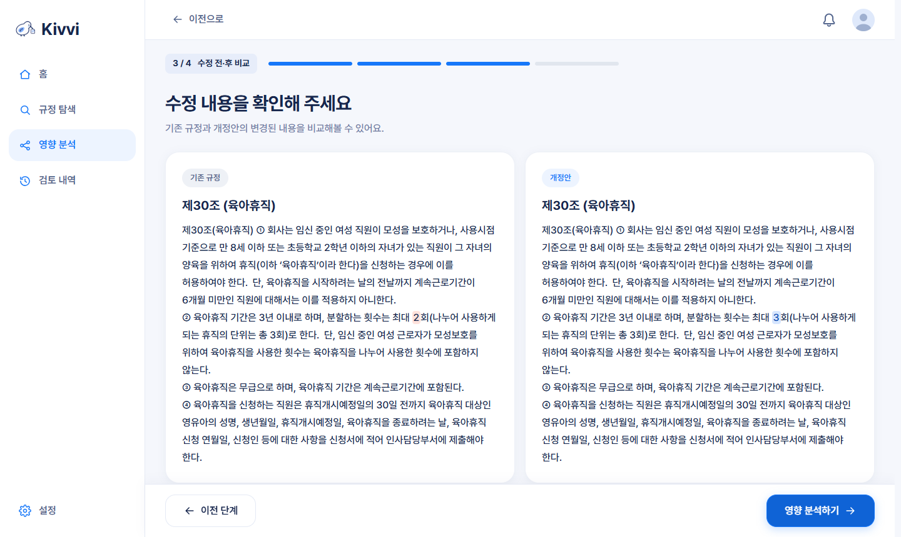
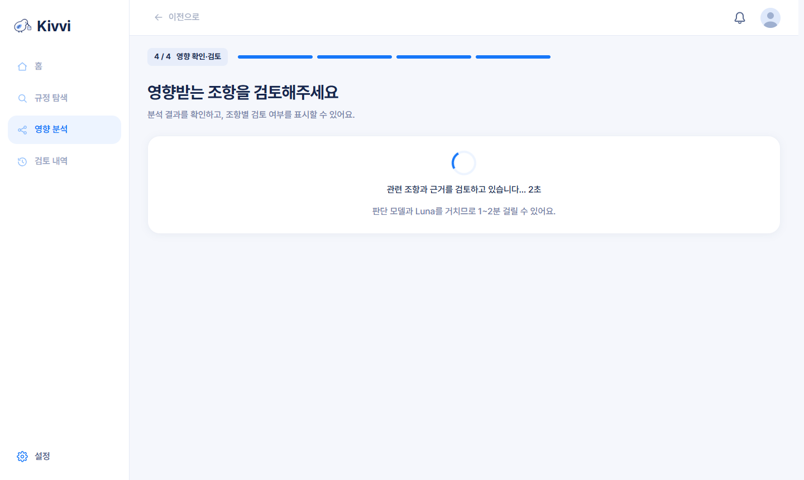
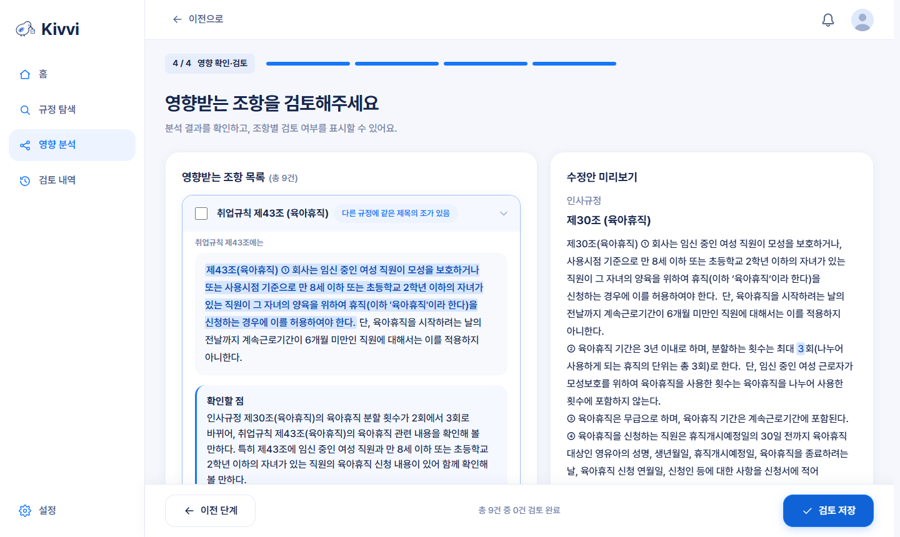

# 규정 개정 영향 분석 서비스, Kivvi 🥝


</br>

## 🖱️ 목차

| | | | |
| :--- | :--- | :--- | :--- |
| [1. 프로젝트 정보](#-프로젝트-정보)</br>[2. 주제](#-주제)</br>[3. 기획 배경](#-기획-배경) | [4. 기능 소개](#-기능-소개)</br>[5. 서비스 화면](#-서비스-화면)</br>[6. 기술 스택](#-기술-스택) | [7. 아키텍처](#-아키텍처)</br>[8. 데이터와 온톨로지](#-데이터와-온톨로지)</br>[9. 성능과 평가](#-성능과-평가) | [10. API 명세서](#-api-명세서)</br>[11. 시작하기](#-시작하기)</br>[12. 팀원](#-팀원) |

</br>

## 📅 프로젝트 정보

- **프로젝트명:** 규정 개정 영향 분석 서비스, Kivvi
- **과정:** [LG CNS AI 캠퍼스](https://lgcnsaicampus.kr/), MCP 기반 Agentic AI 서비스 개발자 과정
- **프로젝트:** RAG 기반 지식 응답 에이전트 구현 프로젝트
- **기간:** 2026.10.01(목) ~ 2026.11.13(금)
- **팀원:** 맨 아래 [팀원](#-팀원) 참고

</br>

## 📖 주제

> **한 조항을 바꿀 때, 함께 확인할 규정까지**

규정은 서로 인용하고, 위임하고, 같은 용어를 씁니다. 한 곳을 고치면 다른 곳이 어긋날 수 있는데, 그 "다른 곳"을 사람이 90건 전체에서 찾아 읽기는 어렵습니다. Kivvi는 고친 조를 입력하면 **함께 확인해야 할 조항을 근거 문장과 함께 후보로** 보여 줍니다. **RAG와 규정 영향 온톨로지**를 함께 써서 찾습니다.

**예를 들면**

> 인사규정 제30조(육아휴직)에서 분할 횟수를 "최대 2회"에서 "최대 3회"로 고칩니다.
> → Kivvi가 같은 제목의 **취업규칙 제43조(육아휴직)** 를 후보로 올리고, 확인할 점과 원문을 함께 보여 줍니다.

| Kivvi가 하는 일 | 사람이 하는 일 |
| --- | --- |
| 영향이 닿을 만한 조를 찾는다 | 고칠지 말지 최종 판단한다 (내규담당부서, 준법감시인) |
| 후보마다 근거 문장과 원문을 붙인다 | 후보마다 검토 완료와 의견을 남긴다 |
| 저장한 검토를 기록으로 남긴다 | |

Kivvi는 충돌을 확정하지 않습니다. 후보와 근거까지만 내고, 판단은 사람이 합니다.


</br>

## 👨‍🎤 기획 배경

- 사내 AI 챗봇이 정확해도, 참고하는 **규정 문서에 오류가 있으면 틀린 정보**를 줍니다.
- 한국벤처투자 규정을 점검해 **오류 46건**을 찾았지만 이것이 전부일 수는 없습니다.
- 규정은 서로 **인용하고 위임하고 같은 용어를 쓰기** 때문에 불일치를 찾기 어렵고, 개정이 반복될수록 새 오류가 쌓입니다.

**기존 방식의 한계**

| 방식 | 강점 | 한계 |
| --- | --- | --- |
| 일반 RAG | 키워드와 벡터로 비슷한 조항을 잘 찾는다 | 글자나 의미가 겹치지 않으면 못 찾는다 (인용 번호가 밀린 조, 같은 값을 다른 말로 쓴 조) |
| 전통적인 온톨로지 | 관계를 미리 추론해 두어 정확도가 높다 | 어떤 조항이 어떻게 바뀔지 경우의 수를 전부 만들어야 해서 시간과 비용이 매우 크다 |

**해결 방향:** RAG는 의미가 비슷한 조항을, 규정 영향 온톨로지는 인용·같은 제목·같은 용어·같은 값으로 이어진 조항을 찾습니다. 온톨로지는 영향이 갈 만한 관계만 미리 연결해 두었다가 개정이 들어오면 그 연결을 따라가므로, 글자나 의미가 겹치지 않는 조항도 잡습니다. 결론까지 미리 추론해 두지는 않습니다.

</br>

## 📝 기능 소개

### 🧭 세 가지 방법으로 후보 수집

| 방법 | 하는 일 | 성격 |
| --- | --- | --- |
| 규정 영향 온톨로지 | 개정 종류에 맞는 관계만 골라 그래프를 따라 이어진 조를 찾음 | 찾은 이유를 코드로 설명할 수 있음 |
| 개정문 낱말 일치 | 바뀌기 전 말 등을 원문에서 그대로 찾음 | 찾은 이유를 코드로 설명할 수 있음 |
| 의미 검색(RAG) | 임베딩과 키워드를 합쳐 비슷한 조를 가져옴 | 유사해서 가져옴 |

### 🧹 후보 유형별 선별

- **규칙 후보**는 판단 모델이 점수를 매겨 문턱 0.7 미만을 거릅니다. 확정급과 정의가 바뀌는 용어를 쓰는 조는 항상 남깁니다.
- **RAG 후보**는 상위 50개를 LLM(gpt-5.6-luna)이 한 번에 보고 선별, 순서, 근거를 함께 냅니다.
- 원문과 일치하는 인용만 쓰고, 일치하는 인용이 없으면 "원문에서 근거를 확인하지 못함, 담당자 확인 필요"로 표시합니다.

### 🔗 개정이 미치는 영향 6가지

주제만 비슷한 조는 제외하고, 아래 유형 중 하나에 해당할 가능성이 있는 조만 후보로 보여 줍니다.

| 유형 | 내용 |
| --- | --- |
| 인용 | 고치는 조를 번호나 제목으로 가리킨다 |
| 준용 · 위임 | 고치는 조를 준용하거나, 사항을 맡기거나 맡는다 |
| 같은 사항 | 같은 사항(값 · 기간 · 대상 · 주체 · 절차)을 따로 정해, 고친 뒤 서로 어긋날 수 있다 |
| 정의 용어 | 정의가 바뀌는 용어를 쓴다 |
| 전제 | 삭제 · 변경되는 절차 · 직무 · 서식을 전제로 쓴다 |
| 2단계 | 영향받는 조를 다시 인용해서 수정 내용이 이어진다 |

### 🧑‍⚖️ 사람이 최종 판단

시스템은 충돌을 확정하지 않습니다. 담당자가 후보마다 검토 완료와 의견을 남기고 저장하면, 개정 때마다 점검한 기록이 남습니다.

</br>

## 📱 서비스 화면

### 💙 규정 찾기

- 홈에서 규정 이름으로 검색해 바로 시작할 수 있어요.
- 규정 탐색에서는 규정 90건의 본문을 읽을 수 있어요(읽기 전용).

| | | |
|:---:|:---:|:---:|
|  |  |  |
| 홈 | 규정 탐색 | 1단계 · 규정 선택 |

### 💙 개정안 작성

- 바꿀 조를 고르고 수정안을 직접 써요.
- 수정 전·후를 나란히 놓고 바뀐 부분을 확인해요.

| | | |
|:---:|:---:|:---:|
|  |  |  |
| 2단계 · 조 선택 | 2단계 · 수정안 작성 | 3단계 · 수정 전후 비교 |

### 💙 영향 검토

- 영향 후보를 근거 문장, 확인할 점, 원문과 함께 보여 줘요.
- 후보마다 검토 완료를 표시하고 검토 의견을 남겨요(최대 500자).

| | | |
|:---:|:---:|:---:|
|  |  |  |
| 4단계 · 분석 중 | 4단계 · 영향 후보 | 4단계 · 검토 의견 |

### 💙 검토 내역

- 저장한 검토를 다시 열어 체크와 의견을 고치거나 지울 수 있어요.

| |
|:---:|
|  |
| 검토 내역 |

</br>

## 🔎 기술 스택

<div>
  
  
  
  
</div>
<div>
  
  
  
</div>
<div>
  
  
</div>

| 구분 | 사용 |
| --- | --- |
| 검색 | 임베딩 + 키워드 하이브리드, bge-reranker-v2-m3 |
| 규칙 후보 선별 | Kanana-2-v-decide-3b (로컬) |
| RAG 후보 선별·근거 작성 | gpt-5.6-luna (외부 API) |

</br>

## 🧩 아키텍처


| 단계 | 하는 일 |
| --- | --- |
| 변경 분석 | 개정문에서 수정 종류와 시작 조를 정한다 |
| 후보 수집 | 규정 영향 온톨로지, 개정문 낱말 일치, 의미 검색(RAG)으로 후보를 모은다 |
| 선별 | 규칙 후보는 판단 모델이, RAG 후보는 LLM이 남길 것을 고른다 |
| 근거 작성 | 남은 후보마다 찾은 경로와 원문 인용으로 이유를 쓴다 |
| 사람 검토 | 담당자가 후보와 근거를 보고 최종 판단한다 |

**주요 설계**

- **후보를 찾은 방식에 따라 선별 방법을 나눕니다.** 모든 후보를 LLM으로 거르면 후보가 많아 비용이 큽니다. 찾은 경로가 있는 규칙 후보는 점수로 거르기만 하면 되므로 판단 모델에 맡기고, 유사해서 가져온 RAG 후보는 의미를 읽어야 하므로 LLM에 맡깁니다.
- **온톨로지는 결론을 미리 추론하지 않습니다.** 영향이 갈 만한 관계만 미리 연결해 두고, 개정이 들어오면 수정 종류별 탐색 규칙으로 그 연결을 따라갑니다.
- **DB는 세 개로 나눴습니다.** 규정 원문 DB(청크, 임베딩, 형태소 색인), 규정 관계 DB(항·호·목, 인용, 지식 그래프, 개정·영향·결정 기록), 법령 DB(법령 284개, 조문 청크 27,905개)입니다. 규정 원문 DB와 온톨로지 DB는 화면에서 읽기 전용입니다.

</br>

## 🧬 데이터와 온톨로지

### 데이터와 DB

- 한국벤처투자 내부규정 **90건**(HWP 84, HWPX 3, PDF 3)을 장, 조, 항, 호, 목, 부칙, 별표, 별지로 분해하고 조 단위로 청킹했습니다. **청크 4,819개**.
- 규정 관계 DB: 항·호·목 7,382개, 인용 관계 1,884개, 지식 그래프(노드 3,698개, 연결 13,630개).
- 법령 DB: 법령 284개, 조문 청크 27,905개. 내규 90개 중 50개가 법령 109개를 634번 인용합니다.

### 규정 영향 온톨로지

규정 조항 사이의 관계를 정의한 지식 그래프와, 수정 종류별 탐색 규칙으로 구성됩니다. **노드 11종, 관계 22종**이고, 규칙으로만 구축했으며 LLM은 쓰지 않았습니다.

| 묶음 | 노드 |
| --- | --- |
| 조항 단위 | 규정, 본문 조, 부칙의 조, 별표, 별지 서식 |
| 개체 | 용어, 위원회, 조직, 약칭 |
| 법령 | 법령, 법령 조 |

| 묶음 | 뜻 | 관계 |
| --- | --- | --- |
| 구조 | 어디에 속하는가 | PART_OF, ARTICLE_OF |
| 인용 | 다른 조, 규정, 장·절을 가리킴 | CITES, CITES_REG, CITES_CHAPTER |
| 법령 | 법령 또는 법령 조를 가리킴, 약칭이 가리키는 대상 | CITES_LAW, CITES_LAW_ART, ALIAS_OF |
| 용어 | 용어를 정의하거나 사용함 | DEFINES, USES_TERM |
| 언급 | 제목, 제목 줄기, 서식, 위원회, 조직 이름이 나옴 | MENTIONS_TITLE, MENTIONS_STEM, MENTIONS_FORM, MENTIONS_BODY, MENTIONS_ORG |
| 같은 사항 | 같은 제목, 같은 값, 같은 부속, 규정과 시행 지침의 짝 | SAME_TITLE, SAME_VALUE, SHARED_ATTACH, SUPPLEMENTS |
| 의심 | 기한 불일치, 정의 불일치, 옛 번호 인용 | VALUE_DIFF, DEF_DIFF, STALE_CITE |

개정마다 관계를 전부 탐색하면 후보가 과도하게 늘어나서, 수정 종류별로 탐색할 관계와 방향을 정해 둡니다. 예를 들어 값 변경은 같은 제목, 같은 값, 기한 불일치, 인용받음 관계를 따라갑니다. 상세 설계는 [충돌 정의](docs/06-conflict-definition.md)에 있습니다.

**동작 예시:** "인사규정 제30조 중 2회를 3회로 한다." → 수정 종류는 값 변경 → 같은 제목 관계를 따라 취업규칙 제43조(육아휴직)를 후보로 냅니다.

### 평가셋

| 세트 | 용도 | 문항 수 |
| --- | --- | --- |
| 개발 | 후보 수집과 선별 설정을 정하는 데 사용 | 100건 |
| 시험 | 설정을 확정한 뒤 최종 성능 측정에 사용 | 100건 |

- 문항은 가상 개정문 1건과 "담당자가 함께 살펴봐야 하는 조" 정답으로 구성합니다. 정답은 확신 높음과 중간만 쓰고, 정답이 0개인 문항도 넣었습니다(후보를 억지로 내지 않는지 보기 위함).
- 독립 라벨러 2명(AI)의 판정 일치도는 Cohen's kappa 0.601(개발셋)입니다. 정답은 AI 초안이고 현업 검수 후 확정합니다.

</br>

## 📊 성능과 평가

시험 100(설정을 고정한 뒤 한 번만 측정)에서 **최종 재현율 0.900(45/50)**, 사람이 보는 목록은 문항당 평균 **5.9개**입니다.

| 방법 | 검색 재현율 | 최종 재현율 | 목록 크기 | 정답 없는 문항의 후보 수 |
| --- | --- | --- | --- | --- |
| 선별 전 (검색 결과 전체) | 0.940 (47/50) | 0.940 | 63.5 | 60.1 |
| **선별 후** | 0.940 (47/50) | **0.900 (45/50)** | **5.9** | **3.8** |

- **최종 재현율:** 정답 조 중에서, 사람에게 보여 주는 최종 후보 목록 안에 든 비율. 목표치는 90%입니다.
- 근거 작성의 Faithfulness는 0.96(95% 구간 0.91~0.99)입니다. 시험 답변 531개 중 50개를 뽑아 원문과 대조한 추정입니다.
- **주의:** 정답은 AI가 만든 초안이고 현업 검수 전입니다. 시험 정답이 50개라 구간이 넓습니다.

</br>

## 🔃 API 명세서

Kivvi 화면이 쓰는 서버 주소입니다. 요청과 응답은 JSON입니다.

| 메서드 | 주소 | 설명 | 요청 | 응답 |
| --- | --- | --- | --- | --- |
| GET | `/api/edit/catalog` | 규정 목록 | 없음 | `regulations`: `id`, `name` 목록 |
| GET | `/api/edit/catalog?reg=<규정 id>` | 한 규정의 본문 | `reg` | `name`, `articles`(조 목록: `id`, `label`, `title`, `text`, `deleted`, `version`, `chapter`), `sections`(부칙·별표·별지) |
| POST | `/api/edit/review` | 영향 분석 실행 | `reg_id`, `article_id`, `version`, `edited`(수정한 조 전문) | 영향 후보 목록과 근거. 후보마다 `regulation`, `label`, `title`, `tier`, `evidence`(근거 문장, 이유), `answer`, `text` |
| POST | `/api/edit/save` | 검토 저장 | `id`(분석 번호), `regulation`, `article`, `before`, `after`, `items`(후보별 `id`, `done`, `note` 등, 최대 300개) | `ok`, `saved_at`, `total`, `done` |
| GET | `/api/edit/history` | 저장한 검토 목록 | 없음 | `items`: `id`, `saved_at`, `regulation`, `article`, `total`, `done` |
| GET | `/api/edit/history?id=<분석 번호>` | 저장한 검토 하나 | `id` | 저장한 검토 전체(`items`에 체크와 의견 포함) |
| POST | `/api/edit/delete` | 저장한 검토 삭제 | `id` | `ok` (분석 초안은 지우지 않고 저장한 검토만 지웁니다) |

오류는 `{"error": "안내 문구"}`로 돌아옵니다.

</br>

## 🚀 시작하기

### 환경 조건

| 항목 | 조건 |
|---|---|
| Python | **3.12 이상** (`pyproject.toml`의 `requires-python`) |
| 패키지 관리 | **uv** (`uv.lock`으로 버전 고정) |
| 규정 원본 | 저장소 안의 `한국벤처투자_내부규정/` (각 규정은 `고유번호_문서명` 폴더, 폴더명 끝 숫자 = 알리오 고유번호) |
| 선택 | 의미 검색 색인, `OPENAI_API_KEY`(Luna), 판단 모델. 없으면 영향 분석 결과가 일부만 나옵니다 |

### 개정안 검토 화면 (Kivvi) 실행

**처음 한 번 준비** (생성물 `out/`은 git에 올라가지 않아 각자 만듭니다. 규정 원문은 저장소 안의 `한국벤처투자_내부규정/` 폴더를 씁니다)

```powershell
uv sync
uv run python scripts/parse_regs.py --all        # 규정 90건 → out/parsed/
uv run python scripts/extract_edges.py --all     # 조항 연결 추출
uv run python scripts/build_kg.py                # 지식 그래프 → out/kg/
```

**서버 켜기**

```powershell
uv run --extra db python app/web_server.py --review-only
```

`http://127.0.0.1:8765/edit-review.html`을 엽니다. 화면은 다섯 가지입니다.

| 메뉴 | 하는 일 |
|---|---|
| 홈 | 규정 검색, 진행 안내, 최근 검토 |
| 규정 탐색 | 규정 90건 본문 읽기(읽기 전용) |
| 영향 분석 | 1 규정 선택 → 2 조항 선택·수정안 작성 → 3 수정 전·후 비교 → 4 영향 확인·검토 |
| 검토 내역 | 저장한 검토를 다시 열어 체크·의견을 고치거나 삭제 |
| 설정, 알림, 프로필 | 아직 연결된 기능이 없습니다(눌러도 안내만 뜹니다) |

- 영향 분석은 개정 영향 온톨로지 경로와 개정문 낱말 일치(판단 모델로 거름), 의미 검색(Luna가 고름)으로 후보를 찾아 첫 화면에 10개(확정급은 10개를 넘어도 포함)를 보이고 나머지는 「더 보기」에 둡니다.
- 규정 원문 DB와 온톨로지 DB는 읽기 전용입니다. 분석 초안은 `out/changes/<id>/changeset.json`, 4단계에서 「검토 저장」을 누른 검토는 같은 폴더의 `review.json`에 저장됩니다(git 제외). 검토 삭제는 `review.json`만 지웁니다.
- 서버 주소: 조항 목록 `GET /api/edit/catalog`, 영향 분석 `POST /api/edit/review`, 검토 저장 `POST /api/edit/save`, 검토 삭제 `POST /api/edit/delete`, 검토 내역 `GET /api/edit/history`.

**위 준비만 하면 되는 것과 아닌 것**

- 홈, 규정 탐색, 조항 수정, 수정 전·후 비교, 검토 내역은 위 준비만으로 동작합니다.
- 영향 분석 결과는 아래 세 가지가 없으면 일부만 나옵니다. 꺼진 단계가 있으면 4단계 위에 안내 문구가 뜨고, 판단 모델이 꺼지면 규칙 후보를 거르지 않고 모두 보여 줍니다.
  - **의미 검색 색인**: `uv run --extra vector python scripts/build_vectors.py`로 `out/vector/`를 만듭니다. Ollama에 `bge-m3`가 있으면 `uv run python scripts/build_vectors.py --ollama bge-m3`도 됩니다.
  - **Luna**: `.env` 또는 서버 환경에 `OPENAI_API_KEY`를 둡니다. 이때 개정 내용과 후보 조항이 외부 API로 전송됩니다.
  - **판단 모델**: 서버를 켜기 전에 환경변수 `IMPACT_DECIDE_PYTHON`(판단 모델용 Python 실행 파일)과 `IMPACT_DECIDE_MODEL`(모델 폴더)을 지정합니다. 설정 예와 주의점은 리포트 99(`docs/reports/261113-1700-99-web-run-pipeline.md`)에 있습니다.
- **글꼴**: Pretendard 파일(`app/web/fonts/PretendardVariable.woff2`)은 저장소에 없습니다. 받는 방법은 `app/web/fonts/README.md`에 있고, 없으면 맑은 고딕으로 보입니다.

### 전처리 (`run.py`)

```powershell
uv sync
uv run python run.py                  # 추출 → 청킹 → 참조 해석 → 보정 적용 → out/ 저장
uv run python -m unittest discover tests
```

`run.py`가 하는 일: 원본 90건 텍스트 추출(`out/text/`) → 조 단위 청킹과 부칙 분리 → 약칭 사전과 참조 해석 → 옛 규정 참조 판정 → 확정된 보정 적용 → 보정 검증(`경고:` 출력) → `out/` 저장. 상세 규칙은 [전처리 규칙](docs/전처리_규칙.md)에 있습니다.

보정 목록은 `data/manual/`에 있습니다. `corrections.json`은 사람이 판정한 보정 기록(오탈자 치환 쌍, 참조 정정, 근거 없음, 옛 규정), `manual_chunks.jsonl`은 조문 없는 문서의 수동 청크입니다. 보정 상태는 `확정(…)`은 적용, `후보(…)`는 적용하지 않음, `없음(…)`은 근거 없음으로 표시합니다.

### 재현할 때 주의

- 원본 파일을 바꾸면 보정 목록의 원문·대상 ID가 맞지 않을 수 있습니다. `run.py`의 `경고:` 출력을 확인하세요.
- `out/`은 실행할 때마다 다시 만들어지며 git에 올라가지 않습니다. 직접 수정하지 마세요.
- 외부 법령(90건 밖)을 참고하는 항목은 이 저장소에서 처리하지 않습니다.
- `docs/archive/`와 `docs/reports/`의 오래된 문서는 당시 기준이라 지금 구현과 다를 수 있습니다.

### 폴더 구조

```
app/                   웹 서버와 화면 (Kivvi: app/web/edit-review.*)
src/                   추출·청킹·참조 해석·보정, 영향 후보 파이프라인(regcheck), 검색·평가
scripts/               구축·실험 실행 스크립트
eval/                  평가셋과 실험 결과
data/manual/           사람이 정한 보정 목록
configs/               실험 설정
assets/                README 그림(화면 캡처, 구조도)
docs/                  현재 유지하는 설명 문서
docs/reports/          작업 기록(날짜·번호순)
docs/archive/          지난 계획서·실험 안내·챗봇 연동 기록·작업 중 만든 임시 파일(현재와 다를 수 있음)
ontology-search/       온톨로지 검색만 떼어 낸 독립 실행 폴더
한국벤처투자_내부규정/     규정 원본 90건
config.py, run.py      경로·설정, 전처리 실행 진입점
```

현재 설명 문서: [전처리 규칙](docs/전처리_규칙.md) · [검색 설계](docs/검색_설계.md) · [답변 설계](docs/답변_설계.md) · [질의 흐름](docs/질의_흐름.md) · [충돌 정의](docs/06-conflict-definition.md) · [용어집](docs/04-glossary.md) · [DB 설정](docs/DB_설정.md)

</br>

## 🥝 팀원

| Name | Roles | GitHub |
| :-- | :-- | :-- |
| 김가빈 | Frontend, Backend, Design | [@9abin](https://github.com/9abin) |
| 박형건 | 팀장, Frontend, Backend | [@Broogun](https://github.com/Broogun) |
| 이민형 | Frontend, Backend, Design | [@minhyeongi-lab](https://github.com/minhyeongi-lab) |
| 한석희 | Frontend, Backend | [@han14308](https://github.com/han14308) |

> 과거 계획서와 실험 기록은 `docs/archive/`, `docs/reports/`에 있으며 지금 구현과 다를 수 있습니다.
