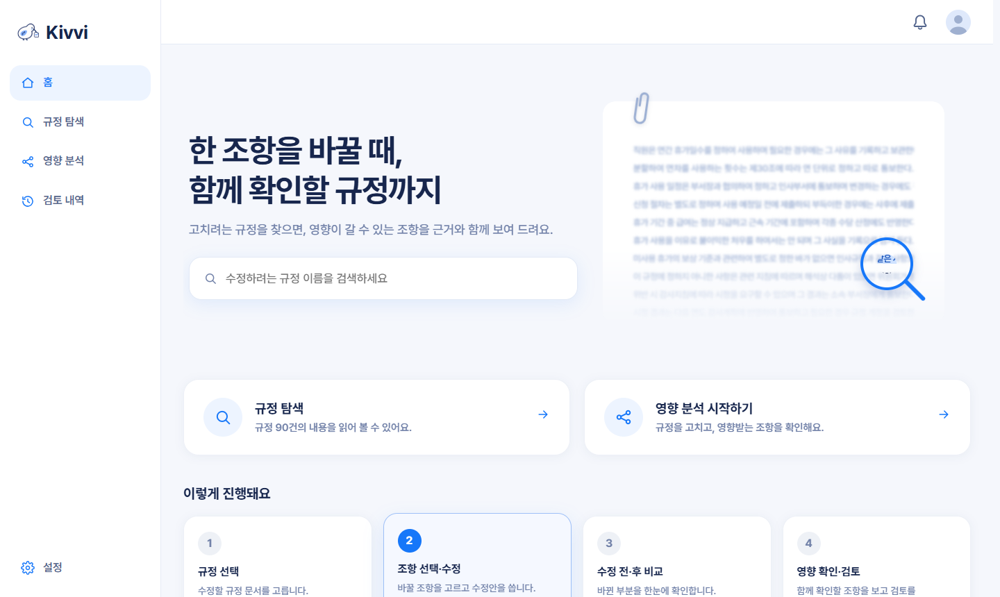
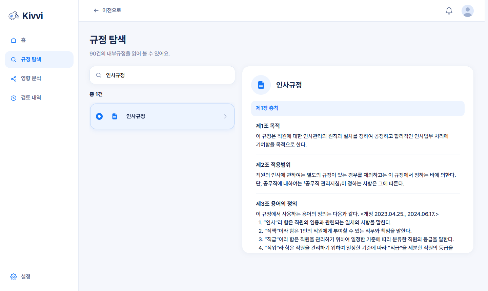
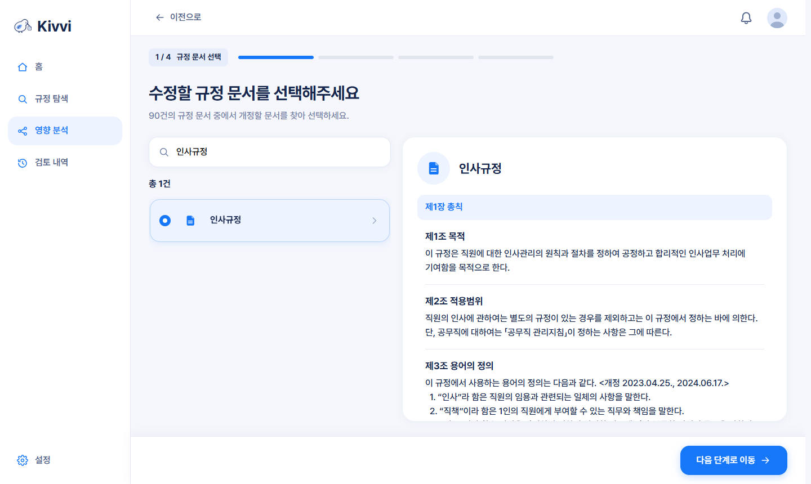
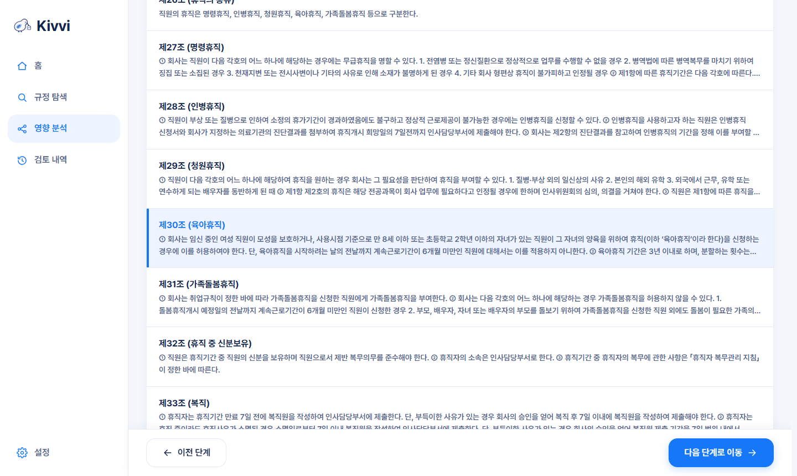
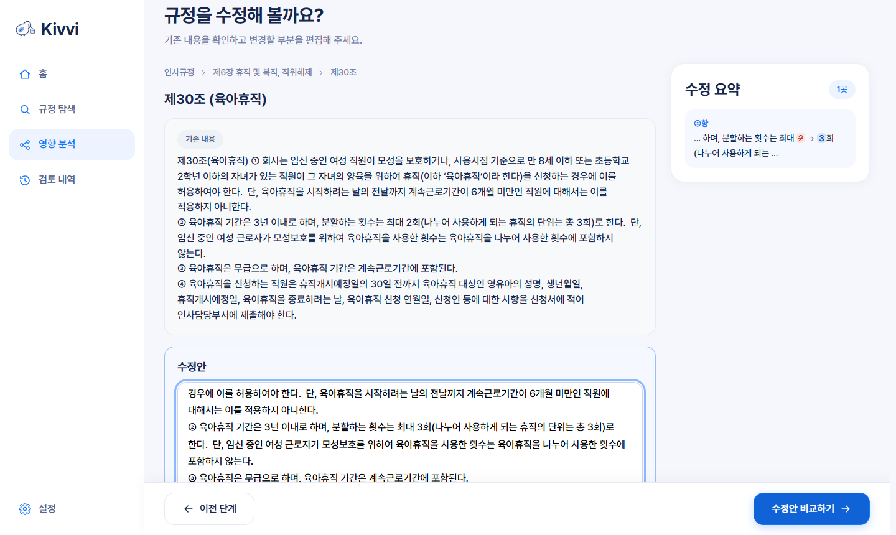
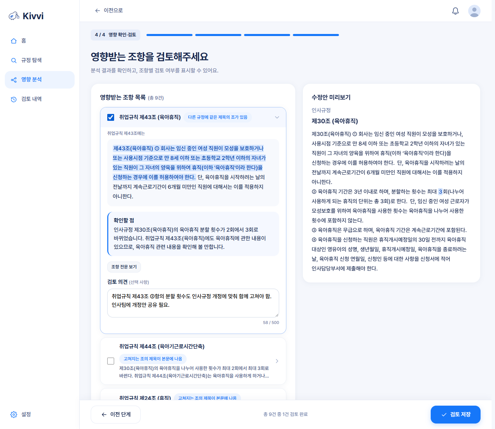
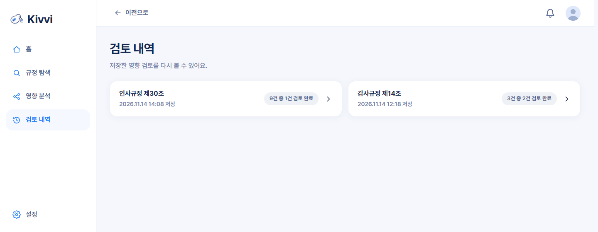
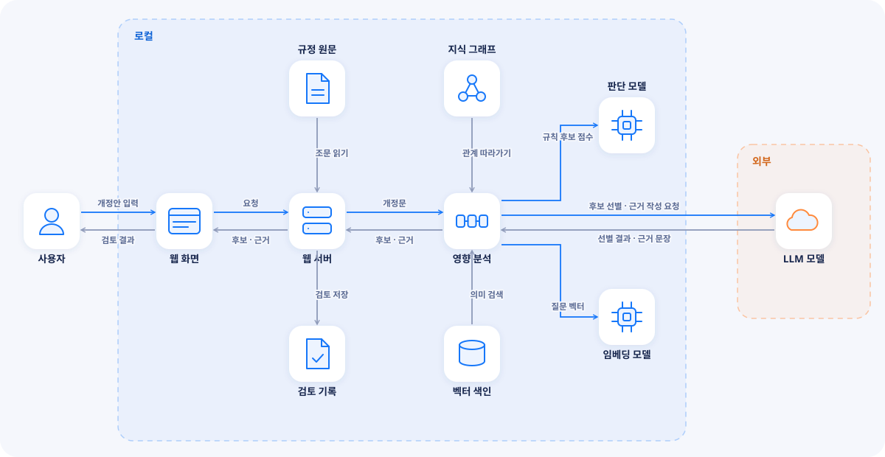
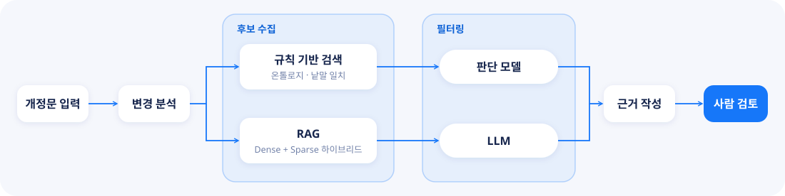

# 규정 개정 영향 분석 서비스, Kivvi 🥝



</br>

## 🖱️ 목차

| | | |
| :--- | :--- | :--- |
| [1. 프로젝트 정보](#-프로젝트-정보)</br>[2. 기획 배경](#-기획-배경)</br>[3. 서비스 화면](#-서비스-화면) | [4. 아키텍처](#-아키텍처)</br>[5. 기술 스택](#-기술-스택) | [6. 시작하기](#-시작하기)</br>[7. 팀원](#-팀원) |

</br>

## 📅 프로젝트 정보

- **프로젝트명:** 규정 개정 영향 분석 서비스, Kivvi
- **과정:** [LG CNS AI 캠퍼스](https://lgcnsaicampus.kr/), MCP 기반 Agentic AI 서비스 개발자 과정
- **프로젝트:** RAG 기반 지식 응답 에이전트 구현 프로젝트
- **기간:** 2026.10.01(목) ~ 2026.11.13(금)

</br>

## 👨‍🎤 기획 배경

> **한 조항을 바꿀 때, 함께 확인할 규정까지**

- 규정 문서에 오류가 있으면, 정확한 사내 AI 챗봇도 틀린 정보를 제공
- 한국벤처투자 규정 점검 결과 **오류 46건** 확인, 이것이 전부는 아닐 가능성
- 규정끼리 인용 · 위임 · 같은 용어 사용 → 한 곳을 고치면 다른 곳과 불일치 발생
- 개정이 반복될수록 새 오류 누적
- 일반 RAG는 글자나 의미가 겹치지 않는 조항을 놓치고, 온톨로지만으로는 모든 경우를 미리 만들기 어려움
- **RAG + 규정 영향 온톨로지**로 영향 후보와 근거를 제시, 최종 판단은 사람이 수행

> 예) 인사규정 제30조(육아휴직) 분할 횟수를 "최대 2회"에서 "최대 3회"로 수정하면, 같은 제목의 **취업규칙 제43조(육아휴직)** 가 후보로 제시

</br>

## 📱 서비스 화면

### 💙 규정 찾기

- 홈에서 규정 이름으로 검색해 바로 시작할 수 있어요.
- 규정 탐색에서는 규정 90건의 본문을 읽을 수 있어요(읽기 전용).

| | | |
|:---:|:---:|:---:|
|  |  |  |
| 홈 | 규정 탐색 | 1단계 · 규정 선택 |

### 💙 개정안 작성

- 바꿀 조를 고르고 수정안을 직접 써요.
- 수정 전·후를 나란히 놓고 바뀐 부분을 확인해요.

| | | |
|:---:|:---:|:---:|
|  |  |  |
| 2단계 · 조 선택 | 2단계 · 수정안 작성 | 3단계 · 수정 전후 비교 |

### 💙 영향 검토

- 영향 후보를 근거 문장, 확인할 점, 원문과 함께 보여 줘요.
- 후보마다 검토 완료를 표시하고 검토 의견을 남겨요(최대 500자).

| | | |
|:---:|:---:|:---:|
|  |  |  |
| 4단계 · 분석 중 | 4단계 · 영향 후보 | 4단계 · 검토 의견 |

### 💙 검토 내역

- 저장한 검토를 다시 열어 체크와 의견을 고치거나 지울 수 있어요.

| |
|:---:|
|  |
| 검토 내역 |

</br>

## 🧩 아키텍처

### 시스템 구성



### 영향 분석 파이프라인



**① 변경 분석**

- 개정문에서 수정 종류와 시작 조 결정

**② 후보 수집**

| 유형 | 검색기 | 후보 성격 |
| --- | --- | --- |
| 규칙 기반 검색 | 규정 영향 온톨로지(그래프 탐색), 개정문 낱말 일치(바뀌기 전 말 등을 원문에서 그대로 찾음) | 찾은 이유를 코드로 설명할 수 있음 |
| RAG | Dense(임베딩) + Sparse(키워드) 하이브리드 검색 | 유사해서 가져옴 |

**③ 필터링 (후보 유형별)**

| 후보 | 필터링 | 방법 |
| --- | --- | --- |
| 규칙 후보 | 판단 모델 | 점수를 매겨 문턱 0.7 미만을 거름. 확정급과 정의가 바뀌는 용어를 쓰는 조는 항상 남김 |
| RAG 후보 | LLM (gpt-5.6-luna) | 상위 50개를 한 번에 보고 선별, 순서, 근거를 함께 냄 |

원문과 일치하는 인용만 쓰고, 일치하는 인용이 없으면 "원문에서 근거를 확인하지 못함, 담당자 확인 필요"로 표시합니다.

**④ 근거 작성 · 사람 검토**

- 남은 후보마다 찾은 경로와 원문 인용으로 이유 작성
- 충돌은 확정하지 않고, 담당자가 후보마다 검토 완료와 의견을 남겨 최종 판단

**후보로 보는 영향 6가지**

주제만 비슷한 조는 제외하고, 아래 유형 중 하나에 해당할 가능성이 있는 조만 후보로 보여 줍니다.

| 유형 | 내용 |
| --- | --- |
| 인용 | 고치는 조를 번호나 제목으로 가리킨다 |
| 준용 · 위임 | 고치는 조를 준용하거나, 사항을 맡기거나 맡는다 |
| 같은 사항 | 같은 사항(값 · 기간 · 대상 · 주체 · 절차)을 따로 정해, 고친 뒤 서로 어긋날 수 있다 |
| 정의 용어 | 정의가 바뀌는 용어를 쓴다 |
| 전제 | 삭제 · 변경되는 절차 · 직무 · 서식을 전제로 쓴다 |
| 2단계 | 영향받는 조를 다시 인용해서 수정 내용이 이어진다 |

### 사용 모델

- 임베딩: BGE-m3 (기본), Qwen3-Embedding-4B (선택)
- 판단 모델(규칙 후보 필터링): Kanana-2-v-decide-3b (로컬)
- LLM(RAG 후보 필터링 · 근거 작성): gpt-5.6-luna (OpenAI API)
- 비교 실험: bge-reranker-v2-m3, Qwen3-Reranker-4B, Qwen3-Embedding-0.6B, Gemma 4 12B-it, Qwen3 30B-A3B, Qwen3.5 9B, Solar

온톨로지 스키마, 평가셋, 성능 결과는 [온톨로지와 평가셋 상세](docs/온톨로지와_평가셋.md)에 있습니다.

</br>

## 🔎 기술 스택

### AI / Model

<div>
  
  
  
  
  
</div>

</br>

### Backend / Data

<div>
  
  
  
  
  
</div>

- 추출: olefile(HWP), pypdf(PDF), kiwipiepy(형태소 분석)
- 검색: BM25, sentence-transformers, Transformers, PEFT, NumPy
- DB: PostgreSQL 17 + pgvector(규정 원문 · 관계), SQLite(법령 · 온톨로지 검색)
- 웹 서버: Python 표준 라이브러리(`http.server`)

</br>

### Frontend

<div>
  
  
  
</div>

</br>

### Infra

<div>
  
  
</div>

</br>

### Collaboration Tool

<div>
  
  
  
</div>

</br>

## 🚀 시작하기

- 필요: Python 3.12 이상, [uv](https://docs.astral.sh/uv/)
- 규정 원본: 저장소 안 `한국벤처투자_내부규정/` 폴더 사용

```powershell
uv sync
uv run python scripts/parse_regs.py --all        # 규정 90건 정리
uv run python scripts/extract_edges.py --all     # 조항 연결 추출
uv run python scripts/build_kg.py                # 지식 그래프
uv run --extra db python app/web_server.py --review-only
```

- 접속: http://127.0.0.1:8765/edit-review.html
- 전체 결과에는 의미 검색 색인, `OPENAI_API_KEY`, 판단 모델이 추가로 필요 → [실행 안내](docs/실행_안내.md)

### 폴더 구조

```
kvic-internal-regulations-review/
│
├── 📂 app/                       # 웹 서버와 화면
│   └── web/                      # Kivvi 화면 (edit-review.html · css · js)
│
├── 📂 src/                       # 핵심 코드
│   ├── regcheck/                 # 영향 후보 파이프라인 (후보 수집 · 필터링 · 근거 작성)
│   ├── extract/ preprocess/      # 원문 추출 · 정제
│   ├── chunk/ citations/         # 조 단위 청킹 · 참조 해석
│   ├── corrections/              # 확정된 보정 적용
│   └── search/ answer/ eval/     # 검색 · 답변 · 평가
│
├── 📂 scripts/                   # 구축 · 실험 실행 스크립트
├── 📂 eval/                      # 평가셋과 실험 결과
├── 📂 data/manual/               # 사람이 정한 보정 목록
├── 📂 configs/                   # 실험 설정
├── 📂 tests/                     # 테스트
│
├── 📂 docs/                      # 문서
│   ├── reports/                  # 작업 기록 (날짜 · 번호순)
│   └── archive/                  # 지난 계획서 · 실험 안내 (현재와 다를 수 있음)
│
├── 📂 assets/                    # README 그림 (화면 캡처 · 구조도)
├── 📂 ontology-search/           # 온톨로지 검색만 떼어 낸 독립 실행 폴더
├── 📂 한국벤처투자_내부규정/       # 규정 원본 90건
│
├── config.py                     # 경로 · 설정
├── run.py                        # 전처리 실행 진입점
├── docker-compose.yml            # 규정 DB (PostgreSQL + pgvector)
└── pyproject.toml                # 의존성 (uv)
```

현재 설명 문서: [전처리 규칙](docs/전처리_규칙.md) · [검색 설계](docs/검색_설계.md) · [답변 설계](docs/답변_설계.md) · [질의 흐름](docs/질의_흐름.md) · [충돌 정의](docs/06-conflict-definition.md) · [용어집](docs/04-glossary.md) · [DB 설정](docs/DB_설정.md)

</br>

## 🥝 팀원

| Name | Roles | GitHub |
| :-- | :-- | :-- |
| 김가빈 | Frontend, Backend, Design | [@9abin](https://github.com/9abin) |
| 박형건 | 팀장, Frontend, Backend | [@Broogun](https://github.com/Broogun) |
| 이민형 | Frontend, Design | [@minhyeongi-lab](https://github.com/minhyeongi-lab) |
| 한석희 | Frontend, Backend | [@han14308](https://github.com/han14308) |
