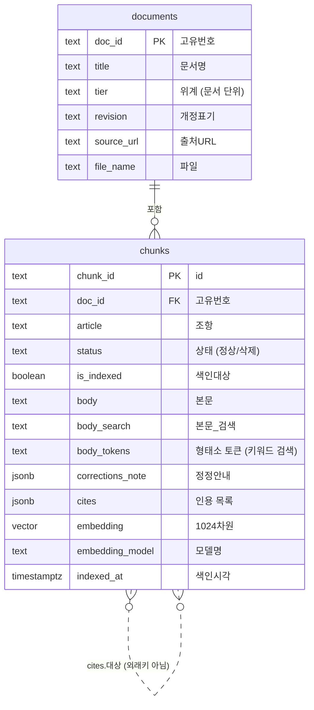

# DB 스키마 (pgvector)

`regulations` DB의 테이블 구조를 정리한다. 테이블을 만들기 전에 이 문서를 확인한다.
청크 생성 규칙은 `docs/전처리_규칙.md`, 색인 대상과 임베딩 입력은 `docs/재색인_설계.md`, 서버 설정은 `docs/DB_설정.md`를 본다.

**상태: 설계 (아직 테이블을 만들지 않음)**
**기준일: 2026.10.06**

---

## 1. 테이블 구성

| 테이블 | 역할 | 행 수(예정) |
|---|---|---|
| `documents` | 규정 문서 한 건 (90건) | 90 |
| `chunks` | 조·항 청크 (정상·부칙·별지·삭제 모두) | 4,774 |

문서 정보를 `chunks`에 반복하지 않고 `documents`로 나눈다. 부칙과 삭제 조문도 `chunks`에 넣고, `색인대상` 열로 구분한다. 그래서 `cites` 해석에 필요한 청크를 한 테이블에서 찾을 수 있다.

---

## 2. `documents` (문서)

| 컬럼 | 타입 | 한글 이름 | 설명 |
|---|---|---|---|
| `doc_id` | `text` PK | 고유번호 | 알리오 고유번호 (예: `23234`) |
| `title` | `text` NOT NULL | 문서명 | 예: `감사규정` |
| `tier` | `text` NOT NULL | 위계 | 문서 한 건의 종류. `정관`, `규정`, `지침`, `헌장`, `강령`, `기타` (10절 참고) |
| `revision` | `text` | 개정표기 | 예: `2026년도 08월 28일 개정` |
| `source_url` | `text` | 출처URL | 알리오 링크 |
| `file_name` | `text` | 파일 | 원본 파일명 |

```sql
CREATE TABLE documents (
    doc_id      text PRIMARY KEY,
    title       text NOT NULL,
    tier        text NOT NULL,
    revision    text,
    source_url  text,
    file_name   text
);
```

---

## 3. `chunks` (청크)

| 컬럼 | 타입 | 한글 이름 | 설명 |
|---|---|---|---|
| `chunk_id` | `text` PK | id | 청크 ID (예: `23234_제5조_2항`) |
| `doc_id` | `text` NOT NULL, FK | 고유번호 | `documents.doc_id` 참조 |
| `article` | `text` | 조항 | 예: `제5조` (2026.10.13부터 조 단위. 이전에는 `제5조 제2항`). 조 없는 문서는 `null` |
| `section` | `text` | 장 | 장·절 경로. 예: `제2장 감사의 종류 > 제1절 정기감사`. 없으면 `null` (2026.10.13 추가) |
| `status` | `text` NOT NULL | 상태 | `정상`, `삭제` |
| `is_indexed` | `boolean` NOT NULL | 색인대상 | 정상이고 부칙·별지가 아니면 `true` (2026.10.12: 별지 제외 추가) |
| `body` | `text` NOT NULL | 본문 | 원문 표기. 답변 인용에 쓴다 |
| `body_search` | `text` NOT NULL | 본문_검색 | 확정 오탈자 반영 글자. 임베딩 입력 |
| `corrections_note` | `jsonb` | 정정안내 | 답변용 정정 안내 목록. 없으면 `null` |
| `cites` | `jsonb` | cites | 인용 목록 (4.2절) |
| `embedding` | `vector(1024)` | (벡터) | BGE-m3 임베딩. `is_indexed=false`이면 `null` |
| `embedding_model` | `text` | (모델) | 예: `BAAI/bge-m3`. 모델을 바꿀 때 구분용 |
| `indexed_at` | `timestamptz` | (색인시각) | 임베딩을 만든 시각 |

```sql
CREATE TABLE chunks (
    chunk_id          text PRIMARY KEY,
    doc_id            text NOT NULL REFERENCES documents(doc_id),
    article           text,
    status            text NOT NULL CHECK (status IN ('정상', '삭제')),
    is_indexed        boolean NOT NULL,
    body              text NOT NULL,
    body_search       text NOT NULL,
    body_tokens       text,
    corrections_note  jsonb,
    cites             jsonb NOT NULL DEFAULT '[]',
    embedding         vector(1024),
    embedding_model   text,
    indexed_at        timestamptz,
    CHECK (is_indexed = false OR embedding IS NOT NULL)
);
```

`CHECK` 조건은 색인 대상 청크에 벡터가 반드시 있도록 막는다.

---

## 4. 인덱스

| 인덱스 | 대상 | 목적 |
|---|---|---|
| `chunks_embedding_hnsw` | `embedding` (HNSW, 코사인) | 벡터 검색 |
| `chunks_doc_idx` | `doc_id` | 형제 항 확장 (같은 문서의 같은 조) |
| `chunks_article_idx` | `(doc_id, article)` | 같은 조의 항 조회 |
| `chunks_tier_idx` | `documents.tier` | 위계 필터 |

```sql
CREATE INDEX chunks_embedding_hnsw
    ON chunks USING hnsw (embedding vector_cosine_ops)
    WHERE is_indexed;

CREATE INDEX chunks_doc_article_idx ON chunks (doc_id, article);
CREATE INDEX documents_tier_idx ON documents (tier);
```

HNSW 인덱스는 `is_indexed = true`인 행만 대상으로 한다. 부칙과 삭제 조문은 벡터 검색에 나오지 않는다.

키워드 검색용 인덱스는 `body_tokens`에 건다. 방식은 12.2절에 있다.

```sql
CREATE INDEX chunks_body_tokens_gin
    ON chunks USING gin (to_tsvector('simple', body_tokens))
    WHERE is_indexed;
```

---

## 5. `cites` 형식

`chunks.cites`는 청크 하나가 인용하는 조문 목록이다. 기존 `out/chunks.jsonl`의 형식을 그대로 옮긴다.

```json
[
  {"원문": "제16조", "대상": "24024_제16조", "유형": "내부문서", "상태": "정상연결"},
  {"원문": "제15조", "대상": "eflaw:011357_15", "유형": "외부", "법령명": "개인정보 보호법", "상태": "외부연결", "외부본문": "제15조(개인정보의 수집ㆍ이용) ..."},
  {"원문": "외부 법령", "대상": null, "유형": "외부", "상태": "외부"}
]
```

| 키 | 설명 |
|---|---|
| `원문` | 본문에 쓰인 인용 표기 |
| `대상` | 연결된 청크 ID. 없으면 `null`. 외부연결은 `chunks.chunk_id`가 아니라 법령 DB의 `{document_id}_{조번호}` 형식 |
| `유형` | `내부`, `내부문서`, `외부`, `미해결` 등 |
| `상태` | `정상연결`, `외부`, `외부연결`, `옛 규정 참조(검토 완료)`, `정정 확정`, `근거 없음(확인 완료)`, `미해결(약칭)` 등 |
| `법령명` | `유형`이 `외부`일 때만, 캡처된 법령 이름(예: "개인정보 보호법"). 없으면 법령명을 몰라서 연결을 시도하지 않은 경우 |
| `외부본문` | `상태`가 `외부연결`일 때만. 법령 원문 조 전체 텍스트(`data/manual/law_rag.sqlite3`에서 가져옴, 2026.10.12 추가) |

`대상`은 보통 `chunks.chunk_id`를 가리킨다. 외래키로 걸지 않는다. 대상이 부칙이나 삭제 조문일 수 있고, `cites`는 JSON이라 SQL 제약을 걸기 어렵기 때문이다. 조회는 `chunk_id`로 한다.

**외부연결 (2026.10.12 추가)**: 내부규정이 외부 법령(법률·시행령·시행규칙)을 인용한 곳을 `data/manual/law_rag.sqlite3`(법령 232건, 조문 23,189개, 임베딩 없음)의 실제 조문과 연결한다. 법령명을 실제로 캡처한 경우만 시도하고(`src/citations/law_lookup.py`), 조 번호로 못 찾으면 그대로 `유형: 외부, 상태: 외부` 로 남긴다. 법령 조문 자체는 검색 대상이 아니라 **인용을 따라갈 때만** 나온다(`Searcher._cited()`, `검색_설계.md` 6절). 전체 435건 중 253건(58%)이 연결됐다(2026.10.12 측정).

---

## 6. 색인 기록

| 항목 | 값 |
|---|---|
| 색인대상 (`is_indexed = true`) | 4,551 |
| 부칙 (`is_indexed = false`) | 89 |
| 별지 (`is_indexed = false`, 2026.10.12 추가) | 54 |
| 삭제 조문 (`is_indexed = false`) | 80 |
| 합계 | 4,774 |

**2026.10.12 변경**: 별표·별지 분리가 들어오면서 별지(서식)도 별표와 달리 `is_indexed=false`로 바뀌었다 (`전처리_규칙.md` 4.9절, `src/index/build.py`의 `is_indexed`). 별표는 그대로 색인대상이다.

이 수치는 `out/chunks.jsonl`과 맞아야 한다. 적재 후 아래로 확인한다.

```sql
SELECT is_indexed, status, count(*) FROM chunks GROUP BY 1, 2 ORDER BY 1, 2;
```

---

## 7. 한글 컬럼 대응

| 한글 이름 | 컬럼 |
|---|---|
| 고유번호 | `documents.doc_id`, `chunks.doc_id` |
| 문서명 | `documents.title` |
| 위계 | `documents.tier` |
| 개정표기 | `documents.revision` |
| 출처URL | `documents.source_url` |
| 파일 | `documents.file_name` |
| id | `chunks.chunk_id` |
| 조항 | `chunks.article` |
| 상태 | `chunks.status` |
| 색인대상 | `chunks.is_indexed` |
| 본문 | `chunks.body` |
| 본문_검색 | `chunks.body_search` |
| (형태소 토큰) | `chunks.body_tokens` |
| 정정안내 | `chunks.corrections_note` |
| cites | `chunks.cites` |

---

## 8. 설계 결정

| 항목 | 결정 | 이유 |
|---|---|---|
| 테이블 수 | 2개 (`documents`, `chunks`) | 문서 정보 반복 제거 |
| 부칙·삭제 저장 | `chunks`에 넣고 `is_indexed=false` | `cites` 조회를 한 곳에서 처리 |
| 벡터 크기 | 1,024 | BGE-m3 출력 차원 |
| 벡터 인덱스 | HNSW, 코사인, 부분 인덱스 | 검색 속도, 색인 대상만 포함 |
| `cites` 저장 | JSONB | 인용 목록을 청크마다 통째로 읽는다 |
| 외래키 | `chunks.doc_id`만 | `cites.대상`은 JSON이라 걸지 않음 |
| 임베딩 모델 기록 | `embedding_model` 열 | 나중에 모델을 바꿀 때 구분 |

---

## 9. 적재 순서

1. `documents` 90행 적재 (`out/chunks.jsonl`의 메타데이터에서 중복 제거)
2. `chunks` 4,774행 적재 (`embedding`은 `is_indexed=true`인 행만 채움)
3. HNSW와 일반 인덱스 생성 (적재 후에 만드는 것이 빠르다)
4. 개수와 샘플 검색으로 확인

---

## 10. 위계(tier)는 문서 단위다

위계는 **조나 항마다 붙는 값이 아니다.** 규정 문서 한 건이 어떤 종류인지를 나타내며, 그 문서의 모든 조와 항이 같은 값을 가진다.

- 판정 기준은 문서명 끝 글자다 (`전처리_규칙.md` 4장).
  - 문서명이 `한국벤처투자 정관`이면 `정관`
  - 끝이 `규정`이면 `규정`, `지침`이면 `지침`, `헌장`이면 `헌장`, `강령`이면 `강령`
  - 그 밖은 `기타` (예: 취업규칙)
- 예: `감사규정`(23234)의 모든 청크는 `tier = 규정`이다.
- 그래서 `documents` 테이블에 둔다. `chunks`에 같은 값을 반복해 넣지 않는다.
- 위계 필터는 "지침만 검색" 같은 조건에 쓴다. 조회는 `chunks`와 `documents`를 `doc_id`로 조인한다.

---

## 11. ERD



- `documents 1 : chunks N` 관계만 외래키로 건다.
- `chunks`끼리의 인용 관계는 `cites` JSON 안에 있다. 외래키가 아니므로 ERD에서는 점선으로 표시했다.

---

## 12. 결정 사항과 미정 항목

### 12.1 결정됨

| 항목 | 결정 | 근거 |
|---|---|---|
| 형제 항 확장 상한 | 3,000자 | `재색인_설계.md` 4절. 현재 데이터에서 3,000자를 넘는 조는 없음 |
| 팀 권한 | 팀원 전원에게 `regulations` DB 전체 권한을 준다 | 팀 결정 |
| 키워드 검색 방식 | 형태소 토큰을 `chunks.body_tokens`에 저장하고 전문 검색 인덱스(GIN)를 건다 | 아래 12.2 |

### 12.2 키워드 검색 방식

PostgreSQL 기본 전문 검색은 한국어 형태소를 나누지 못합니다. 그래서 색인 단계에서 Python으로 형태소를 나누고, 그 결과를 저장합니다.

- 형태소 분석기: `kiwipiepy` (Kiwi). 설치해서 동작을 확인했습니다.
  - `제2조 제2항에 따라 직원채용지침을 적용한다.` → `제`, `2`, `조`, `제`, `2`, `항`, … `직원`, `채용`, `지침`, …
  - 조항 번호가 토큰으로 남습니다. 규정 이름은 `직원`, `채용`, `지침`으로 나뉩니다.
  - 검색어도 같은 분석기로 나누므로 "직원채용지침"으로 검색해도 같은 토큰이 나와 맞습니다.
- 저장: `body_search`를 형태소로 나눈 토큰을 공백으로 이어서 `body_tokens`에 저장
- 인덱스: `body_tokens`에 `tsvector` GIN 인덱스
- 검색: `ts_rank`로 순위를 매기고, 벡터 검색 결과와 RRF로 합칩니다

토큰 열은 `chunks.body_search`를 Kiwi로 나눠서 채웁니다. 전체 4,465개를 나누는 데 걸리는 시간은 아직 재지 않았습니다.

### 12.3 미정

현재 미정 항목은 없습니다.
