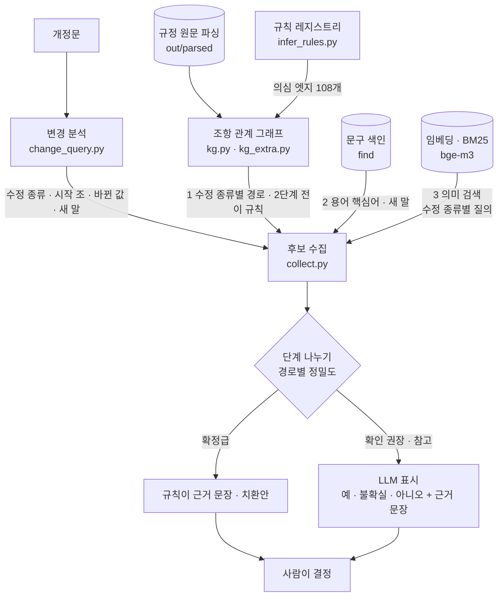

# 261102-1530 영향 후보 점검 전체 구조

- 관련: [66 검색 평가셋](261029-1500-66-retrieval-evalset-design.md), [67 범위](261030-1700-67-impact-check-scope.md), [68 평가셋 설계](261030-1800-68-impact-evalset-design.md), [69 라벨 키트](261030-1830-69-impact-label-kit.md), [72 온톨로지·지식 그래프](261102-1200-72-ontology-kg.md), [73 라벨 검토 체크리스트](261102-1300-73-label-review-checklist.md)
- 목적: 규정 한 조를 고칠 때 **함께 살펴볼 조항 후보**를 모아 근거와 함께 보여 주는 흐름 전체를 한 장으로 둔다. 후보를 확정하거나 충돌을 판정하지 않는다. 결정은 사람이 한다.
- 상태: 개발 분할 5문항에서 만들고 고른 구성이다. 정답 라벨은 AI 라벨러 초안이며 사람 확인 전이다. 아래 수치는 **탐색적 결과**이고 최종 성능이 아니다.

## 1. 전체 구조

| 단계 | 하는 일 | 방식 | 코드 |
|---|---|---|---|
| 변경 분석 | 개정문에서 수정 종류, 시작 조, 지워진 말·새 말, 번호 이동 범위를 뽑는다 | 규칙 | `src/regcheck/change_query.py` |
| 조항 관계 그래프 | 조·부칙·별표·서식·용어·기관·법령을 노드로, 인용·같은 제목·용어 사용 등 17개 관계를 엣지로 둔다 | 규칙(LLM 없음) | `src/regcheck/kg.py`, `kg_extra.py` |
| 후보 수집 | ① 그래프 경로(수정 종류별 관계 표 + 2단계 전이 규칙 화이트리스트) ② 용어 핵심어·새 말 문구 검색 ③ 의미 검색 | 규칙 + 임베딩 | `src/regcheck/collect.py` |
| 단계 | 후보의 가장 강한 경로로 확정급 / 확인 권장 / 참고를 정한다 | 측정한 경로별 정밀도 | `collect.py` `TIER_*` |
| 근거·판단 | 확정급은 규칙이 근거 문장을 뽑는다. 나머지는 LLM이 예/불확실/아니오와 근거 문장을 붙인다(후보를 지우지 않음) | 규칙 + LLM | `scripts/exp_infer_dev.py`(실험) |
| 결정 | 담당자가 승인·기각한다 | 사람 | `app/review_app.py` |

- 검색 질의는 수정 종류별로 다르다. 삭제는 지워진 말, 정의·위임은 새 말 + 개정문, 값 변경은 현행 + 개정, 번호 이동·내용 변경은 수정 전 조항이다. 그래프 탐색의 시작점은 항상 **수정 전 조항**이다.
- 추론은 세 곳에 있다. 구축 때 규칙으로 파생한 엣지, 탐색 중 수정 종류별 전이 규칙, 탐색 뒤 LLM 판단 표시. 에이전트가 스스로 계획하지 않는 고정된 순서의 흐름이다.

## 2. 평가 구성

- 가상 개정 24개(개발 8, 봉인 16). 영향 있음 13, 없음 11. 라벨은 독립 라벨러 A/B1/B2/C가 만든 초안(`eval/impact_label_kit/`, 사람 확인 전, 리포트 69·73).
- 봉인 분할은 2026-11-02에 한 번 열었다. 이후 개선은 개발 분할에서만 확인했고, 효과를 말하려면 **새 봉인 문항이 필요하다**.
- 지표: 후보 상한 k에서의 재현율, 후보 중 정답 비율, 도달 재현율, 정답을 모두 포함하는 데 필요한 후보 수(k@100%), 문항 단위 bootstrap.

## 3. 지금까지의 결과 (탐색적, 개발 5문항 · 정답 68건 기준 표기 외에는 전체 12문항)

| 비교 | 결과 |
|---|---|
| 후보 20개 안 정답 포함률, 전체 12문항(정답 126건) | RAG만 33% / 그래프만 60% / 그래프 먼저 + RAG 67%. 봉인 7문항만 31% / 41% / 53% |
| 수정 종류별 질의 + 단계 + 전이 규칙 (개발) | 재현율@20 75%, k@100% 176→42, 확정급 52개만 읽어도 정답 47/68(정밀도 90%) |
| 경로별 후보 정밀도(12문항) | 인용받음 97%, 용어 사용 88%, 제목 언급 39%, 제목 줄기 14%, 조직 이름 3% |
| LLM 판단 표시(개발, 후보 292) | 정답 구분 AUC: 상/중/하 0.80, 기준만 명시 0.80, 기준 + 예시 0.90, 원칙만 0.81. 정렬로 얻는 재현율은 +1~5%p |
| 영향 없음 문항 | 확정급 오경보 0. 후보는 참고 단계에 남는다(의미 검색 40개 안팎) |

## 4. 알려진 한계

- 정답이 AI 초안이고 영향 범위의 정의는 현업 판단이 필요하다(리포트 73). 이 문서에서 결론을 내지 않는다.
- 규칙(전이 규칙, 단계 경계)과 프롬프트를 개발 5문항에서 골랐다. 봉인 분할은 이미 열려서 독립 평가가 아니다.
- 법령 개정(I22)은 조 단위 법령 노드가 없어 후보가 0개였다. 정의 변경 I20은 정확한 용어 일치에 의존해 놓치는 정답이 많다.
- LLM 판단은 정답 후보의 16~33%를 「아니오」로 본 구성도 있었다. 그래서 숨기지 않고 접기만 한다.
- 비용: LLM 판단 실험은 `gpt-5.6-luna`, 후보 약 290~390개 호출. 가상 개정문과 공개 규정 문장만 보냈다.

## 5. 다음 순서

1. 새 가상 개정 10개 안팎의 봉인 문항 작성, 코드·프롬프트 동결 후 한 번 실행.
2. 정답 사람 확인(불일치·무영향 문항 위주, [73](261102-1300-73-label-review-checklist.md)).
3. 근거 카드를 검토 화면에 연결(확정급은 규칙 근거 + 치환안, 나머지는 LLM 표시).
