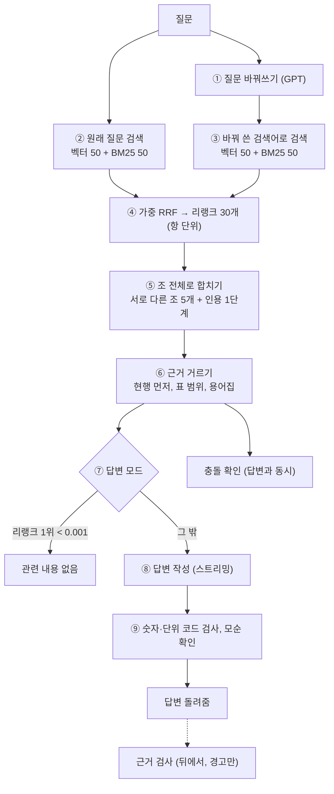

# 질의 흐름

질문 하나가 들어와서 답변이 나가기까지의 순서. **기준 구성**(2026.10.15 확정): 팀 DB 항 단위 색인(`PG_DATABASE=regulations_team`) → 조 전체 넘기기. 조 단위 색인 `regulations`는 초기 실험용 잔재로 남아 있을 뿐 기본이 아니다.
단계별 상세 규칙은 `검색_설계.md`, `답변_설계.md`, `재색인_설계.md`, 실행·평가 방법은 `팀_실행_안내.md`. 값은 모두 `config.py`에서 바꾼다.

| 스위치 (`config.py`) | 추천 | 기본값 | 비고 |
|---|---|---|---|
| `USE_REWRITE` 질문 바꿔쓰기 | 켬 | 켬 | |
| `FAST_PIPELINE` 응답 시간 개선 | 켬 | 켬 | 답변 내용은 같고 순서만 바뀜 |
| `RETURN_ARTICLE` 항으로 찾고 조 전체 넘기기 | 켬 | 켬 (2026.10.15부터) | 항 단위 DB(팀 DB)에서만 의미 있음. 조 단위 색인으로 돌릴 때만 `RETURN_ARTICLE=0` |
| `HIGHLIGHT_HITS` 역할 표시·▶ 강조 | 켬 | 켬 (〃) | 〃 |
| `LAW_CITES_FROM_HITS` 법 인용은 찾은 항에서만 | 켬 | 켬 (〃) | 〃 |
| `QUERY_PLAN` 질문 나누기 | 끔 | 끔 | 190문항에서 효과 없음 |
| `USE_SYNONYMS` 동의어 사전 | 끔 | 끔 | 효과 미측정 |
| `OPENAI_MODEL`, `JUDGE_MODEL` | gpt-5.6-luna | gpt-5.6-luna | |

## ① 질문 바꿔쓰기 — `Generator.rewrite_query`

- GPT가 구어체 질문을 규정 용어 검색어 한 줄로 바꾼다 (`REWRITE_PROMPT`). 후보를 찾을 때만 더하고, 리랭크는 원래 질문으로 한다.
- `FAST_PIPELINE`이면 이 호출을 기다리는 동안 ②를 먼저 한다 (`Searcher.search(rewritten_future=…)`). 결과는 같고 기다림만 준다.
- 측정: 깨끗한 질문에서는 차이 없음, **오타 질문에서 Hit@10 0.78 → 0.84**, 답변 100문항에서 오답 8 → 4. 비용은 답 완성까지 약 1.7초.

## ②·③ 후보 검색 — `Searcher.search` (`src/search/search.py`)

| 순서 | 하는 일 | 값 |
|---|---|---|
| a | 색인이 바뀌었으면 BM25·목록을 다시 읽는다 | 검색마다 확인 |
| b | **정확 조회**: 규정 이름 하나 + "제N조"가 하나뿐이면 그 조를 직접 가져와 맨 앞에 둔다 | `exact.py` |
| c | 메타데이터 필터 (위계, 문서, 개정연도) | 화면에서 고름 |
| d | 원래 질문으로 벡터(BGE-m3, pgvector)와 BM25(Kiwi 형태소) | 각 50개 |
| e | 바꿔 쓴 검색어 + 용어집 신호어로 벡터·BM25 한 번 더 (동의어 사전은 끔) | 각 50개 |

## ④ 합치기와 리랭크

- 가중 RRF: 점수 = Σ 가중치 / (60 + 순위). 벡터 0.7, 키워드 0.3 (바꿔 쓴 검색어 목록도 같은 가중치).
- 상위 30개를 `BAAI/bge-reranker-v2-m3`로 **원래 질문**과 다시 채점. 입력은 `[문서명 장 조항] 본문`.
- 용어집 후보 필터: 확인된 다른 개념의 수치 항을 항 단위로 지운다.
- 항 단위 색인이라 리랭커는 짧은 항을 읽는다 (정밀하게 맞출 수 있다).

## ⑤ 조 전체로 합치기 — `Searcher._as_articles` (`RETURN_ARTICLE`)

- 같은 조의 항은 가장 앞선 순위 하나로 합쳐 **서로 다른 조 5개**를 고르고, 각 조의 모든 항을 항 순서대로 이어 붙여 넘긴다.
- **강조**(`HIGHLIGHT_HITS`): 찾은 항 앞에 `▶▶ [찾은 항]`, 같은 조 다른 항 앞에 `▷ [같은 조]`, 단서·예외 문장 앞에 `【단서】`. 근거마다 "질문으로 찾은 조문 / 인용된 조문(참고)" 역할을 적는다. 사람에게 보여 줄 때는 `strip_marks`로 지운다.
- **인용**: 그 조의 항들이 가진 인용을 1단계 따라간다. **법 인용은 찾은 항이 직접 인용한 것만**(`LAW_CITES_FROM_HITS`), 이미 조 전체로 들어간 조를 가리키는 인용은 뺀다.
- 이렇게 한 이유: 인용으로 따라온 조문이 검색으로 찾은 조문과 같은 모양이라 인용이 많으면 핵심 조문이 묻혔다 (조 단위 색인은 인용 근거가 평균 2.0개, 팀 DB 항→조는 0.8개).
- **주제 링크**(`TOPIC_LINKS=1`, 기본 끔, `Searcher._related`): 질문·바꿔 쓴 검색어에 주제어 사전(`data/manual/topics.json`)의 말이 있으면, 같은 주제어를 담은 조문 중 찾은 조·인용·같은 조 항을 뺀 나머지를 원래 질문으로 리랭크해 최대 3개를 "같은 주제 조문(참고)"으로 붙인다. 사전의 `함께` 조문(건강검진 → 복무규정 제25조 공가)은 점수와 무관하게 먼저 붙는다 (검색_설계.md 12절).

## ⑥ 근거 거르기 — `src/answer/pipeline.py`

1. 근거 전체 8,000자 상한 (`CONTEXT_CHAR_BUDGET`). 검색 결과 → 인용 → 같은 주제 조문 → 형제 항 순으로 담는다.
2. 현행 조문 먼저, 부칙·삭제 조문 뒤로.
3. 표 범위 필터(`guard.filter_tables_by_scope`): 질문 대상과 맞지 않는 표를 뺀다.
4. 용어집 필터(항 단위): 질문이 한쪽 개념만 말하는데 다른 개념의 수치 항이면 지운다.

## ⑦ 답변 모드 — `decide_mode`

| 조건 | 모드 |
|---|---|
| 검색 결과 없음 | none (고정 문구, GPT 안 부름) |
| 정확 조회 결과 있음 | answer |
| 리랭크 1위 점수 < `ANSWER_NONE_BELOW`(0.001) | none |
| 그 밖 | answer |

## ⑧ 답변 작성 — `Generator.answer`

- 근거 [1]…[n]과 질문을 GPT에 넘긴다. 규칙 20개(`SYSTEM_PROMPT`, 18 현행 기준, 19 계산식, 20 별도 기준 없으면 문의 안내). `HIGHLIGHT_HITS`면 질문 뒤에 역할·표시의 뜻을 알려 주는 안내(`HIT_NOTE`)를 붙인다.
- `ask(…, asker="일반직 4급 팀원")`이면 맨 위에 "질문자: …"와 `ASKER_NOTE`를 넣는다. 검색에는 쓰지 않는다.
- 과거·시행일 질문(`asks_past`)이면 코드가 답 끝에 "※ 이 안내는 현행 규정 기준입니다…"를 붙인다.
- `ask(…, on_token=함수)`면 스트리밍한다. 출력은 세부 불릿 → 결론이고, 저장할 때 결론을 위로 올린다.
- **충돌 확인**(근거끼리 다른 수치)은 근거만 보므로 `FAST_PIPELINE`이면 답변 작성과 동시에 돈다.

## ⑨ 검사와 마무리

| 검사 | 결과 | 시점 |
|---|---|---|
| 결론이 불릿과 모순 (GPT) | 한 번 다시 씀 (100문항 중 0~2번) | 답변 직후 |
| 숫자·단위가 근거에 없음 (코드). 계산식 `결과(재료 × 재료)`가 맞으면 통과 | 답 대신 관련 조문만 (partial) | 답변 직후 |
| 표가 "구분 없이"라고 한 것을 구분해 설명 (코드) | 같음 | 답변 직후 |
| 질문 핵심 말이 근거에 없는데 답에 쓰임 (코드) | 경고 | 답변 직후 |
| 근거끼리 같은 항목에 다른 수치 (GPT) | 두 조문을 나란히 | 답변과 동시 |
| 불릿이 근거에 없는 내용 (GPT) | 경고 | **답을 돌려준 뒤** (`ask(…, wait_checks=False)` → `finish()`) |

마지막에 부칙·삭제 상태와 정정 안내를 답변 끝에 붙인다. `ask()`를 그냥 부르면(`wait_checks=True`, 기본) 예전처럼 경고까지 다 붙여 돌려준다.

## 질문 하나당 호출과 시간

| 종류 | 횟수 |
|---|---|
| GPT | 바꿔쓰기 1, 답변 1(+재작성), 모순 확인 1, 충돌 확인 1, 근거 검사 1 |
| 리랭커 | 1번 (30쌍) |
| 임베딩 | 2번 (질문, 바꿔 쓴 검색어) |

| 시간 (100문항 평균, 추천 구성) | |
|---|---|
| 첫 글자까지 | 8.0초 |
| 답 완성까지 | 10.4초 |
| 근거 검사까지 끝 | 15.3초 (사용자는 기다리지 않음) |

검색 단계별(15문항 평균): luna 바꿔쓰기 2.18초 / 4o-mini 바꿔쓰기 0.96초, 리랭크 30개 0.95초, 벡터 0.05초, BM25 0.004초, 조 조립·인용(DB 6번) 0.005초.
