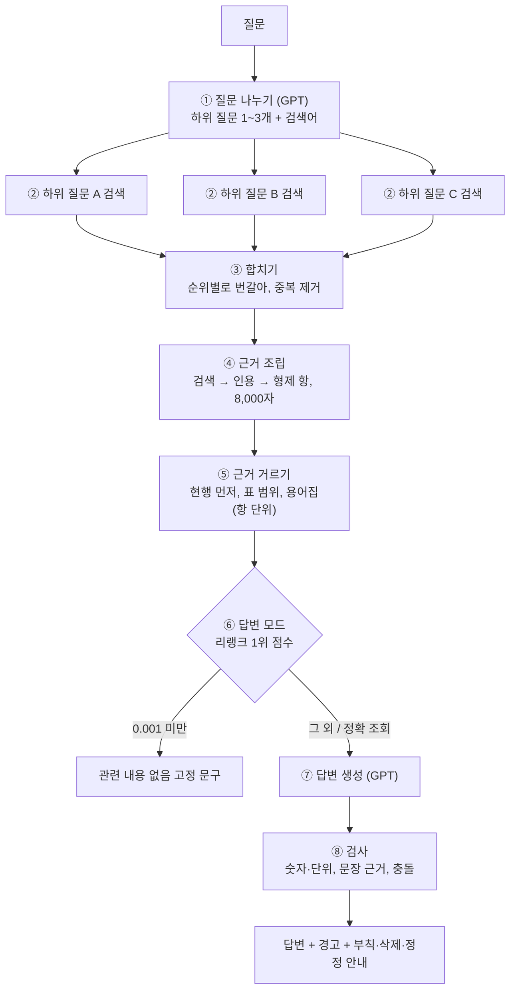

# 질의 흐름

질문 하나가 들어와서 답변이 나가기까지의 순서. 2026.10.13 기준 코드(조 단위 청크, 용어집 항 단위 판정).
**확정 구조: 질문 나누기 끔(`config.QUERY_PLAN = False`). 동의어 사전 끔(`config.USE_SYNONYMS = False`). 답변·채점 모델 gpt-5.6-luna.** 팀 실행 방법은 `팀_실행_안내.md`.
단계별 상세 규칙은 `검색_설계.md`, `답변_설계.md`, `재색인_설계.md`를 본다. 값은 모두 `config.py`에서 바꾼다.

## ① 질문 나누기 — `Generator.plan_queries` (`src/answer/generate.py`)

- GPT(`gpt-4o-mini`) 한 번 호출로 질문을 **하위 질문 최대 3개**로 나누고, 하위 질문마다 규정 용어로 바꾼 **검색어**를 만든다.
  예전의 질문 바꿔 쓰기(`rewrite_query`) 호출을 대신하므로 GPT 호출 수는 늘지 않는다.
- 한 가지만 묻는 질문은 하위 질문 1개이고, 원래 질문 글자를 그대로 쓴다. 이 경우 검색은 나누기 전과 같다.
- 한 제도의 여러 면("생리휴가는 월 몇 회이고 유급인가요")은 나누지 않는다.
- 질문에 규정 이름이 적혀 있으면 하위 질문 글자에도 남긴다(리랭커 입력의 `[문서명 …]` 머리말과 맞물린다).
- 응답을 해석하지 못하면 원래 질문 하나로 검색한다.
- **2026.10.13 결정: 끔.** `config.QUERY_PLAN = False`면 질문 한 줄 + 바꿔 쓴 검색어(`rewrite_query`)로 검색한다. 아래 ①·③은 켰을 때만 해당한다.

## ② 하위 질문별 검색 — `Searcher.search` (`src/search/search.py`)

하위 질문마다 아래를 따로 돈다. 리랭킹도 하위 질문으로 한다(원래 질문 전체로 하면 B를 찾는 조문이 질문의 절반과만 맞아서 밀린다).

| 순서 | 하는 일 | 값 |
|---|---|---|
| a | 색인이 바뀌었으면 BM25·목록을 다시 읽는다 | 검색마다 확인 |
| b | **정확 조회**: 규정 이름 하나 + "제N조"가 하나뿐이면 그 조를 직접 가져와 맨 앞에 둔다 | `exact.py` |
| c | 메타데이터 필터 (위계, 문서, 개정연도) | 화면에서 고름 |
| d | 벡터 검색(BGE-m3, pgvector)과 BM25(Kiwi 형태소)로 후보를 각각 뽑는다 | 각 50개 |
| e | 보조 검색어(①의 검색어 + 동의어 사전 + 용어집 신호어)로 벡터·BM25를 한 번 더 | 후보 찾기에만 씀 |
| f | 가중 RRF로 합친다 | 벡터 0.7 : 키워드 0.3, RRF_K 60 |
| g | 상위 30개를 리랭커로 다시 채점. 입력은 `[문서명 장 조항] 본문` | bge-reranker-v2-m3 |
| h | 용어집 후보 필터 (⑤와 같은 규칙, 아래) | |
| i | 정확 조회 결과 + 나머지 상위 k개 | |
| j | 각 결과에 형제 항(같은 조항 이름의 다른 청크, 3,000자까지)과 인용 대상(1단계, 최대 5개)을 붙인다 | 인용 상태 `정상연결`·`정정 확정`·`외부연결`만 |

청크는 **조 단위**다(색인 2,161개, 부칙·별지·삭제 제외). 임베딩 입력에는 장·절 경로를 머리말로 붙이고, 문서명은 리랭커 입력에만 붙인다.

## ③ 합치기 — `Searcher.search_plan`, `interleave`

- 하위 질문별 결과를 1위끼리, 2위끼리 번갈아 담는다. 그래서 어느 하위 질문도 자리를 뺏기지 않는다.
- 같은 청크는 한 번만 담는다.
- 받는 개수: 하위 질문이 1개면 k(답변은 5), 2개 이상이면 `max(k, 3 × 하위 질문 수)` (2개 → 6, 3개 → 9).

## ④ 근거 조립 — `Searcher.assemble`

- 순서: 검색 결과 → 인용 대상 → 형제 항. 같은 청크는 한 번만.
- 전체 글자 수가 `CONTEXT_CHAR_BUDGET`(8,000자)을 넘는 항목은 건너뛴다. 그래서 상한에 걸리면 인용 대상과 형제 항이 먼저 빠진다.
- (문서, 조) 단위로 묶어서 답변 단계에 넘긴다.

## ⑤ 근거 거르기 — `src/answer/pipeline.py`

1. 현행 조문을 먼저, 부칙·삭제 조문을 뒤로 정렬한다.
2. 표 범위 필터(`guard.filter_tables_by_scope`): 질문 대상(국내·해외 등)과 맞지 않는 표를 뺀다.
3. **용어집 필터**(`search/glossary.py`): 서로 다른 개념으로 확인된 쌍(인병휴가/인병휴직 등)과 보증금 계열에서,
   질문이 한쪽만 말하는데 근거가 다른 쪽만 말하고 수치·기간·비율이 있으면 뺀다.
   - **항 단위로 판정한다.** 조 본문을 ①, ② …로 나눠 해당 항만 지우고, 모든 항이 빠지는 조만 통째로 뺀다.
   - 수치가 없는 절차 항, 질문의 개념을 다루는 항은 남는다.
   - 다 빼게 되면 하나도 빼지 않는다. 뺀 항은 경고로 기록한다.

## ⑥ 답변 모드 — `decide_mode`

| 조건 | 모드 |
|---|---|
| 검색 결과 없음 | none (고정 문구, GPT 안 부름) |
| 정확 조회 결과 있음 | answer |
| 리랭크 1위 점수 < `ANSWER_NONE_BELOW`(0.001) | none |
| 그 밖 | answer |

partial 구간은 `ANSWER_PARTIAL_BELOW`를 NONE과 같게 둬서 쓰지 않는다. 기준값은 항 단위 시절(2026.10.10)에 정했다. 조 단위에서 다시 맞추는 중.

## ⑦ 답변 생성 — `Generator.answer`

- 근거 [1]…[n]과 질문을 GPT에 넘긴다. 규칙 17개(`SYSTEM_PROMPT`): 근거에 있는 것만, 문장마다 [n], 대상·상황이 맞는 근거만,
  여러 항목을 물으면 빠짐없이(규칙 16), 조건·예외를 떼지 않기(규칙 17) 등.
- 출력: `세부:` 불릿 → `결론:` (화면에서는 결론을 위로 올린다).
- 결론이 불릿과 모순되면(별도 GPT 판정) 한 번 다시 쓴다.

## ⑧ 검사와 마무리

| 검사 | 결과 |
|---|---|
| 숫자·단위가 인용한 근거에 없음 (`unsupported_numbers`, 코드 검사) | 답을 내지 않고 관련 조문만 보여 줌 (partial) |
| 표가 "구분 없이"라고 한 것을 구분해서 설명 (`contradicted_distinctions`) | 같음 |
| 불릿이 근거에 없는 내용 (GPT `verify`) | 경고만 |
| 질문의 핵심 말이 근거에 없는데 답에 쓰임 (`missing_terms`) | 경고만 |
| 근거끼리 같은 항목에 다른 수치 (GPT `conflicts`) | 두 조문을 나란히 보여 줌 |

마지막에 인용한 근거의 부칙·삭제 상태와 정정 안내, 개정 표기를 답변 끝에 붙인다.

## 질문 하나당 호출

| 종류 | 횟수 |
|---|---|
| GPT | 질문 나누기 1, 답변 1(+재작성 1), 모순 판정 1, 근거 검사 1, 충돌 확인 1 → 4~6회 |
| 리랭커 | 하위 질문 수만큼 (각 30쌍) |
| 임베딩 | 하위 질문 수 × 2 (질문, 보조 검색어) |

## 측정 기록 (2026.10.13)

| 평가셋 | 파일 | 나누기 전 | 나누기 후 |
|---|---|---|---|
| 두 가지를 묻는 20문항 (정답 조 모두 상위 6개) | `eval/questions_multi.jsonl` | 19/20 | 20/20 |
| 어려운 19문항 (비슷한 주제 9, 세 가지 5, 한쪽 후보 많음 5) | `eval/questions_multi_hard.jsonl` | 17/19 | 19/19 |
| 20문항 답변: 두 정답 조문을 답변이 모두 인용 | 위 20문항 | 19/20 | — |

- 비교 실행: `uv run python -m src.eval.run_multi --questions <파일>` (나누기 전후를 같은 질문으로 잰다).
- 측정 중: 190문항(검색 160 + 답변 190)의 나누기 전후, 용어집 항 단위 판정 전후, 기준값(`ANSWER_NONE_BELOW`, RRF 가중치) 재조정.
