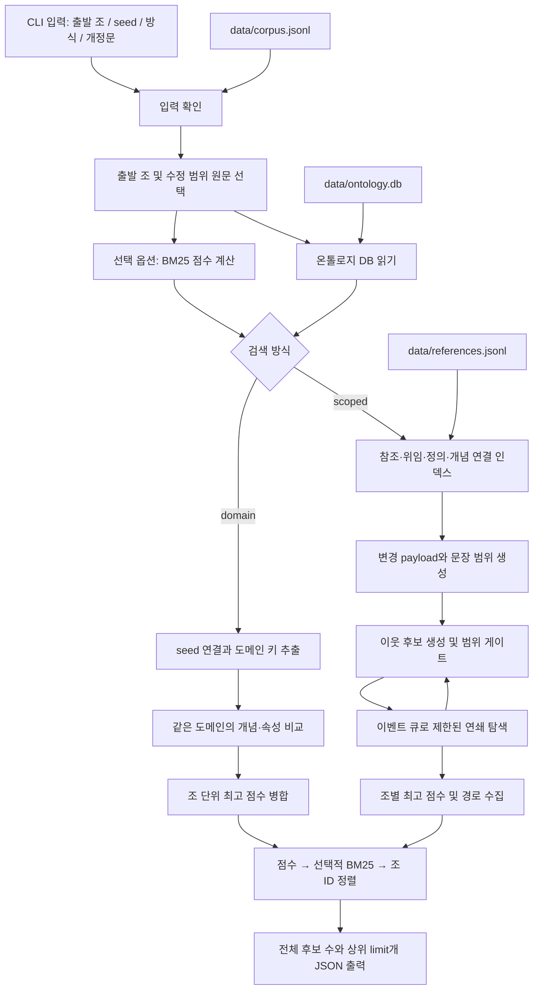

# 온톨로지 검색 검증 및 전체 실행 흐름

검증일: 2026-11-10 · 대상: 이 `ontology-search` 폴더 · 실행 환경: Windows, Python 3.13.15

## 1. 현재 상태

이 폴더는 **개정으로 영향을 받을 수 있는 내부규정 조항을 찾는 검색 코어**다. 출발 조와 선택적인 항·호 ID를 받아 후보 조항 및 연결 경로를 JSON으로 출력한다.

독립 실행, 기존 회귀 검사 14개, 입력 오류 처리는 통과했다. 그러나 데이터 정합성과 기존 탐색 로직의 문제가 남아 있어 **전체 검증 완료 또는 검색 정확도 검증 완료로 판단하면 안 된다.**

이번 추가 점검 24항목 중 23항목이 통과했고, 항·호 ID 유일성 1항목이 실패했다. 기존 회귀 검사 14개는 이 점검의 `regression_suite` 한 항목에 포함되므로 두 숫자를 합산하지 않는다.

검증 과정에서 검색 알고리즘·DB·코퍼스·인용 데이터를 수정하지 않았다. 추가한 파일은 검증 실행기, 결과 기록, 이 설명 문서다.

## 2. 포함 범위와 파일 역할

| 파일 | 역할 |
|---|---|
| `run.py` | CLI 입력 확인, 데이터 로딩, 검색 방식 선택, JSON 출력 |
| `ontology_search/__init__.py` | 검색 클래스 공개 |
| `ontology_search/validated_graph.py` | SQLite 읽기, 연결의 활성 상태 판정, 개념 계층 비교, 기존 기준 검색 |
| `ontology_search/domain_key_graph.py` | 최상위 개념을 도메인 키로 삼아 후보 비교 |
| `ontology_search/propagating_graph.py` | 참조 인덱스, 기본 이웃 생성, 전파 이벤트 큐, 탐색 예산 |
| `ontology_search/scoped_propagating_graph.py` | 도달한 문장·항·호 범위와 변경 속성에 따른 확장 제한 |
| `ontology_search/bm25.py` | 선택적인 한국어 2-gram BM25 점수 |
| `data/ontology.db` | 개념·속성·조문 연결·출처 매핑 DB |
| `data/corpus.jsonl` | 90개 규정의 검색 단위 3,171개와 item 행 7,462개 |
| `data/references.jsonl` | 기존 chunks에서 필요한 내부 인용 필드만 추린 395행 |
| `data/schema.sql` | DB 테이블과 뷰 정의 |
| `tests/` | 기존 핵심 회귀 검사 14개 |
| `manifest.json` | 추출 당시 원본 및 패키지 파일의 해시·출처 |
| `verify.py` | 이 폴더만 사용한 재검증 실행기 |
| `validation/report.json` | 이번 검증의 수치·통과 여부·진단 결과 |
| `validation/examples.json` | 실제 검색 응답 세 가지의 원문 JSON |
| `validation/unittest.log` | 회귀 검사 실행 기록 |

`corpus.jsonl`은 39문항 평가에 사용한 코퍼스 스냅샷이다. 이 폴더에는 평가 문항이나 정답을 넣지 않았으며 검색도 정답을 읽지 않는다. `references.jsonl`은 그 코퍼스와 별개로 기존 `out/chunks.jsonl`에서 추출한 인용 데이터다. 두 데이터의 ID 체계가 완전히 일치하지 않는 점은 아래에서 별도로 다룬다.

원본 HWP 추출, 코퍼스 생성, 온톨로지 작성·검수, 벡터 임베딩 생성, RRF 병합, LLM 오류 판정, 챗봇 UI는 이 폴더에 포함되지 않는다. 데이터 생성 이후부터 후보 출력까지가 현재 실행 범위다.

## 3. 전체 흐름



두 방식은 **선택해서 실행하는 별도 경로**다. `domain` 결과를 `scoped`에 넘기는 직렬 파이프라인이 아니다. `scoped`에서도 `DomainGraph`를 만들지만 주로 DB에서 읽은 연결과 개념 관계 비교를 이용한다.

### 3.1 입력과 수정 범위 선택

`run.py`는 먼저 코퍼스를 `조 ID → 조문 객체` 사전으로 읽는다.

| 인자 | 현재 동작 |
|---|---|
| `--anchor` | 필수 출발 조 ID. 예: `24024:30` |
| `--seed` | 그 조에 속한 item ID 목록. 예: `24024:30-1-0-0` |
| `--method` | `domain` 또는 `scoped`. 기본 `domain` |
| `--amendment` | `scoped`에서 필수인 개정문 |
| `--kind` | 변경 종류 문자열. 기본 `값 변경` |
| `--query` | BM25 계산에 사용할 검색어. 생략하면 선택 범위 원문 |
| `--lexical` | BM25 동점 정렬 사용. numpy 필요 |
| `--limit` | 최종 출력 개수. 기본 10, 1 이상 |

출발 조가 없거나, seed가 출발 조에 없거나, limit이 0 이하이거나, scoped인데 개정문이 없으면 CLI 오류로 종료한다.

seed가 있으면 해당 item 원문을 이어 붙여 `focus`로 사용한다. 없으면 출발 조 전체 원문을 사용한다. **개정문에 ‘제1항’이라고 써도 seed를 자동 추출하지 않는다.** 정확한 범위를 지정하려면 `--seed`도 전달해야 한다.

또한 개정문의 변경 전 문구가 실제 원문에 있는지, 그 개정이 문법적으로 유효한지, 새 상태가 어떻게 되는지는 검사하지 않는다. 실제 코퍼스를 개정문대로 바꾸는 단계도 없다.

### 3.2 DB 로딩

`validated_graph.DomainGraph.__init__()`가 SQLite를 `mode=ro`로 연다.

1. `concept`에서 개념과 상위 개념을 읽는다.
2. `source_binding`에서 DB item과 코퍼스의 논리 조·항 ID를 연결한다.
3. `edge_item_concept`, `edge_attr`에서 item의 개념·관계·속성을 읽는다.
4. `review_evidence`로 추가 연결의 검토 상태와 시간 범위를 확인한다.
5. `edge_head`에서 개념별 머리말·하위 item 연결을 읽는다.

원본 사용자 연결은 활성화한다. 추가 연결은 `review_status=source_checked_ai`이면서 `temporal_scope=current_text`인 경우 활성화한다. 따라서 ‘활성’은 이 코드의 사용 조건을 충족한다는 의미이며 사람의 의미 검수가 완료됐다는 뜻은 아니다.

현재 DB의 item–concept 연결은 1,997개다. 원본 연결 151개와 활성 추가 연결 1,766개를 합쳐 1,917개가 활성 상태이며 나머지 80개는 비활성이다. 머리말 연결은 516개다.

`domain_key_graph`는 개념의 부모를 최상위까지 따라가 도메인 키를 계산한다. 현재 키는 `보수`, `인사`, `휴가`, `휴직` 네 가지다. 계층 순환이나 존재하지 않는 부모를 만나면 오류를 발생시킨다.

DB 로더는 출처 매핑 ID를 읽지만, 매 호출마다 원문 내용이나 `source_text_sha256`를 다시 대조하지 않는다.

## 4. domain 방식의 상세 흐름

진입점은 `domain_key_graph.DomainGraph.rank()`다.

1. 활성 연결 중 코퍼스에 조가 있고, 필요한 item도 존재하는 연결을 고른다. 삭제 item은 가용 item 집합에서 제외한다.
2. 출발 조와 seed를 확인한다. seed가 없으면 출발 조의 연결을 사용한다.
3. `edge_head`를 이용해 같은 개념에 연결된 머리말·하위 item을 함께 고려한다.
4. seed 연결을 `도메인 키 → 개념 → 속성 집합`으로 묶는다.
5. 같은 도메인 키의 후보 연결만 비교한다. 중간 후보가 다른 분야에도 연결됐다는 이유로 새 도메인 가지를 열지 않는다.
6. 개념이 같거나 실제 상하위 관계이고, seed에 속성이 있으면 속성 교집합도 있는 후보를 남긴다.
7. 동일 조가 여러 번 발견되면 점수는 최댓값을 사용한다. 연결 수만큼 합산하지 않는다.
8. 출발 조를 제외하고 정렬한다.

개별 연결 점수는 다음과 같다.

```text
개념 관계 점수 + 0.5 × min(일치 속성 수, 4) + 관계 보정

개념 관계: 동일 3 / 실제 상하위 1 / 무관 0
관계 보정: 근거 0.3 / 정의 0.2 / 언급 0.1
정렬: 연결 점수 내림차순 → BM25 점수 내림차순 → 조 ID 오름차순
```

이 방식은 반복 BFS가 아니라 seed 연결과 후보 연결의 비교다. 현재 `query` 인자는 `rank()` 안에서 직접 사용하지 않는다. `--lexical`이 꺼져 있으면 `--query`를 바꿔도 domain 후보 생성에는 반영되지 않는다.

**남아 있는 문제:** 명시 seed가 있어도 대응 연결이 없으면 출발 조 전체 연결로 돌아간다. 이번 스냅샷에서도 직원채용지침 `10770:4`의 제1항은 직접 활성 연결이 0개인데 후보 97개가 생성됐다.

## 5. scoped 방식의 상세 흐름

### 5.1 실행 시 메모리 인덱스 생성

`ScopedPropagatingGraph`는 기본 `PropagatingGraph`를 초기화하면서 다음을 만든다.

- 조문별 개념·속성 연결, 규정별 조문 목록, 주제어 집합.
- `references.jsonl`에서 출발·대상 조를 모두 찾을 수 있는 직접 인용의 정방향·역방향 인덱스.
- 다른 규정명이 본문에 들어 있는지 확인해 만드는 규정 단위 참조 인덱스.
- 원문을 항 번호·호 번호 경계로 나눈 문장 범위 목록.

규정명 문자열의 등장을 이용한 인덱스는 실제 위임 관계를 의미적으로 확정한 결과가 아니다. 부칙·별지 표기 차이 등으로 조 ID를 찾지 못하는 인용은 직접 인용 인덱스에 들어가지 않는다.

### 5.2 변경 payload 생성

`initial_payload()`는 다음 상태를 준비한다.

| 필드 | 의미 |
|---|---|
| `kind` | 입력된 변경 종류 |
| `change_hash` | 개정문 해시 |
| `root_reg` | 원래 출발 규정 |
| `concepts` | seed item에서 읽은 개념·속성 |
| `scope_terms` | focus 원문과 개정문의 주제어 |
| `definition_terms` | 정의 변경 시 ‘이하 …’에서 찾은 용어 |
| `focus_text` | 출발 원문 범위 |
| `active_spans` | 현재 단계에서 실제로 도달한 문장 범위 |
| `root_topic_terms` | 일반 행정어 등을 제외한 원래 주제어 |
| `root_property_tags` | 지급·기간·절차·평가·의결·보관·참조 등의 변경 속성군 |

scoped에서 seed를 생략하면 `concepts`는 빈 사전이다. 조 전체 원문은 주제어와 직접 참조 탐색에 사용되지만, 조 전체의 온톨로지 연결이 자동으로 seed가 되지는 않는다. `--query`도 이 payload에는 직접 들어가지 않는다.

### 5.3 이웃 생성과 범위 게이트

| 경로 종류 | 후보를 찾는 방법 | scoped 추가 제한 |
|---|---|---|
| `specific_reference_in` | 현재 조를 직접 인용하는 조 | 인용 원문이 있는 대상 문장과 변경 주제·속성 대조 |
| `specific_reference_out` | 현재 조가 직접 인용하는 조 | 현재 `active_spans` 안에 그 인용이 있어야 함 |
| `regulation_delegation_in` | 현재 규정 전체를 언급하는 조 | 원 출발점에서만 허용, 중간 조의 문서 전체로 재확산 차단 |
| `regulation_delegation_out` | 현재 조가 언급한 다른 규정의 관련 조 | 현재 범위에 규정명이 있고 대상 문장도 범위 조건을 충족해야 함 |
| `definition_use` | 정의한 용어를 사용하는 조 | 원래 출발 규정 안으로 제한 |
| `schema_concept_attribute` | 원래 seed 개념·속성과 관련된 조 | 현재 도달 문장의 연결과 대상 item 원문 모두 대조 |

직접 인용은 추가 확장의 의미 근거가 약해도 **종착 후보**로 남길 수 있다. 반면 범위 조건을 충족하지 못하는 개념 연결·규정 단위 참조는 후보에서 제외한다. 통과한 문장만 다음 이벤트의 `active_spans`로 넘긴다.

`fits()`는 주제어 교집합과 속성군을 이용한 휴리스틱이다. 지급·평가·보관·의결 속성군은 주제어가 달라도 통과할 수 있다. 같은 대상·조건·예외에 대한 실제 영향이라는 의미적 보증은 없다.

### 5.4 이벤트 큐와 탐색 예산

`walk_events()`가 이벤트를 큐에서 하나씩 꺼내 이웃을 확장한다. 이벤트에는 현재 조, payload, 깊이, 경로, 확장 가능 여부가 있다.

| 제한 | 현재 기본값 |
|---|---:|
| 최대 깊이 | 6 hop |
| 최대 방문 노드 | 출발점 포함 300개 |
| 최대 결과 후보 | 299개 |
| 최대 등록 이벤트 | 600개 |
| 노드별 상태 | 4개 |
| 이벤트당 이웃 | 가중치순 상위 40개 |
| 간선 검사 예산 | 20,000개, 초과를 감지하는 검사에서 카운터는 20,001이 될 수 있음 |
| 후보별 보관 경로 | 최대 3개 |

기본 클래스는 2-hop 이후 게이트를 적용하지만 **현재 CLI가 쓰는 scoped 클래스는 이를 1로 덮어써 첫 번째 후보부터 추가 확장을 제한한다.**

점수는 `해당 단계 간선 가중치 × 0.78^(hop-1)`이다. 경로 전체 간선 가중치의 곱이나 합이 아니다. 동일 후보가 여러 경로로 나오면 관측된 최고 점수를 사용한다. 최종 동점 정렬은 domain과 같은 BM25 → 조 ID 순서다.

**남아 있는 문제:** 중복 이벤트 키는 `(대상 조, payload 해시)`이며 확장 가능 여부는 포함하지 않는다. 같은 payload로 종착 경로가 먼저 도달하면 나중의 확장 가능 경로를 버릴 수 있다. 이번 최소 재현에서도 후속 후보 D가 누락됐다.

## 6. 출력과 실제 실행 예시

두 방식 모두 JSON을 출력한다.

| 필드 | 의미 |
|---|---|
| `anchor` | 출발 조 ID |
| `method` | 선택한 검색 방식 |
| `candidate_count` | 출력 제한 적용 전 전체 후보 수 |
| `results` | 상위 `limit`개 후보의 ID·규정명·조 표기·근거 경로 |
| `stats` | domain은 DB/도메인 통계, scoped는 전파·차단 통계 |

domain의 경로에는 도메인 키·출발 개념·후보 개념·일치 속성·관계·출처가 들어간다. scoped의 경로는 hop별 출발·도착·관계·게이트·이유·인용 근거의 목록이다. 두 `paths` 형식과 `stats` 형식은 동일하지 않다. 현재 CLI는 내부 정렬 점수와 후보 조문 전체 본문을 결과 필드로 내보내지 않는다.

`--limit`은 탐색 종료 조건이 아니라 **검색이 끝난 뒤의 출력 제한**이다.

### 재현 명령

이 폴더에서 다음 명령으로 실행한다. 예시 개정문의 변경 전 표현 ‘만 8세 이하’는 현재 인사규정 제30조 제1항 원문에 존재한다.

```powershell
# 도메인 키 검색
python run.py --anchor 24024:30 --limit 3

# 조 전체를 focus로 쓰는 범위 제한 연쇄 검색
python run.py --anchor 24024:30 --method scoped --amendment '제30조제1항 중 "만 8세 이하"를 "만 9세 이하"로 한다.' --limit 3

# 제1항 item을 명시하는 범위 제한 연쇄 검색
python run.py --anchor 24024:30 --seed 24024:30-1-0-0 --method scoped --amendment '제30조제1항 중 "만 8세 이하"를 "만 9세 이하"로 한다.' --limit 3
```

| 실제 실행 | 전체 후보 수 | 상위 3개 ID |
|---|---:|---|
| domain, seed 생략 | 6 | `24010:43`, `24010:26`, `24047:11` |
| scoped, seed 생략 | 114 | `48440:별표2`, `23245:별표2`, `23926:별표1` |
| scoped, 제1항 seed 지정 | 107 | `48440:별표2`, `23245:별표2`, `23926:별표1` |

scoped 제1항 seed의 초기 개념은 `육아휴직`, 속성은 `대상·제외·주체`였다. seed 생략 시 초기 개념은 없었다. 후보 수 차이는 실행 동작을 보여줄 뿐, 어느 결과가 더 정확하다는 평가가 아니다.

원시 출력은 `validation/examples.json`에 보존했다. 세 실행을 각각 두 번 반복했으며 같은 입력의 JSON 출력은 일치했다.

## 7. 검증 결과와 남은 문제

### 7.1 통과한 항목

- 추출 당시 manifest의 파일 해시와 현재 파일 일치.
- Python 파일 13개 구문 분석 통과.
- 조 ID 3,171개 유일성 확인.
- SQLite `integrity_check=ok`, 외래키 위반 0건.
- 기존 핵심 회귀 검사 14개 통과.
- 서로 다른 세 CLI 검색의 실행·반복 일치·출발 조 제외·중복 없는 출력 확인.
- 필수 인자 누락, 없는 조·item, 0 limit, scoped 개정문 누락의 오류 종료 확인.
- 외부 작업 디렉터리에서 `run.py`의 절대 경로로 실행, `PYTHONPATH`를 제거한 환경에서도 동작 확인.
- 검증 전후 DB·코퍼스·인용·스키마 파일 해시 불변 확인.

### 7.2 실패: 항·호 ID 중복

코퍼스 item 행 7,462개 중 **ID 16종이 중복**되며 초과 행은 20개다. 고유 item ID는 7,442개다.

예를 들어 `23368:16-2-0-0`은 서로 다른 문장 세 개에 사용된다. seed는 같은 ID의 여러 문장을 함께 선택할 수 있지만, `source_item_in_scope()` 등 `next()`를 쓰는 경로는 첫 번째 일치 item만 읽는다. ID 사전으로 만들면 마지막 문장이 남을 수도 있다. 문장 범위와 온톨로지 연결의 해석이 호출 위치마다 달라질 수 있다.

중복 ID 전체 목록과 횟수는 `validation/report.json`의 `duplicate_items`에 기록했다. 이번 작업에서는 원문과 연결을 임의로 재번호화하지 않았다.

### 7.3 주의: DB 출처 매핑과 현재 코퍼스

DB의 `source_binding` 3,133행을 현재 코퍼스의 item ID 및 공백 제거 후 텍스트로 비교했다.

| 결과 | 행 수 |
|---|---:|
| ID 존재, 텍스트 일치 | 2,719 |
| ID 존재, 텍스트 다름 | 22 |
| item ID 없음 | 392 |

이 값은 연결 간선 수가 아니라 **출처 매핑 행 수**다. 중복 item ID의 텍스트 비교는 마지막 행을 기준으로 하므로 중복 문제를 먼저 해결해야 엄밀한 대조가 가능하다. 텍스트 불일치는 개정 시점·추출 방식 차이 등을 포함할 수 있으며 곧바로 오연결로 단정할 수 없다.

현재 검색은 주로 ID 존재 여부로 가용성을 판단한다. 따라서 텍스트가 달라도 ID가 같으면 연결이 사용될 수 있다.

### 7.4 주의: 인용 데이터와 현재 코퍼스의 ID 체계

인용 1,177건을 현재 `label_code()` 규칙으로 확인했다.

| 확인 항목 | 건수 |
|---|---:|
| 출발·대상 조가 모두 존재하는 비자기 인용 | 410 |
| 출발 조 ID를 찾지 못함 | 748 |
| 대상 조 ID를 찾지 못함 | 30 |
| 인용 원문이 출발 조 본문에서 공백 제거 후 발견됨 | 425 |
| 원문 존재를 이 방식으로 확인하지 못함 | 752 |

각 행은 **서로 겹치는 진단 항목**이다. 합계로 더하면 안 된다. 410건도 중복 제거 전 수치이므로 실제 인덱스의 고유 간선 수와 같다고 볼 수 없다.

출발 ID 미확인 사례에는 `10770:부칙`, `23245:별지서식` 같은 집계 표기가 포함된다. 현재 코퍼스의 날짜별 부칙·번호별 서식 ID와 바로 연결되지 않는 경우다. 일부 본문 조 ID도 찾지 못했다. 이는 인용 자체의 오류율이 아니라 **현재 두 스냅샷 및 정규화 규칙의 연결 한계**다. 직접 인용 기반 탐색의 누락 가능성이 있어 통합 정리가 필요하다.

### 7.5 미실행 범위

numpy가 없어 `--lexical`의 실제 BM25 점수·순위는 실행하지 못했다. 의존성 누락 시 안내 메시지와 오류 종료는 검증했다. 기본 그래프 실행에는 numpy가 필요하지 않았다.

정답 세트를 이용한 Recall·Precision, 실제 개정 오류 판정 정확도, 의미적 연결의 타당성, 39문항 전체 모델 평가, 대규모 부하·동시성은 이번 검증 범위가 아니다. 과거 전체 앱에서 발견했던 필터 우회나 카드 경고 소실은 해당 모듈이 이 폴더에 없으므로 이 코어의 검증 결과로 다시 주장하지 않는다.

## 8. 재검증 및 정리 순서

```powershell
# 전체 점검: 결과를 validation/에 기록
python -B verify.py

# 기존 회귀 검사만 실행
python -m unittest discover -s tests -t . -v
```

현재 `verify.py`는 item ID 유일성 실패 때문에 **종료 코드 1**을 반환한다. 실행 중 예외로 검증이 중단된 것이 아니라 문제를 결과에 기록한 뒤 실패 상태로 끝내는 동작이다. 알려진 탐색 문제는 `diagnostics`에 따로 기록하며, 그 재현을 성공한 검색 동작으로 계산하지 않는다.

정리 우선순위는 다음과 같다.

1. 코퍼스 중복 item ID를 원문에 맞춰 분리하고, DB 출처 매핑도 함께 검토한다.
2. 코퍼스와 인용의 부칙·별표·별지 ID 체계를 맞춘 뒤 인용 인덱스 누락을 다시 측정한다.
3. domain의 명시 seed 실패 시 조 전체 fallback과 전파 이벤트의 gate 중복 처리를 고친다.
4. scoped의 seed 생략 정책, `--query`의 실제 용도, 두 방식의 서로 다른 출력 형식을 명시적 API 계약으로 정리한다.
5. 기능 수정과 별도로 압축된 한 줄 코드, 중복 기준 검색, 미사용 import를 정리하고 기존 결과와 회귀 검사를 비교한다.

이번 문서는 현재 구현과 관측한 결과를 설명한다. 위 수정 사항을 적용하거나 검색 품질이 개선됐다고 주장하는 문서는 아니다.
